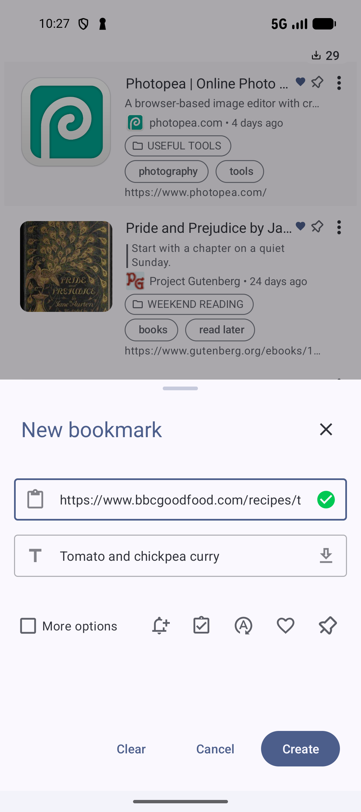

# Getting Started with SmarterBookmarks

Welcome to SmarterBookmarks! This guide will help you get started and make the most out of our app for organizing and managing your bookmarks.

For a hands-on introduction, save a recipe to try later, find it again, then give it a home. These basic steps work without sign-in, AI setup, or Pro:

1. [Save your first bookmark](pages/SAVE.md).
2. [Find something you saved](pages/FIND.md).
3. [Organize with collections and tags](pages/ORGANIZE.md).

Continue with the [user guide library](GUIDES.md) for reading, notes, reminders, sources, AI, backup, and sync.

## Table of Contents

1. [Installation](#installation)
2. [Adding Bookmarks](#adding-bookmarks)
3. [Organizing Bookmarks](#organizing-bookmarks)
4. [Searching and Filtering](#searching-and-filtering)
5. [Syncing Across Devices](#syncing-across-devices)
6. [Settings](#settings)
7. [Troubleshooting](#troubleshooting)

## Installation

SmarterBookmarks is available only on Android. Visit [Google Play](https://play.google.com/store/apps/details?id=com.smarter.technologist.android.smarterbookmarks) to download and install it on your device.

## Adding Bookmarks

Follow [Save your first bookmark](pages/SAVE.md) to save a page in the app[^1] and check that it appears in **Bookmarks**. Add other bookmark details[^2] when you need them.

*Enter an address and a title, then tap Create.* [View full-size image](assets/guides/save/bookmark-form.png).

## Organizing Bookmarks

A **collection** groups related bookmarks. A **tag** labels a topic you can use across collections. Follow [Organize with collections and tags](pages/ORGANIZE.md) to try one of each.

For a collection that updates from rules, explore [Smart Collections](pages/SMART.md), a Pro feature.

## Searching and Filtering

Start with [Find something you saved](pages/FIND.md) to search for a word from a bookmark's title. For more ways to narrow the results, see [Search and filtering](pages/SEARCH.md).

## Syncing Across Devices

Follow [Sync across devices and Chrome](pages/SYNC.md) to choose between cloud sync for your Android library and Browser Sync for the Chrome extension. Browser Sync is available to everyone. Keep a [backup](pages/BACKUP.md) before connecting an existing library or changing sync settings.

## Settings

Explore additional features and customize your experience:

1. Open the three-dot toolbar menu and choose **Settings**. Some screens group it under **More options**.
2. Choose the area you want to change, such as **Cloud sync**, **Browser Sync**, **Database**, **AI features**, **Collections**, **Bookmarks**, or **Notes**. The [task guides](GUIDES.md) explain the relevant settings as you use them.

## Troubleshooting

Encountering issues? Here are some tips:

- Check your internet connection.
- Ensure you are using the latest version of the app.
- If you need personalized assistance or have a specific issue that needs attention, you can request support via email:
    1. Open **Settings → About → Send Feedback** and choose your email app.
    2. Describe what you tried, what happened and what you expected.
    3. Review the draft and its device information, then send it from your email app.

That's it! You're all set to make the most of SmarterBookmarks. Happy bookmarking!

[^1]: You can also add bookmarks by sharing links from other apps or by importing them via HTML exports from browsers
[^2]: Bookmark info includes adding as a favorite, adding tags, adding to a collection, setting a status, adding a comment, using a bookmark template (two templates free; Pro removes the limit), configuring how to auto-refresh bookmark metadata, adding a reminder (Pro feature), and setting a bookmark as [dynamic](pages/DYNAMIC.md).
