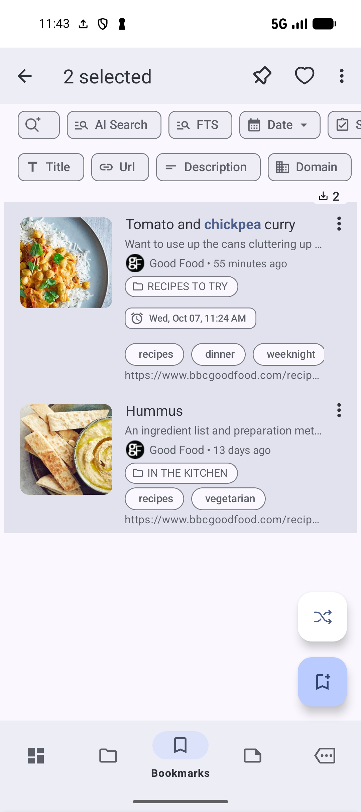
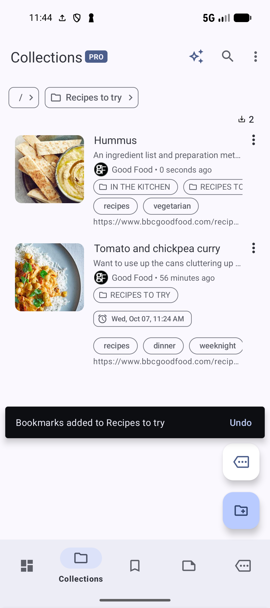
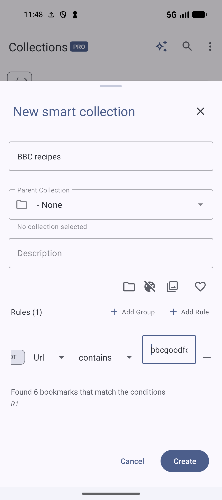
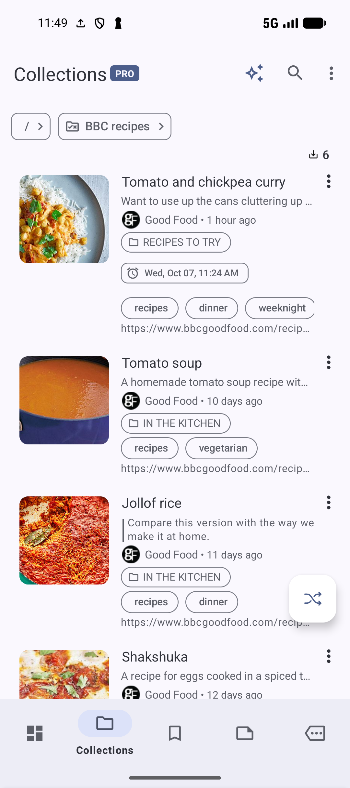

# Manage a growing library

Once you have saved a few pages, organize related items together and keep the main list useful. This walkthrough builds on **Recipes to try** from [Organize with collections and tags](ORGANIZE.md).

## Work on several bookmarks together

1. Open **Bookmarks → Search**. If **AI Search** is selected, tap its chip to return to keyword search. Search for a word shared by the pages you want to organize. In the recipe example, enter `chickpea`.
2. Long-press one result to enter selection mode.
3. Tap another result to select it. Check the selection count in the toolbar before choosing an action.
4. Open the selection toolbar's three-dot menu and choose **Add to collection**.
5. Check the destination breadcrumb. If needed, tap **/** to return to the top level, then enter **Recipes to try**. Tap **Add** once the breadcrumb shows that collection.
6. Open **Collections → Recipes to try** and check that the selected recipes appear there.

*Check which bookmarks are selected and confirm the count before applying an action.* [View full-size image](../assets/guides/advanced/bulk-selection.png).

*Both recipes are in the collection. Hummus also keeps its existing In the kitchen membership.* [View full-size image](../assets/guides/advanced/recipes-expanded.png).

You can use the same selection mode to apply **Edit tags**, set a status, or archive selected pages. If none of the selected pages has tags yet, the tag action is labeled **Add tag**. Clear the selection or press **Back** to return to ordinary tapping, which opens a bookmark.

**Select all** works on the current list or search results. Check the query, filters, and selection count first. A selection made in a collection is different from selecting across the main Bookmarks list.

Bulk **Edit tags** shows the selected bookmarks' combined tag state. Use it deliberately: checking a tag applies it to the selection, while clearing one removes it from the selected bookmarks. For a mixed collection, apply one shared label at a time and inspect the results.

## Keep tags useful

Choose names you will recognize later, such as `recipes`, `dinner`, and `weeknight`. Reuse an existing tag rather than creating near-identical labels for every page.

Open **Tags**, tap a tag to see the pages using it, and inspect those pages before changing the label. To rename a tag, use its three-dot menu → **Rename**, enter a clear name, and tap **Rename**. **Cancel** leaves the tag unchanged. Renaming changes the shared label, so check its linked items afterward.

To remove a tag from one bookmark, use that bookmark's **Edit tags** sheet and clear its checkbox. Removing the label from a bookmark and deleting the tag itself are different operations. Keep the shared tag when other pages still use it.

If a tag contains several unrelated subjects, open its list and select only the relevant bookmarks for the new label. Search can narrow the list before selection. This keeps a library-wide cleanup from changing pages that should retain their existing labels.

## Use a Smart Collection for a changing list

A regular collection contains the bookmarks you add to it. A **Smart Collection** finds bookmarks that match saved rules, so its contents can change as you save or edit pages. Smart Collections require Pro.

Start with one rule you can easily check. For example, a Smart Collection named **BBC recipes** could match URLs containing `bbcgoodfood.com/recipes/`. The recipe saved in [Save your first bookmark](SAVE.md) should match; a page from another site should not.

1. Open **Collections** and return to the top level with **/** in the breadcrumb.
2. Tap the smaller action button above the main **+** button. If an action sheet opens, choose **Create smart collection**. With fewer available actions, the rules button opens the form directly.
3. In **New smart collection**, enter **BBC recipes** and leave **Parent Collection** as **- None**.
4. Tap **Add Rule**. Choose **Url**, then **contains**, and enter `bbcgoodfood.com/recipes/` as the value.
5. Check the matching-bookmark count beneath the rule, then tap **Create**.
6. Open **BBC recipes** and inspect its results.

*Begin with one rule and check the preview before creating the collection.* [View full-size image](../assets/guides/advanced/smart-collection-form.png).

*The example library has six matching recipes. Your count depends on the pages you saved.* [View full-size image](../assets/guides/advanced/smart-collection-results.png).

Compare the result with an ordinary search for the same site. Add more conditions only when the first rule works as expected.

You cannot add bookmarks manually to a Smart Collection or put subcollections inside it. Change the rule or bookmark details when a page belongs in the results. For grouped rules, exclusions, dates, tags, and other conditions, see [Smart Collections](SMART.md).

## Archive pages you want to keep out of the main list

Archive old articles or completed reference pages when you want to retain the link while making room in your active list. Select the intended bookmarks, check the count, and choose **Archive**.

To find them again, open the Bookmarks toolbar's three-dot menu → **More options → Archived bookmarks**. Open a bookmark there to inspect it, or choose **More actions → Unarchive** in its three-dot menu to return it to the active list. Archiving is different from deleting a bookmark.

For recurring feeds, review [Sources](SOURCES.md) and its update schedule as well. Archiving today's feed items does not stop a source from adding future items.

## Pick the right next tool

| When you need to… | Read |
| --- | --- |
| Narrow results by title, tag, status, or page text | [Search and filtering](SEARCH.md) |
| Find related pages, topic groups, or possible duplicates | [AI features and AI Search](AI.md) |
| Keep a collection protected | [Locked Collections](LOCKED.md) |
| Refresh a saved title, description or image | [Refresh bookmark metadata](BOOKMARKS.md#refresh-and-reset-metadata) |
| Keep one bookmark following a changing URL | [Dynamic Bookmarks](DYNAMIC.md) |
| Keep a recoverable copy before a wider cleanup | [Backup, export, and import](BACKUP.md) |

Treat possible duplicates as candidates to inspect. Two similar pages may still be useful for different reasons. Review their URLs, content, and collection memberships before deleting anything.

**Previous:** [AI features and AI Search](AI.md).

**Start again:** [Save your first bookmark](SAVE.md).
