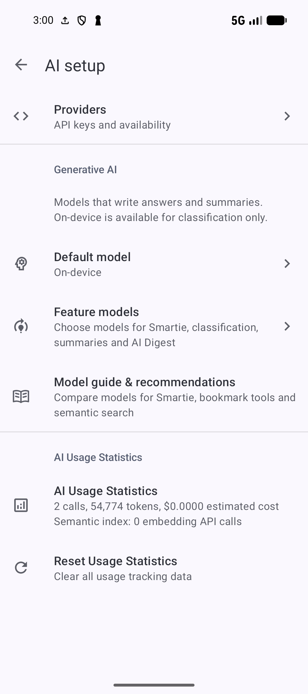
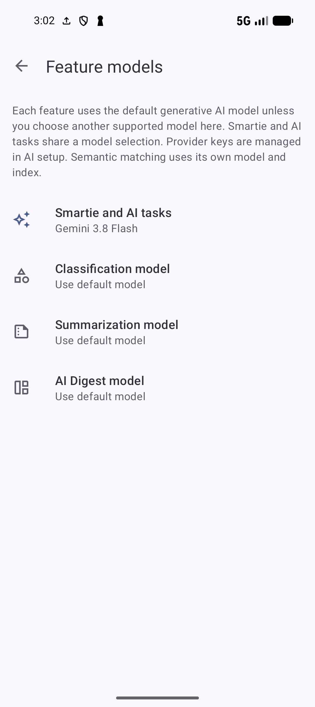
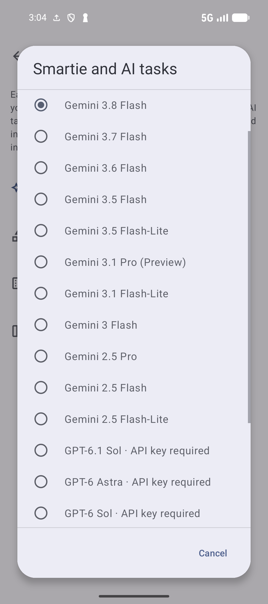
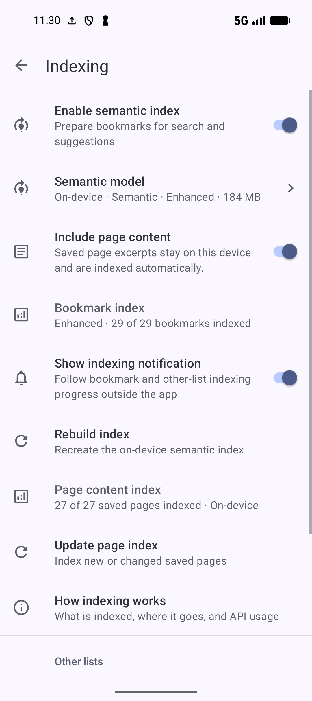

# Set up and maintain AI features

[Documentation home](../README.md) · [All guides](../GUIDES.md) · [AI recipe walkthrough](AI.md)

Choose which work stays on the device, which provider writes answers, and which automatic actions you want. Start in **Settings → AI features**. **AI setup** holds providers and generative models; **Index setup** prepares meaning-based matching. The separate feature switches enable Smartie, classification, summaries, Digest, AI Search, recommendations and insights.

Screenshots show SmarterBookmarks 1.6.6. Follow the [recipe walkthrough](AI.md) for examples of AI Search and a Smartie answer drawn from saved pages.

## Choose the two model roles

| You want to | Choose |
| --- | --- |
| Find saved items by meaning | **Index setup → Semantic model**: On-device, Gemini or OpenAI |
| Ask Smartie or run AI tasks | **AI setup → Feature models → Smartie and AI tasks**: a supported cloud model or **Use default model** |
| Categorize and tag bookmarks | **Feature models → Classification model**: On-device or a supported cloud model |
| Generate summaries or AI Digest | The separate **Summarization model** or **AI Digest model** |

The semantic model finds related items by meaning. A generative model writes answers or suggested content. For example, you can use Enhanced on-device indexing with Gemini 3.8 Flash in Smartie.

On-device indexing and search need no provider key after the model download. Cloud indexing sends eligible details, optional saved text and submitted search queries to the chosen provider. Smartie sends requests and relevant context to its chosen provider; searching by meaning can also use the separately chosen cloud index provider.

App **Pro** access and provider API allowance are separate. Pro Agent enables supported library changes and task notifications. Pro Content Search enables saved-page content indexing. Neither supplies a Gemini or OpenAI API key, provider credit or account permission for a model.

## Add, test or remove a provider key

1. Open **AI features → AI setup → Providers → Gemini** or **OpenAI**.
2. Open the **API key** control and read the data-sharing confirmation. The editor links to the provider's key page.
3. Enter the key, or tap the clipboard icon in the field to paste it.
4. Tap **Validate** and wait for the result. This sends a request to the provider and uses its API allowance.
5. When the key is valid, tap **OK** to save it. **Cancel** leaves without saving the edit.

A validated key can still encounter model-access or allowance limits. If a selected model fails later, check the matching provider key, connection, account access and allowance, then choose a supported alternative if needed.

To remove a saved credential, return to that provider and choose **Remove key**, then confirm. Features using that provider need another key before they can run. Removing the key is separate from deleting your conversations, bookmarks or local model downloads.

The **On-device** provider row explains local processing; it has no key editor.

## Set the default and feature overrides

Open **AI setup → Generative AI → Default model** and choose a model. Open **Feature models** to choose independently for **Smartie and AI tasks**, **Classification model**, **Summarization model** and **AI Digest model**. You can also use a feature's own **AI model** row.

**Use default model** follows the shared Default model. A specific feature choice remains an override when the default changes. Changing Smartie's model in its chat header changes the **Smartie and AI tasks** choice too. The semantic model remains independent.

*This example keeps On-device as the shared default and selects Gemini 3.8 Flash for Smartie and AI tasks.* View full-size [AI setup](../assets/guides/ai/ai-setup-current.png) or [Feature models](../assets/guides/ai/feature-models.png).

**On-device** is a classification choice. It cannot write Smartie answers, summaries or generated Digest content. Use a supported cloud choice for those features.

The app offers the following model families. Open the model picker to see the choices available for each feature.

| Provider | Model choices |
| --- | --- |
| Gemini | 3.8, 3.7, 3.6 and 3.5 Flash; 3.5 Flash Lite; 3.1 Pro and Flash Lite; 3 Flash in feature settings; 2.5 Pro, Flash and Flash Lite |
| OpenAI | GPT-6.1 Sol; GPT-6 Astra, Sol and Luna; GPT-5.6 Sol, Terra and Luna; GPT-5.5 |
| App choices | **Auto**, plus **On-device** for classification |

These are app choices, not a guarantee of provider availability. The picker omits unsupported or retired entries for its feature. **AI setup → Model guide & recommendations** explains feature compatibility and the app's suggested starting points. An unavailable indicator reflects prior requests with the saved key; opening the guide does not probe the provider. A model without a failure indicator can still fail on a later request.

*The radio button marks the selected model. Choices marked API key required need a key for that provider.* [View full-size image](../assets/guides/ai/feature-model-picker.png).

## Let Auto choose a generative model

Select **Auto** as the default or a supported feature override. It chooses among configured providers, using routine and more demanding request categories and previously recorded availability. Saving both provider keys gives it choices from both providers, so a request may go to either.

Auto routing can make an additional provider request to assess the request before answering. It is separate from **Auto** interaction in Agent mode and from automatic indexing. If you need one named model/provider, choose it explicitly. In a long conversation, repeat essential older details or select a model manually; Auto limits recent conversation context to control usage.

## Read usage and reset local counters

Open **AI setup → AI Usage Statistics** for recorded calls, prompt/output token totals and provider/model breakdowns. The displayed cost is an app estimate, not the provider's bill or balance. Cloud indexing use is listed separately from requests that generate answers or content.

Choose **Reset Usage Statistics**, read the confirmation and tap **Reset** to clear the app's local usage counters, including cloud indexing counters. This does not refund requests or reset provider quota. Check the provider account for its actual allowance and charges.

## Gemini context cache and batches

Open **AI setup → Providers → Gemini**. These controls require provider support; paid Gemini API access is separate from app Pro.

| Context cache choice | Effect |
| --- | --- |
| **Auto** | Uses supported cached context when the API allows it |
| **Enable** | Always tries to use caching |
| **Disable** | Turns caching off and hides the duration control |

**Gemini context cache duration** controls how long cached context is retained. Choices run from **1.5 hours** through **2, 3, 4, 6, 8, 12 and 24 hours**, then **7, 14 or 30 days**. Longer retention can reuse context across more requests but retains provider-side cache storage longer. Choose a duration suited to how often you return to the conversation.

Tap **Clear context cache** to request deletion of Gemini's cached context. If caching remains enabled, a later request can create a new cache. Clearing a cache does not delete the conversation history.

**Background batch processing** lets Gemini process supported large operations in the background. It is separate from recurring AI tasks and actions performed on several items in a live chat. It needs a paid Gemini API plan; changes still need Agent access and the applicable review. See [track batch jobs](SMARTIE.md#track-background-batch-jobs) before starting one.

## Prepare the semantic index

1. Open **AI features → Index setup → Semantic model**.
2. Choose **On-device**, **Gemini** or **OpenAI** as the index method.
3. For On-device, choose **Compact** or **Enhanced** and tap **Download model** if it is missing. Compact is the lighter choice; Enhanced uses a larger download and can take longer to prepare. The Enhanced download first explains the storage/performance tradeoff. On-device indexing needs Android 7 or newer.
4. Return to **Index setup → Indexing**, turn on **Enable semantic index**, and inspect bookmark coverage.
5. Enable **AI Search**, **AI recommendations** or **AI insights** at the AI features hub as needed. Preparing the index alone does not turn on every discovery control.

*Check bookmark coverage and saved-page coverage separately to see which content is ready to search.* [View full-size image](../assets/guides/ai/indexing.png).

For a cloud method, save the matching provider key, tap **Index existing bookmarks**, and read the consent before proceeding. This sends eligible bookmark details and uses provider allowance. After the initial index, **Update index** handles a manual update. **Automatically update semantic index** controls later new or changed data. Changing the index method or model can require new preparation and separate consent for the selected cloud setup.

Use **Show indexing notification** to follow background preparation outside Settings. Allow SmarterBookmarks notifications in Android if you want to see it. Coverage is more useful than elapsed time: bookmark metadata and saved pages have different totals.

**Indexing → How indexing works** explains how the index supports search, recommendations, classification and finding saved content in Smartie.

## Add saved pages and Other lists

In **Indexing**, enable **Include page content** if you have Pro Content Search access and want matching passages from saved text. A link without readable saved text is not sufficient. Cloud methods request separate consent to send eligible excerpts. Check **Page content index** as well as bookmark status.

Tap **Update page index** for new or changed saved text. If the first pass is incomplete or failed, the same control is labelled **Retry saved page indexing**. It needs the selected local model installed or the cloud provider key ready, and is disabled while that content pass runs.

To include notes, collections or tags:

1. Open **Indexing → Other lists → Lists to index**.
2. Check **Notes**, **Collections** and/or **Tags**, then confirm the selection.
3. Read **Other-list status** for the selected lists' coverage.
4. Tap **Update indexes** to process new or changed items. With cloud indexing, read the confirmation about sending names/text and confirm only if you want that update. With an installed on-device model, changing the selection also schedules local preparation.

Hidden items, locked collections and notes attached to private bookmarks are excluded. Selecting a list does not make private content eligible.

## Search Notes, Tags and Collections by meaning

First select the list in **Other lists** and let its index finish. Open that list, tap **Search**, choose the **AI Search** chip, enter a topic and submit with the keyboard. Notes match their text; Tags and Collections match their indexed names and details. Collection AI Search is available in the top-level list of regular collections.

Use a topic from a note or collection in your library. Check the ranking, then open the match. To find an exact name or search while the index is preparing, use the ordinary search mode. Bookmark AI Search has an illustrated [recipe example](AI.md#search-by-what-you-need).

## Recover indexing and remove model downloads

| What you see | Next step |
| --- | --- |
| Model download needed | Return to **Semantic model**, download the selected local model and check storage/network |
| Waiting or incomplete coverage | Read the displayed waiting state and let background work continue; Android can delay it |
| Interrupted or failed bookmark indexing | Tap **Resume now** when offered to continue completed work |
| Local bookmark index needs preparing again | Tap **Rebuild index** in Indexing; it is unavailable while indexing runs |
| Cloud bookmark data changed | Tap **Update index**, or enable automatic updates after the initial index |
| Saved-page coverage failed or stale | Use **Retry saved page indexing** or **Update page index** |
| Other lists need consent or updated coverage | Open **Other lists**, check selections and tap **Update indexes** |
| Cloud request fails | Check the selected provider key, connection, account allowance and model availability |

Partial coverage can return useful matches but also omit an expected page. Check the selected model and relevant coverage before judging the result. Ordinary search remains available during recovery.

Open **Semantic model → Advanced → Manage downloaded models**, choose a downloaded model and confirm **Remove** to free its storage. Removal also deletes that model's related indexes. If it is the selected local model, download and prepare it again before using its AI Search. If none are installed, the manager shows that state.

**Indexing → Embedding API usage** shows cloud calls, texts and reported tokens, including when the provider did not report tokens. Missing token counts do not mean zero use. These counters are separate from generative requests and do not show provider balance.

## Recommend bookmarks, collections and passages

Enable **AI recommendations** in the AI features hub after preparing a usable index.

| Starting item and menu action | How to use the result |
| --- | --- |
| Bookmark → **AI recommendations → Similar bookmarks** | Review ranked saved pages; open a match or select pages for the available normal/linking actions |
| Bookmark → **AI recommendations → Suggest collections** | Select a suggested collection and tap **Add to collection**; no collection is chosen until you select one |
| Collection menu/details → **Suggest bookmarks** | Review ranked candidates, long-press to select the pages you want, then use **Add selected to this collection** in the selection toolbar |
| Bookmark → **AI recommendations → Related passages** | Review matching saved pages and use the result's **View passage** action to open the matched text |

Recommendations compare details already indexed from your library. An empty collection can use its name and description as its topic instead. With a cloud index method, the app asks before sending that topic to the provider. Cancel if you do not want to send it.

Related passages need **Include page content** and Pro Content Search access. If a matched passage is no longer available, update saved-page indexing and try again. Suggestions do not automatically add, link or delete your bookmarks. A no-results message can reflect incomplete data, an unhelpful topic or insufficient similarity.

## Review topic groups and possible duplicates

Enable **AI insights**, then open **Bookmarks toolbar menu → AI insights → Topic groups** or **Possible duplicates**. Tap a group to open its ranked bookmark list. Use toolbar **Search** to filter group names and pull down to refresh the groups.

Topic groups collect similar bookmark details. Possible duplicates are candidates, not confirmed duplicates. Open the pages and compare URLs/content before using the normal library actions; the insight itself does not merge or delete them.

## Classify and reclassify bookmarks

Open **AI features → AI classification**, choose its **AI model**, and turn on **Enable classification**. It is independent of AI Search and index preparation.

With the On-device classification model, **On-device method** offers **Keyword-based**, **Semantic · Compact** and **Semantic · Enhanced**. Semantic matching needs the corresponding local model and enabled index; unavailable semantic setup falls back to keywords. Collection names/descriptions and existing tagged examples give it useful information to compare.

Choose the automatic actions you actually want:

- **Auto categorize new bookmarks** can assign a suggested collection.
- **Auto create suggested collection** can create a missing root collection; it depends on auto categorization.
- **Auto tag from meta keywords** adds generated keyword labels. **Max number of auto tags** limits them to 1 through 10.

After saving a page, check its collection and tags and correct them using the [normal organization controls](ORGANIZE.md). The separate bookmark **Generate tags** action adds tags immediately; see the [tag tools reference](../FEATURES.md#review-tag-suggestions-and-generate-tags).

For existing bookmarks, turn on **Enable reclassification of bookmarks** only when you want their classification processed again. Choose **Reclassification mode** before that processing:

| Mode | Effect |
| --- | --- |
| **Keep existing collections and tags unchanged while categorizing uncategorized bookmarks** | Preserves existing assignments while categorizing uncategorized bookmarks |
| **Replace existing collections and tags with new ones** | Replaces the old assignments with the new classification |
| **Append new collections and tags alongside existing ones** | Adds the new assignments alongside those already present |

Turning on indexing does not apply these modes or reclassify the whole library. The switch is used when an existing bookmark's **Refresh metadata** action processes it. Turn on the desired automatic categorization/tagging options too, choose the mode, then refresh one bookmark and inspect its assignments before processing more. Replace removes the previous collection or tag assignments only when a new corresponding result is available. This is separate from an index rebuild.

## Choose summary style and format

Open **AI features → AI summarization**, choose a supported cloud **AI model**, turn on **Enable summaries**, and decide whether to **Auto summarize new bookmarks**. The provider needs readable content and available allowance.

| Summary Style | Requested presentation |
| --- | --- |
| **Concise** | 1 to 2 sentences |
| **Standard** | 3 to 4 sentences |
| **Detailed** | 5 to 10 sentences |
| **Bullet List** | Bullets |
| **Key Points** | Numbered points |
| **Executive Summary** | An overview suitable for a quick decision |
| **Research Analysis** | A more analytical treatment |

**Summary Format** chooses **Plain Text**, **Markdown** or **HTML**. These settings shape the requested output; they do not guarantee its accuracy. Check the page behind it. Sign-in requirements, inaccessible pages or little readable text can prevent a useful result.

In **AI digest**, choose its feature model, turn on **Generate AI digests**, and optionally **Prefer AI digest** to show generated content first when available. Gemini AI Digest requires Android 8 or newer. Generated AI Digest and the Bookmark Digest reading screen are separate. You can still read available descriptions/saved content without a generated digest; see [Bookmark Digest](DIGEST.md).

Continue with [Smartie conversations and actions](SMARTIE.md) or [AI tasks](AI-TASKS.md).
