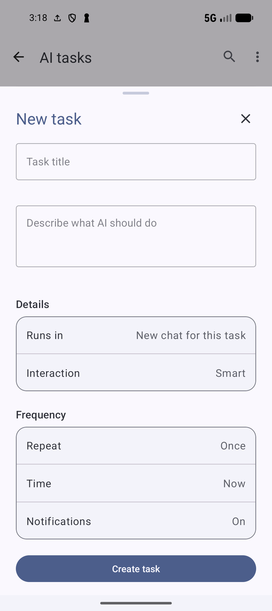
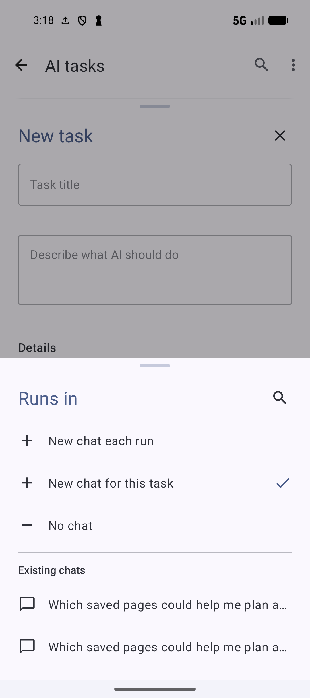
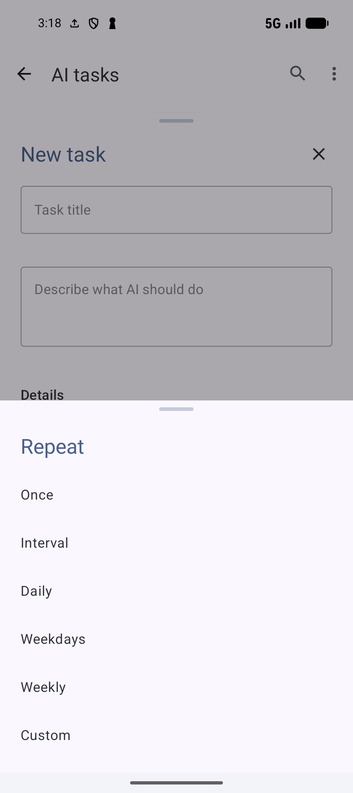

# Create and follow AI tasks

[Documentation home](../README.md) · [All guides](../GUIDES.md) · [AI setup](AI-SETUP.md) · [Smartie](SMARTIE.md)

An AI task saves instructions for one run or a repeat schedule. Each run has a report and activity. Use a read-only task for research, or an Agent interaction when you want supported library changes.

Screenshots show SmarterBookmarks 1.6.6. See the [recipe task example](AI.md#run-a-reusable-ai-task) for a prompt you can adapt to your library.

## Create a first read-only task

1. Open **Bookmarks toolbar menu → Organize → AI tasks**, or **Settings → AI features → AI assistant → AI tasks**.
2. Tap **+** for **New task**. Give it a nonempty **Task title**, for example `Dinner ideas`.
3. In **Describe what AI should do**, write complete instructions: `Review my saved dinner recipes. Suggest two meals to try and link to the bookmarks. Do not change my library.`
4. Choose **Interaction → Read-only**. Choose **Runs in → No chat** for a report in the task, or one of the chat destinations below.
5. For an immediate first run, choose **Repeat → Once** and **Time → Now**. Check **Notifications** before saving.
6. Tap **Create task**. Creating a Once/Now task schedules it to run; it is not a draft-only save.
7. Tap its row to inspect the report and linked pages after the run completes.

*Choose Read-only and No chat for the example above. Check the interaction, chat destination and schedule before creating the task.* [View full-size image](../assets/guides/ai/ai-new-task.png).

Tasks use the **Smartie and AI tasks** feature model. Save the matching provider key and check allowance first. A task can run without the Smartie sheet or retained chat if **No chat** is selected. App Pro and provider allowance remain separate.

To edit a saved task, tap its row → **Task details → Edit task**, change the instructions/choices and tap **Save changes**. Put collection names, topics and limits in the instructions so each run knows what to include, even outside your current chat.

## Choose the interaction

| Interaction | Intended use |
| --- | --- |
| **Read-only** | Research and reports without library changes |
| **Interactive** | Agent proposals wait for review before applying changes |
| **Auto** | Permitted Agent changes can be applied automatically |
| **Smart** | The model chooses when a proposed action needs review |

Read-only research does not require Pro Agent. Applying changes does, along with the normal action's access/permissions. For a first changing task, choose Interactive and a small, named set of items.

Tasks can add or remove bookmark tags, add or remove bookmark membership in existing collections, and edit a bookmark's title, description, pinned, favorite or archived state. For example, ask a task to add `weeknight` to selected dinner recipes. For other changes, use the broader [Smartie chat operations](SMARTIE.md#request-supported-library-actions) or the relevant app controls.

## Choose where chat results go

Tap **Runs in** in the editor. Chat destinations need **Smartie** and **Save Chat History** enabled. The task can still run with **No chat**.

| Destination | Result |
| --- | --- |
| **No chat** | Read reports in AI tasks without posting into Smartie |
| **New chat each run** | A separate retained conversation for each occurrence |
| **New chat for this task** | A conversation is created for the task and reused by its later runs |
| A chat under **Existing chats** | Runs post into that selected retained conversation |

*New chat for this task reuses one conversation. Choose No chat to keep results in task reports, or select an existing conversation.* [View full-size image](../assets/guides/ai/ai-task-runs-in.png).

Use the destination sheet's **Search chats** control to filter existing conversations by title, then tap the intended one. Recheck the displayed destination before saving. If the selected conversation has been deleted or chat/history is turned off, linked posting can be unavailable; task reports are still the place to inspect the run.

Linked runs can post their request, report, review-needed message or failure into the chosen conversation. This destination does not itself select the task's interaction style or recurrence.

## Set repeat, date and time

Choose **Repeat**, then inspect all displayed timing rows before saving:

| Repeat | Timing choice |
| --- | --- |
| **Once** | **Time → Now**, or **Choose date and time** for a future occurrence |
| **Interval** | Every **30 minutes**, **hour**, **6 hours** or **12 hours** in the editor; check the first run time |
| **Daily** | Select the daily local time |
| **Weekdays** | Select the local time for Monday through Friday |
| **Weekly** | Use **On** to choose the weekday, then choose the local time |
| **Custom** | Check one or more days, tap **Save days**, then choose the local time |

*Choose Once for a single run, or a repeat schedule for ongoing work.* [View full-size image](../assets/guides/ai/ai-task-repeat.png).

For a deferred one-off task, check **Date** and **Time** together and choose a future date/time. For example, after confirming that a one-time dinner report is useful, edit it to **Weekly → On Sunday → Time 09:00**. Review the next scheduled time shown in the list/Details. Device local time and Android background scheduling apply; a selected time does not guarantee delivery at that exact minute.

Each run uses provider allowance. A frequent interval can produce many requests; choose a repeat that matches the information you need. Background Gemini batches are a separate operation, not a repeat option.

## Set notifications and Android permission

In the task editor, tap **Notifications** and choose **On** or **Off**. Notifications for completion, failure or needed review require **Pro Agent access** as well as Android notification permission, even for a read-only task. On alone does not establish eligibility.

Saving with notifications enabled can request Android permission. If the AI tasks list shows a notification notice, tap it to open the app's Android notification settings and enable the permission/channel you need. You can still open the task and read its report when notifications are off or unavailable.

## Find tasks and get suggestions

Use toolbar **Search** to match a task's title or instructions. Filter **All**, **Active**, **Disabled** or **Completed** when the filter chips are shown. Chips appear when there is more than one saved task or an active search/filter. If no task matches, clear the query and return to All.

**Suggest tasks from my library** is available in the empty state or toolbar menu. The sheet explains that generating suggestions sends a sample of up to **60 visible bookmarks**, including titles, descriptions, links and tags, to your configured provider. Hidden/locked content is excluded.

Tap **Generate suggestions** if you want that provider request. Read the suggested interests/tasks, tap one to open its editable draft, and review title, instructions, interaction, chat, notifications and schedule before **Create task**. A suggestion is not a saved task until you create it. **Refresh suggestions** regenerates the profile/suggestions with another request; closing the sheet stops the pending suggestion request.

## Run, stop or pause work

| Control | Effect |
| --- | --- |
| Row overflow → **Run now** | Starts an enabled task immediately when it is not already running |
| One-off task Details → **Run again** | Starts another occurrence of the saved instructions |
| Running task overflow or Details → **Stop run** | Stops the current occurrence |
| Recurring task overflow → **Pause** | Suspends future scheduling |
| Paused task overflow → **Resume** | Restores its schedule after setup checks |
| Details → **Disable schedule** / **Enable schedule** | The equivalent recurring-schedule controls |

Stopping a recurring run retains its next scheduled occurrence. Pause/Disable the schedule too if you want future runs suspended. Controls reflect current state, so the menu can change between runs. If a run fails, inspect its report, fix provider/setup/connection issues and retry that task instead of creating a duplicate.

## Read the latest report and previous runs

Tap the task row to open the latest report sheet. Check its **status** and **time**, read the report and open its links. **Activity** lists the actions taken and pages consulted. Check the affected library items after applying changes. A task with no run has no report yet; a running or failed run can show progress or a failure message.

Tap **Task details** for instructions, current state, next scheduled time and editing/manage/delete controls. Its run list opens a previous report. The report's **Recent runs** control opens a chooser of prior occurrences by status and start time when history exists. Choose the particular run you want to inspect rather than assuming the latest result describes all earlier runs.

## Review, apply or discard proposed changes

When a run shows **Needs review**, open its report and tap **Review changes**. Read every target/action in the proposal sheet.

- **Apply** rechecks Agent access and the current target items, then attempts the proposed changes. Read the returned result and inspect the affected library items. Changed access or stale targets can prevent application.
- **Discard** declines the proposed changes and completes that review without applying them.
- Closing the sheet leaves the review pending; it is not approval.

Interactive is useful when changes need your judgment, but the review still needs careful reading. A completed report can contain research and proposals separately; verify the resulting bookmark/tag/collection state after Apply.

## Continue a result in Smartie

The task report has **Task details**, **Recent runs** and **Review changes** when a review is needed. It has **no Open in Smartie action**. Use Conversations to continue a result in its linked chat.

For a task configured with a retained chat destination, use the existing route:

1. Close AI tasks and open Smartie from the toolbar stars.
2. Open **Conversations** and select the task's conversation or the existing chat chosen in **Runs in**. Task-linked conversations are marked.
3. Read the posted run messages, then ask a specific follow-up, such as `Compare the two recipe options in the latest Dinner ideas report.`

The conversation must still exist and history must be enabled. A **No chat** report has no posted conversation to reopen; copy the relevant report text into a Smartie request or change the destination for a later run.

## Create and manage tasks from Smartie

Ask explicitly for deferred or recurring work: `Create a read-only task to review Recipes to try every Sunday at 09:00 and report two dinner ideas with bookmark links.` Include complete instructions and the intended schedule; review the task editor or confirmation presented under your interaction policy.

You can ask Smartie to list tasks linked to the conversation, inspect a report, edit instructions, pause/resume, run now or delete a named task. Specify when you mean tasks outside the current conversation. Ask supports read-only task management; Agent task changes still require Agent access. Ordinary requests for an answer now do not imply a new scheduled task.

Task-labelled messages in chat open the linked task. Check the saved configuration in AI tasks after creation or editing rather than relying only on the conversational wording.

## Delete a task

Use the row overflow → **Delete task**, or **Task details → Delete task**, and confirm the named task in the confirmation sheet. Deletion cancels its scheduling and removes that task from the list. It does not undo library changes from completed runs. Keep any report you need before deleting its task.

Return to [AI setup](AI-SETUP.md) for provider/index recovery or [Smartie](SMARTIE.md) for conversation and action controls.
