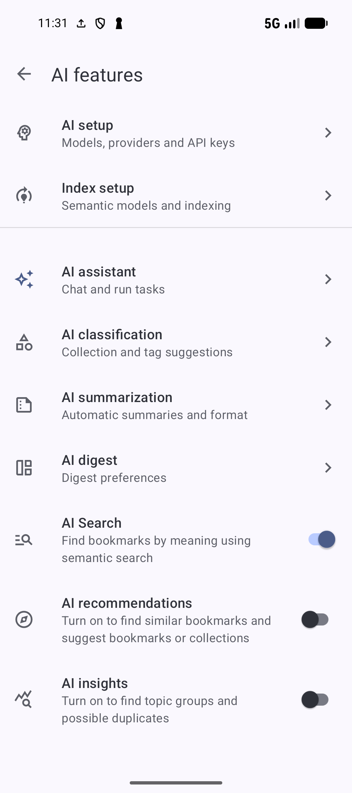
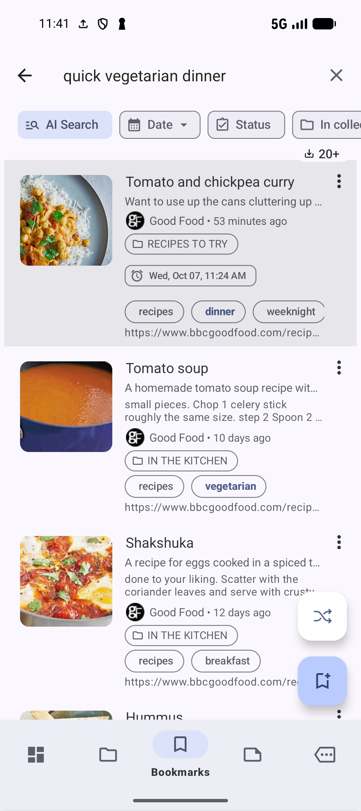
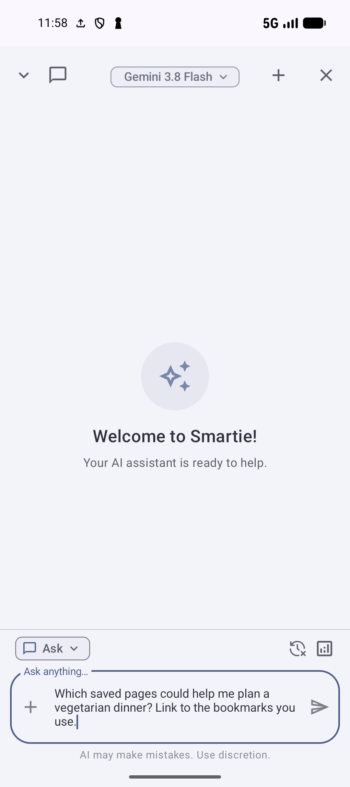
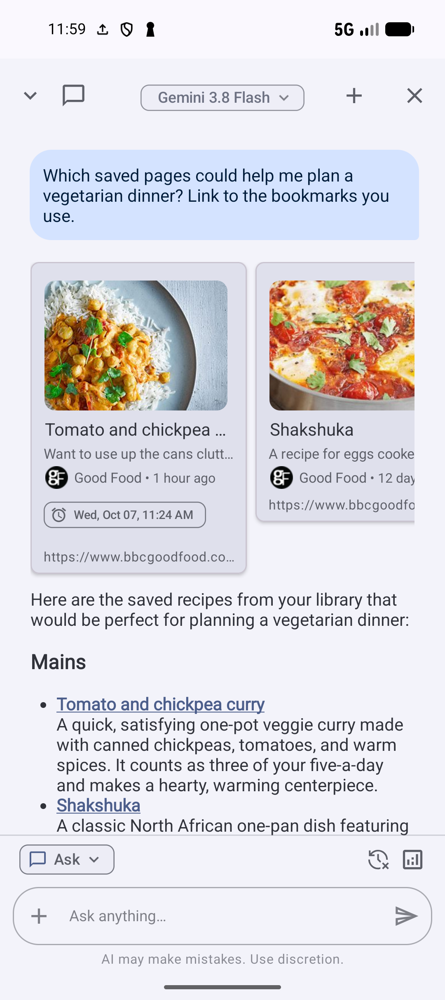
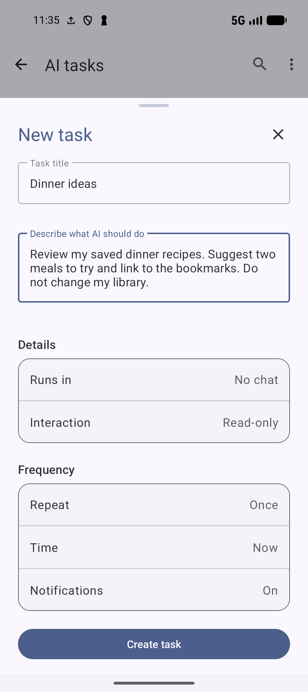

# Find and use your library with AI

Use AI when you remember a topic instead of a title, want an answer drawn from saved pages, or want help organizing new bookmarks. Start with the recipes from [Save](SAVE.md) and [Organize](ORGANIZE.md), then try a question about dinner.

You can keep using ordinary search, collections, and tags while AI is off or indexing. Setting a provider API key, preparing a semantic index, and turning on automatic classification are separate choices.

For the complete control reference, see [AI setup and index maintenance](AI-SETUP.md), [Smartie conversations and actions](SMARTIE.md), and [AI tasks and reports](AI-TASKS.md). Return to [documentation home](../README.md) or [all guides](../GUIDES.md) to choose another workflow.

## Choose the setup for your goal

Open **Settings → AI features**.

*Set up indexing and the features you want to use separately.* [View full-size image](../assets/guides/ai/features.png).

| Your goal | Set up |
| --- | --- |
| Find bookmarks by meaning | **Index setup**, then turn on **AI Search** |
| Ask questions about saved pages | **AI setup → Providers**, choose a model in **AI assistant**, then enable **Smartie** |
| Suggest collections and tags for new bookmarks | **AI classification → Enable classification**, then choose the automatic actions you want |
| Generate bookmark summaries | Choose a supported model in **AI summarization**, then enable summaries |
| Generate a reading digest | Choose a supported model in **AI digest**, then turn on **Generate AI digests** |

The semantic model compares related content. The model used by Smartie writes answers and can use tools. You can use an on-device semantic model with Gemini or OpenAI for Smartie; these settings do not need to use the same provider.

On-device indexing and search do not need a provider API key. Cloud indexing, Smartie, and generated summaries use the configured provider and its API allowance. The app's setup screens explain which data will be sent before cloud indexing is enabled.

## Set up AI Search

1. Open **Settings → AI features → Index setup → Semantic model**.
2. Choose the on-device method and a model. **Compact** uses less storage and indexes faster. **Enhanced** uses a larger model and can take longer to index. Download the selected model if prompted. Alternatively, choose a cloud method and set its provider key in **AI setup → Providers**.
3. Return to **Index setup** and open **Indexing**.
4. Turn on **Enable semantic index**. Check the bookmark coverage while the index is prepared.
5. Return to **AI features** and turn on **AI Search**.

*Check bookmark coverage before judging the search results. Page content indexing is optional and needs Pro Content Search access.* [View full-size image](../assets/guides/ai/indexing.png).

Search results can be limited while indexing is incomplete. You can start with the bookmarks already indexed; wait for complete coverage before deciding whether an expected result is missing.

For a cloud method, tap **Index existing bookmarks** and read the confirmation to prepare the initial index. **Automatically update semantic index** controls later new or changed bookmarks; use **Update index** for a manual update. Switching the index method or model may require indexing again.

**Include page content** is optional and needs Pro Content Search access. It uses text from saved pages, so saving a link alone does not guarantee that page text is available. With an on-device method, that text stays on the device. With a cloud method, the confirmation explains that eligible text excerpts are sent to the selected provider. **Other lists** can include notes, collections, and tags; hidden items and locked collections are excluded.

## Search by what you need

1. Open **Bookmarks** and tap **Search**.
2. Tap the **AI Search** chip to find pages by meaning.
3. Enter a phrase such as `quick vegetarian dinner`.
4. Press **Enter** on the keyboard to submit the search.
5. Review the ranked matches and tap the page you want.

*Describe what you need, then submit the query to find related bookmarks.* [View full-size image](../assets/guides/ai/semantic-results.png).

Try a topic or goal even when those exact words do not appear in a title. Results depend on the details available in your own library. For an exact title, tag, field, or regular expression, switch back to the relevant ordinary search mode; see [Search and filtering](SEARCH.md).

If the **AI Search** chip is missing, check that **AI Search** and the semantic index are enabled. If the app says the index is not ready, check the model download and bookmark coverage. Use **Resume now** when offered. Android may delay background indexing when the device is warm or managing power.

## Find related pages

Turn on **AI recommendations** in **AI features** to use the same index for suggestions. Open a bookmark's menu → **AI recommendations → Similar bookmarks** to review related pages, or **Suggest collections** to look for a suitable collection. A collection's menu offers **Suggest bookmarks**. Inspect the matches before choosing to add or link them; suggestions do not organize the library automatically.

Turn on **AI insights** to see **Topic groups** and **Possible duplicates** under **AI insights** in the Bookmarks toolbar menu. Open a group to inspect its pages. A high similarity score does not prove that two bookmarks are duplicates; check both before deleting one.

## Ask Smartie about saved pages

1. In **Settings → AI features → AI setup → Providers**, add the API key for the provider you want to use.
2. Return to **AI features → AI assistant**. Open **AI model** and choose an available supported model. An on-device classification model cannot generate a Smartie answer.
3. Open **Smartie** in that section and turn on **Enable Smartie**.
4. Return to **Bookmarks**, tap the **stars icon** in the toolbar to open Smartie, and select **Ask**.
5. Send: `Which saved pages could help me plan a vegetarian dinner? Link to the bookmarks you use.`
6. Read the answer and open its bookmark sources to check the pages behind it.

*Choose Ask, enter a question about your library, then send it.* [View full-size image](../assets/guides/ai/smartie-prompt.png).

*The answer uses saved recipes and links back to their bookmarks. Open the sources to check the details.* [View full-size image](../assets/guides/ai/smartie-answer.png).

**Ask** explores your library without changing it. Use `@` in the input to attach a specific bookmark, collection, or tag when a question needs a narrower context. For example, attach **Recipes to try** and ask which recipe to cook first. Start a new chat when moving to another topic; chat history must be enabled to keep conversations for later.

Smartie can combine semantic matches with keyword matches. A complete semantic index helps retrieval, but it is not a requirement for every chat. Answers and linked sources vary with the library and model; check the original page before relying on a detail from a generated answer.

To reuse a useful question, tap your sent message and choose **Save prompt**. Give it a name and tap **Save**. Use `@` or the attachment control → **Saved prompts** to place a saved prompt in the input, edit it, then send it. Manage saved prompts from **AI assistant → Smartie → Saved prompts** in settings.

If a reply cannot finish, check the connection, the selected model, and the matching provider key. A saved key is not proof that the provider has API allowance remaining. Follow any quota message and retry when the provider is available. The stop control lets you end a response that is still running.

If Smartie shows **No response from AI**, use keyword or AI Search to open saved pages while checking the model and provider setup.

## Organize with a review step

**Agent** mode requires Pro Agent access and can make supported changes to your bookmarks, collections, and tags. Choose the interaction style before sending an action:

| Style | Behavior |
| --- | --- |
| **Interactive** | Requests review before applying changes |
| **Auto** | Applies permitted changes automatically |
| **Smart** | Lets AI decide when review is needed |

For a first organization request, choose **Interactive**, attach a small collection with `@`, and give a concrete instruction such as `Suggest a useful tag for these dinner recipes. Show me the changes before applying them.` Review the affected items and proposed action before accepting. Open the collection or tag afterward to confirm the result.

## Classify new bookmarks automatically

Open **Settings → AI features → AI classification**. Select an **AI model**, turn on **Enable classification**, and choose whether to **Auto categorize new bookmarks**, **Auto create suggested collection**, and **Auto tag from meta keywords**. Set **Max number of auto tags** to keep labels manageable.

With an on-device classification model, **On-device method** offers keyword-based or semantic matching. Semantic classification needs the matching on-device model and enabled index; it falls back to keywords when those are unavailable. Useful collection names, descriptions, and existing tagged examples give the app more information to compare.

Indexing does not itself assign collections or tags. Existing bookmarks are not all reclassified just because AI Search is ready. **Enable reclassification of bookmarks** and **Reclassification mode** are separate options for processing existing bookmarks; review those settings before applying them to an established library.

After saving a new page, review any assigned collection and tags. You can correct them with the same [collection and tag controls](ORGANIZE.md) used for manual organization.

## Summaries and Digest

In **AI summarization**, choose a supported **AI model**, enable summaries, and decide whether to **Auto summarize new bookmarks**. **Style** controls the length and shape of the summary; **Format** controls its presentation.

In **AI digest**, **Generate AI digests** enables generated reading digests. **Prefer AI digest** makes that content appear first when a bookmark has one. You can still use Bookmark Digest with available descriptions and saved content when a generated digest is missing; see [Bookmark Digest](DIGEST.md).

A page that needs a sign-in, blocks access, or has little readable text may not produce a useful summary. Open the original page, check what is available, and avoid assuming that every saved link has been summarized.

## Run a reusable AI task

Use a task for a prompt you want to run now or repeat. Open **Bookmarks → three-dot toolbar menu → Organize → AI tasks**, or **Settings → AI features → AI assistant → AI tasks**.

1. Tap the **+** button to open **New task**.
2. Give it a **Task title**, such as `Dinner ideas`.
3. In **Describe what AI should do**, enter a specific request, such as `Review my saved dinner recipes. Suggest two meals to try and link to the bookmarks. Do not change my library.`
4. Set **Interaction** to **Read-only**. Choose **Runs in → No chat** if you want the report kept in the task, or choose a chat destination.
5. Leave **Repeat → Once** and **Time → Now** for the first run, then tap **Create task**. This schedules the task immediately; it does not save a draft.
6. Open the task to read its completed report and activity. Check the linked pages.

*Choose Read-only for research and Once for a single report. Check the schedule before creating the task.* [View full-size image](../assets/guides/ai/task-form.png).

Tasks use the same configured model as Smartie. Read-only research is available without Agent access; supported changes and task notifications require Pro Agent access. For changes, **Interactive** waits for review before applying them. A chat destination needs Smartie and chat history enabled; a task can also run without a chat.

Once the first report is useful, edit the task to choose a repeat schedule and time. Android may delay scheduled work. Use the task's overflow menu to **Pause** a recurring task, **Resume** it later, or **Run now**. If a run fails, check the connection and AI setup, then retry from the task instead of creating a duplicate.

**Next:** [Manage a growing library](ADVANCED.md).

**Previous:** [Cloud and Browser Sync](SYNC.md).

*English screenshots from SmarterBookmarks 1.6.6 · 6 October 2026.*
