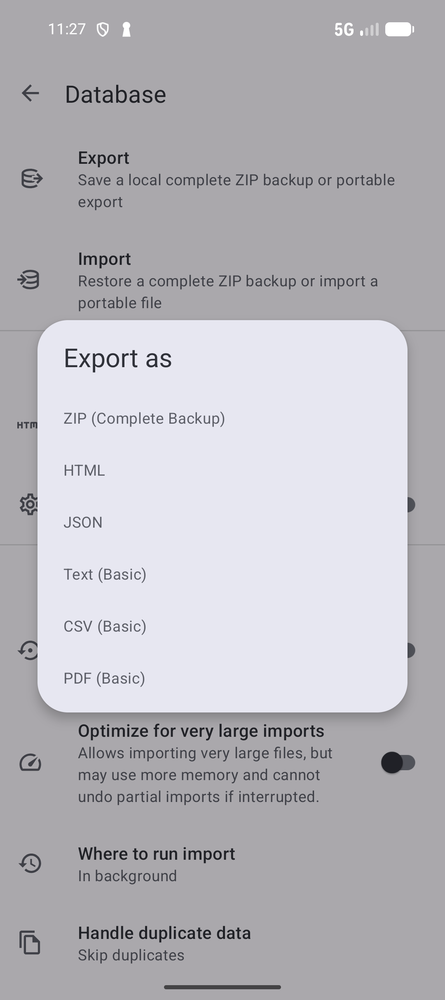
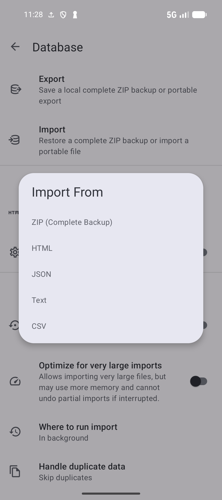

# Back up, export, and import

[Documentation home](../README.md) · [Guide library](../GUIDES.md)

Create a **ZIP (Complete Backup)** when you want a restorable copy of your SmarterBookmarks library. Use a portable export when you want to move links to another app or read them outside SmarterBookmarks. Manual export and import do not require Pro; **Regular Backups** do.

## Save a complete backup

1. Open **Settings → Database**.
2. If you also want your preferences in the file, turn on **Export App Settings** before exporting.
3. Tap **Export**, then choose **ZIP (Complete Backup)** in **Export as**.
4. In Android's file picker, choose a folder and save the file with its `.zip` extension.
5. Wait for the export completion message or notification. Check that the file appears in the chosen folder.

*Choose ZIP (Complete Backup) for a restorable library copy.* [View full-size image](../assets/guides/backup/export-options.png).

Keep a copy somewhere you can access if this device is lost, such as your computer or your own cloud storage. A backup is a saved copy at a point in time; it does not automatically follow later edits.

## Choose a portable format

The same **Export as** menu also offers:

| Format | Use it for |
| --- | --- |
| **ZIP (Complete Backup)** | Restoring the library in SmarterBookmarks. |
| **HTML** | Moving bookmarks to a browser or reading an exported bookmark page. Check **HTML Exports** in Database settings for the intended target. |
| **JSON** | A structured portable export for supported tools and SmarterBookmarks import. |
| **Text (Basic)** or **CSV (Basic)** | Basic link data. These are limited exports, not complete backups. |
| **PDF (Basic)** | A readable document to keep or share. PDF export cannot currently be imported. |

Choose ZIP when preserving the whole library matters. The simpler formats do not carry every app feature.

In **Export Options → HTML Exports**, choose **Optimize for App** for SmarterBookmarks-oriented HTML, or **Optimize for External Browsers** when the intended destination is another browser. This changes the HTML export representation; it does not make HTML equivalent to the complete ZIP backup. Choose the option before starting Export.

## Restore a backup or import links

Before importing into a library you already use, export a current ZIP so you have a copy of its present state.

1. Open **Settings → Database** and check **Handle duplicate data**. **Skip duplicates** keeps existing matching records; **Replace duplicates** allows imported matching records to replace them.
2. Turn on **Import App Settings** only if you want included preferences restored too.
3. Tap **Import**. In **Import From**, choose the file's format: ZIP, HTML, JSON, Text, or CSV.
4. Select the file in Android's file picker and wait for the completion result. Check the imported bookmarks and collections afterward.

*Choose the file's format before selecting it.* [View full-size image](../assets/guides/backup/import-options.png).

ZIP restores backup records into the current library using the duplicate setting. It is not a command to erase all existing bookmarks first. Portable files import the data their format supports. You can also open a supported file from a file manager and choose SmarterBookmarks; check the import confirmation before proceeding.

For a large file, check **Optimize for very large imports** and **Where to run import**. Optimization can use more memory and cannot undo a partial import if interrupted. If you choose **On this screen**, stay on that screen until it completes. If an import fails, confirm that the file matches the selected format and is still accessible, then check the import settings before retrying.

## Schedule Regular Backups with Pro

Under **Settings → Database → Regular Backups (Pro)**:

1. Choose **Backup Folder** and grant Android access to that folder.
2. Choose **Backup Formats**. Include ZIP if you need a complete backup; you can select more than one format.
3. Turn on **Enable Regular Backups**.
4. Choose **Backup Frequency**, **Backup Time**, and **Keep Last N Backups**. Retention deletes older backup files beyond the chosen count.
5. Check **Last Backup** and **Next Backup**. Use **Backup Now** to create one immediately, and **View Backups** to inspect the saved files.

If backups fail, check that the folder still exists and the app can access it. Reselect **Backup Folder** when access has changed, then use **Backup Now** to check the result.

## Open, share, or remove saved backup files

Open **Settings → Database → View Backups**. A selected, accessible **Backup Folder** is required. If the list asks for a folder or is empty, choose/check that folder and confirm that a backup file exists there.

Tap a file to open it through Android's chooser. This does not silently restore the database; check the receiving app and any import confirmation. Long-press a file for **Share** or **Delete**. Share sends the file to a receiving app; Delete asks before removing that saved file. It does not remove the current library, but it removes that recovery copy, so keep another current backup if you still need it.

**Show Backup Notifications** shows progress for Regular Backups. Enable it and allow Android notifications if prompted. **Last Backup** shows the most recent backup time, and **Next Backup** shows the planned time. Android background restrictions can delay a scheduled backup.

For **Database memory usage**, large-import recovery, or **Reset Database**, see [Data maintenance](DATA.md). Reset Database is separate from importing a file and deleting a backup copy.

**Next:** [Cloud sync and Browser Sync](SYNC.md).

**Previous:** [Collect bookmarks from Sources](SOURCES.md).
