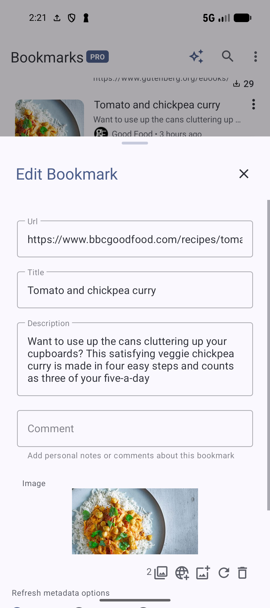
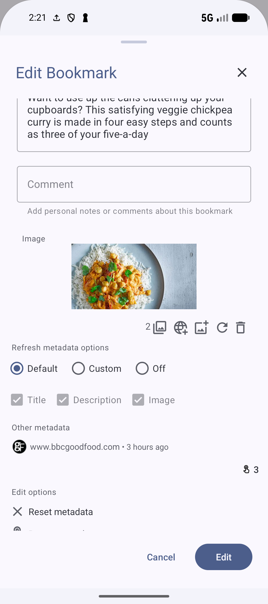
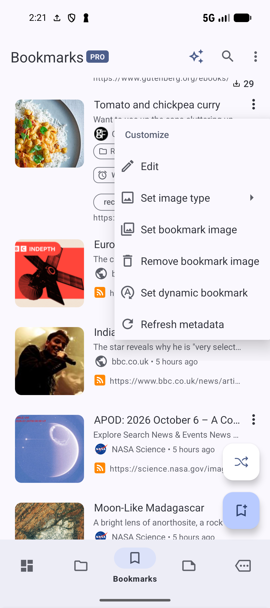

# Bookmarks and collections

[Documentation home](../README.md) · [User guide library](../GUIDES.md) · [Function index](../FEATURES.md)

Start with [Save your first bookmark](SAVE.md) and [Organize with collections and tags](ORGANIZE.md) to save and organize a recipe. This guide explains more creation, editing, organization and list controls. Available actions depend on the screen, selected items and settings.

## Save with more options

Open **Bookmarks**, tap the bookmark **+**, and enter a complete address in **Url**. Use the clipboard icon to paste. If the scanner control appears, tap it, allow camera access as requested, and scan a QR or Aztec code. Check the resulting text before saving: the scanner inserts the result into an empty field or appends another line to existing text. A scanned value still needs to be a valid URL. Scanner availability depends on camera/portrait support and the Google scanner module being ready; paste the address if the control is unavailable.

Expand **More options** before choosing the settings below. Enter an optional **Title**, then tap **Create**. For example, save `https://www.bbcgoodfood.com/recipes/tomato-chickpea-curry` as **Tomato and chickpea curry**.

| Control | How to use it |
| --- | --- |
| **Batch mode** | Turn it on and put several complete URLs in **Url**, separated by spaces or new lines. Review the URLs before **Create**. Batch mode changes the availability of single-bookmark fields, including the title and dynamic settings. Correct invalid input or reduce the batch if validation prevents creation. |
| **Save and open** | Check it to open the page after saving, using the chosen opening behavior. Leave it clear when adding pages to read later. |
| **Archive bookmark** | Check it to save directly into the archive. Find the result through **Bookmarks → More options → Archived bookmarks**, rather than the active list. |
| **Collection** | Choose a regular destination, or **- None** to save without one. Use **New collection** to create a destination such as **Recipes to try**. Check the parent/path before returning to the bookmark form. |
| **Remember last used collection** | Enable it when repeatedly saving to one destination. Check **Collection** on the next save, especially when switching projects. |

Smart Collections are rule-based results and cannot receive manual additions. If the form says **Select a valid parent collection**, choose an eligible regular collection or **- None**, then retry. Missing fetched titles or cover images do not prevent saving a valid address; supply a title yourself.

## Edit saved fields

Open a bookmark's three-dot menu → **Customize → Edit**. Review **Url**, **Title**, **Description**, **Comment** and the image, then tap **Edit** to save. A title is your recognizable label; the description is page metadata, while the comment is your own text. For the recipe, a useful comment might be `Try with spinach next time`.

*Edit the saved URL, title, description, comment and image, then tap Edit to save.* [View full-size image](../assets/guides/bookmarks/bookmark-edit.png).

This edits the saved bookmark shared by all its collection memberships. To change only where it appears, use membership actions below. Reopen **Edit** or **More Actions → Details** after saving to inspect the stored values. **Details** also shows timestamps and other bookmark information; its action is omitted when you are already viewing those details.

### Refresh and reset metadata

Use **Customize → Refresh metadata**, or **Refresh Metadata** inside **Edit**, to fetch current page details. Before refreshing a carefully named bookmark, inspect **Refresh metadata options** in New/Edit:

| Choice | Effect |
| --- | --- |
| **Default** | Follow the app's metadata refresh preferences. |
| **Custom** | Choose which of **Title**, **Description** and **Image** should be refreshed for this bookmark. For example, preserve your title while refreshing the image and description. |
| **Off** | Turn off the bookmark's metadata refresh choices. |

*Choose Default, Custom or Off. Custom lets you choose Title, Description and Image separately.* [View full-size image](../assets/guides/bookmarks/bookmark-refresh-options.png).

Fetching needs access to the page. If it fails, check the URL and connection, or keep/edit the fields manually. In **Edit → Edit options**, use **Reset metadata** when you deliberately want to clear fetched values, or the opened-count reset to clear the counter and last-opened time. Save the Edit form afterward. Resetting is different from downloading new details; inspect the result before relying on an empty field or a reset count.

### Choose the image and image type

New/Edit includes image controls for choosing a file, entering an image URL and selecting a discovered page image. A candidate gallery appears only when there are images to choose from; use the title-download or metadata-refresh control to retrieve page candidates. Select the intended thumbnail, then save the form.

For an existing bookmark, **Customize → Set bookmark image** opens the page-image gallery when candidates are available. **Remove bookmark image** clears its saved image. **Customize → Set image type** chooses **System default**, **Favicon** or **Top image** where the screen supports it. A favicon suits a compact reference list; a top image can help distinguish recipes. If no usable image exists, change the type or select an image yourself. List image visibility is a separate setting under **View options**.

*Customize separates image choice, image presentation and metadata refresh.* [View full-size image](../assets/guides/bookmarks/curry-customize.png).

### Choose what tapping opens

In New/Edit, expand **Open behavior** and choose the default click action and preferred opening method. Available methods include the app, the system default browser and **Ask every time**. Save the bookmark, then tap it to check that it opens the page as intended. Use **Ask every time** when you want to decide per opening. Read [Opening and reading pages](READING.md#open-the-recipe) for the browser/Reader paths; Article mode must be enabled for its article-opening action.

## Favorites pins and markers

Open **Status** in an item's menu. **Add to favorites** and **Remove from favorites** change whether it is a favorite. Favorites can also be sorted first without pinning.

**Pin** puts a bookmark, collection or note ahead of ordinary sorted items in supported list contexts. Use **Unpin** to return it to normal sorting. **Move up** and **Move down** reorder it among pins when a neighboring pin exists; they are not offered on every screen.

**Set marker** saves a position to return to later; **Remove marker** clears it. Open **Bookmarks → Organize → Markers** to choose a marked bookmark, collection or note. The free limit is 10 markers across these item types; Pro removes the limit. If you reach it, remove an old marker before creating another. A marker is separate from a favorite, pin, reminder or status.

## Set expiry and status

For a bookmark, choose **Reminders → Set expiry**, or **Edit expiry** when one exists. New bookmark also has an expiry control. Choose a future date and time, using the shortcuts or date/time controls, then choose **Expiry action** and tap **OK**:

| Action | At the expiry time |
| --- | --- |
| **No action** | Keep the bookmark while recording its expiry. |
| **Archive** | Retain it in the archive and remove it from the active list. |
| **Delete** | Delete it according to the app's deletion/trash settings. |

For a temporary offer, **Archive** gives you a retained reference after the deadline. Use **Reminders → Remove expiry** to cancel the setting. Precise timing can depend on Android alarm access, and expiry notifications have a separate Pro requirement. A missing notification does not by itself establish that the configured time/action was absent. For reminder notes and repeat schedules, use [Reminders](REMINDERS.md).

Choose **Status → Set status** or **Edit status** to add status chips. Select the desired group/value, inspect the preview and confirm. The built-in groups are **Active/Inactive**, **Read/Unread**, **To do/In progress/In review/Done**, and **Open/In progress/Closed**. For example, mark the curry **Unread** before reading and **Done** after cooking; a status does not automatically archive it. Reopen the sheet to change or remove an unwanted status choice.

**Custom Statuses** in the status sheet requires Pro and its feature access. Create a named group, such as **Cooking**, then add values such as **To try** and **Cooked** with their colors. Save the group/values and return to status selection to apply them. The management list offers **Edit**, **Delete** and ordering controls; inspect a group's existing use before changing its meaning. These shared definitions are different from applying one value to one bookmark. If access is unavailable, use a built-in status or a tag instead.

## Keep a changing bookmark

Use **Customize → Set dynamic bookmark**, or the dynamic control in New bookmark, to keep one changing URL. For example, a tutorial bookmark can follow the chapter you most recently visited. **Edit dynamic bookmark** changes its settings; **Clear dynamic bookmark** returns it to an ordinary saved URL.

Choose **Any** to permit any URL match, or **Exact** to limit updates with a regular expression. In Exact mode, select the stable portion of the displayed URL and choose **Regex** from the text-selection menu to construct a pattern. A tutorial prefix such as `https://www.tutorialspoint.com/cplusplus/` can form `https://www.tutorialspoint.com/cplusplus/(.*)`. Check the generated pattern before confirming: it must be valid, specific enough and match the current URL. Narrow a broad pattern or correct a nonmatching pattern when validation blocks saving.

Turn on **Auto** only if later matching saves should update this dynamic bookmark automatically. Conflicting auto patterns are checked, so revise them rather than creating competing broad rules. When using manual updating from the browser, visit a matching URL and use the available dynamic-update action. See [Dynamic Bookmarks](DYNAMIC.md) for the illustrated tutorial example. This behavior follows matching URLs; it is separate from fetching fresh title/image metadata.

## Link related bookmarks

From a bookmark choose **Organize → Link to**, search/select other saved bookmarks, then review the relationship. Choose the relationship type and add an optional note explaining the connection. For example, link **Tomato and chickpea curry** to **Hummus** as **Alternative to**, with `Another chickpea meal`.

Available types are **Relates to**, **Duplicates**, **Blocks**, **Continues in**, **Prerequisite for**, **References**, **Explains**, **Implements**, **Example of**, **Supersedes**, **Alternative to** and **Parent of**. Direction matters: an incoming continuation is shown as **Continues from**, and other directional relationships use the corresponding incoming wording. Check which bookmark is the source before applying a type such as **Blocks** or **Parent of**.

**Group as bookmark** puts a linked bookmark beneath the source in supported lists. **View options → Show grouped bookmarks** controls whether these grouped entries are shown. This display relationship does not create a collection membership.

Use **Organize → View linked bookmarks** to review existing connections, edit their type/note/grouping where allowed, or open a linked row's **Details**/**Open** actions. **Remove link** detaches the relationship while retaining both bookmarks. View-only contexts limit editing. Free use allows 3 incoming/outgoing linked bookmarks per item; Pro removes the limit. Remove an obsolete relationship or use Pro when the limit prevents adding another.

For a link to paste into your own notes, use **Share & Copy → Copy internal link**. The app can reopen a bookmark from a URL-based internal link or a local item identifier. An identifier link needs that same saved item in the recipient library; it is not a substitute for sharing the public page URL.

## Reuse bookmark templates

Enable **Settings → Bookmarks → Enable bookmark templates**. In **New bookmark**, configure reusable settings such as the **Recipes to try** collection, `recipes` tag, a status, refresh options and opening behavior. Open **Template**, choose **Create template**, name it **Recipe to try** and save it. Free use allows 2 templates; the applicable Pro feature removes that limit.

On the next New bookmark form, tap the saved template chip, then check the prefilled settings before **Create**. Enter the new URL/title yourself. Open a template chip's menu for **Edit**, **Replace** or **Delete**. **Edit** changes the saved template; **Replace** saves the current form settings over it, so prepare the intended settings first. Confirm **Delete** only when you no longer want that template. The reset control clears the selected template/settings in the creation form; inspect the form before saving afterward. Deleting or editing a template does not itself revise every bookmark previously created from it.

## Automate new saves with bookmark rules

Open **Bookmarks → Organize → Bookmark rules → New rule**. Give it a name, choose a **Domain** or **Phrase** condition, enter the condition and select a destination collection and/or tags. For example, use domain `bbcgoodfood.com`, the collection **Recipes to try**, and tag `recipes`. A rule needs a valid condition and at least one action; the maximum is 20 rules.

Use the editor's sample URL/title fields and **Preview** to check a matching BBC recipe and a nonmatching page before saving. A domain condition matches that host or its subdomains; a phrase rule searches the bookmark's URL, title and description. Rules organize locally created bookmarks after save/extraction, rather than retroactively reorganizing the whole library or acting on imported/synced entries.

The list switch enables/disables a rule. Open it to edit and save its condition/actions, or use **Delete** in the editor and confirm. The toolbar's **History** shows recorded runs. If a new save is not organized as expected, check the switch, condition, eligible collection and History before changing other library data. A disabled rule retains its definition for later use.

## Build and maintain collection paths

In **Collections**, tap **+**, enter a **Name** and optional description, choose **Parent Collection**, then tap **Create**. Choose **- None** for a root collection. To put **Weeknight meals** under **Recipes to try**, choose that regular collection as the parent. Breadcrumbs let you enter children and return to an ancestor or **/** root. Smart Collections cannot contain children.

In creation/editing, tap the folder icon to search/select an available icon; use its reset choice to return to the default. The adjacent color control sets or clears the folder color. Remembered icon/color preferences can prefill later forms, so check them before saving.

Use **Customize → Edit** on a regular collection to update its name/details. Smart Collection **Edit** opens its rules instead. **More Actions → Details** shows the collection's stored information. Locked items can restrict these operations.

### Memberships paths and moving bookmarks

Use a collection's **Add bookmarks…**, or a bookmark's **Organize → Add bookmark to collection**, to choose an eligible regular unlocked collection and confirm the destination. Adding preserves other memberships. A curry can be in both **Recipes to try** and **In the kitchen** while remaining one saved bookmark.

Tap its collection chip for **Open**, **Copy path to clipboard**, or **Remove from collection**. Check the full path when names repeat in different branches. **Remove from collection** removes that membership; the saved bookmark and other memberships remain.

Inside a regular collection, the bookmark's **More Actions → Move bookmark** chooses a destination and moves its membership from the current collection. Check the destination breadcrumb before completing the move. Use **Add bookmark to collection** when you want to keep both memberships instead. These context actions differ from **Delete everywhere**, described in [Privacy, archives and deletion](PRIVACY.md).

### Move copy and duplicate collections

Use a collection's **Organize → Move** to choose a new regular parent. You cannot move it into its own descendant or use a Smart Collection as a parent. Return to root when you intended a top-level destination.

**Organize → Copy** copies the collection hierarchy into the chosen destination. **Duplicate** creates another copy in the current parent. Inspect the resulting name/path and contents afterward so you can distinguish the copies. These commands do not merge collections; use membership actions to reorganize shared bookmarks deliberately. Favorites, pins and markers for collections use the [same Status controls](#favorites-pins-and-markers) as bookmarks.

### Set a collection image

Choose **Customize → Set collection image**, then the applicable gallery, pasted image URL or bookmark-image choice. Select the intended image and complete the choice. **Remove Image** appears for a custom image and clears it. Choose a collection folder style that displays images if you want to see it in the list. If retrieval fails, check the image URL/access or use a local gallery image.

### Export share and copy a collection

Open **Share & Copy** on an eligible collection. **Share** offers Text, HTML or JSON. **Export** first asks for **Share** or **Save to location**, then offers HTML, JSON, Text, CSV or PDF. Choose the format for your purpose, complete Android's file destination/share target, and inspect the exported result. For example, use Text for a simple URL list or HTML for linked page titles; use [database export](BACKUP.md) for a broader library backup.

**Copy internal link** is for reopening the collection in a matching app/library; the Markdown copy option gives formatted text for pasting elsewhere. Locked collections cannot be exported or shared. Keep a collection unlocked only when you deliberately intend the operation, and inspect the selection/scope before sending it.

## Work with Smart Collection rules

Follow [the BBC recipes example](ADVANCED.md#use-a-smart-collection-for-a-changing-list) to create a Pro Smart Collection. It is a saved query: matching bookmarks appear automatically, with no manual members or children.

The rule editor offers field-specific operators. Choose the field first, then an available operator and valid value. The available families include:

| Match | Example purpose |
| --- | --- |
| Title, URL, description or domain | Find BBC recipe URLs or titles containing `chickpea`. |
| Collection names or membership | Restrict the results to bookmarks belonging to **Recipes to try**. |
| Note title or content | Find bookmarked pages with a note containing your cooking observation. |
| Tags or status | Match `weeknight`, **Unread**, or a selected custom status. |
| Linked-bookmark properties | Find pages with the selected relationship characteristics. |
| Opened count and dates | Compare counts, or match last opened, created or last modified dates. |
| Boolean states | Match In collection, Tagged, Favorites, Pinned, Dynamic, Archived, Hidden, Has image, Has favicon, Is linked or Is grouped. |
| Bookmark health | Match stored health information; producing current health data requires Bookmark Health Monitoring access. |

Text operators include contains/starts with/ends with/equals and their negatives, regex, null and not null. Entity fields offer any/all/equals and their negatives, plus null/not null. Count operators compare greater/less/equal values or a range. Date operators include within last (days/weeks/months/years), on/before/after, today, yesterday, this month and this year. Boolean fields offer true/false/both. Linked-bookmark conditions can distinguish incoming/outgoing/both directions. The field controls determine which of these are available.

Use **Add Rule** for another condition and **Add Group** to nest conditions. **AND** requires all conditions, **OR** allows alternatives, and **NOT** negates the chosen group. For a dinner list, start with URL contains `bbcgoodfood.com/recipes/`; add an AND group with an OR group for tags `dinner` or `weeknight`, then exclude an unwanted condition with NOT if needed. Inspect the matching-count preview after each change. If it becomes empty, simplify one group at a time and check the bookmark's actual fields. Save, then inspect the result list. [Smart Collections](SMART.md#rule-types-and-operators) has the operator reference.

### Apply a template to current matches

On an active Smart Collection, choose **Organize → Apply template to matches**. Select a reusable bookmark template, inspect its settings and the match count, then tap **Apply**. If none exists, use **Create template** and return after preparing one. A template without reusable settings cannot be applied.

This changes the current matching bookmarks; it does not add manual members or make an ongoing template rule. Hidden, locked, archived or otherwise protected collection contexts restrict the action. If settings or items changed since the preview, reopen it and inspect the current matches rather than relying on an earlier count.

## Select and change several items

Long-press a row, then tap more items. Check the selected count and current search/filter before applying an action. **Select range** fills the gap between selected positions when a gap exists; **Select all** selects the eligible current list/query, rather than every item in every library context. Press **Back** to exit selection.

| Selection | Typical actions |
| --- | --- |
| Bookmarks | Favorites/pins, **Add tag/Edit tags**, **Add to collection**, **Set status**, **Set expiry**, **Edit**, metadata refresh, Share/Copy, Archive, Hide/Unhide and Delete. |
| Collections | Move, Copy, Duplicate, favorites/pins, hide/archive/lock, share and delete. Lock retains its Pro requirement. |
| Bookmarks inside Collections | Bookmark actions and current-membership moves/removals depend on the parent and selected row types. A mixed selection changes the available actions and delete scope. |
| Notes | Tags, favorites/pins, share, archive and delete. See [Notes](NOTES.md). |
| Tags | **Merge**, **Add to group** and Delete. See [Tag tools](TAGS.md). |

Choose the action, review its sheet or destination and confirm where offered. In bulk **Edit tags**, checking applies a tag to the selected items; clearing removes it from them. Inspect combined/mixed tag states before clearing a label. Feature-specific permission, Pro, date and privacy requirements still apply to bulk actions. For editing or refreshing several bookmarks, inspect the affected field choices before applying; copied or refreshed fields can replace existing saved values.

### Copy and paste bookmark metadata

Select one source bookmark and choose **Copy → Favicon**, **Domain**, **Image**, **Tags** or **Status** to place that kind of metadata in the app's clipboard. Exit selection, select one or more destination bookmarks and choose **Paste** when it is offered. This is an in-app metadata clipboard, separate from copying a page URL to Android's clipboard. Favicon/image/domain paste changes those stored fields; tag/status paste adds the copied associations. Domain paste checks compatibility with the destination URL, and a custom image needs its source files available. Paste is hidden without compatible copied content. Check the destination items afterward; if paste fails, review the source data and compatible destinations before retrying.

## Sort and arrange library lists

Open a list toolbar's **Sort by**, choose a field, and toggle **Reversed** to change direction. The screen determines its choices:

| List | Field choices alongside applicable Default/Random/Custom choices |
| --- | --- |
| Bookmarks | Title, URL, opened count, last opened and last modified. |
| Collections | Name, size and last modified; embedded bookmarks have their own sort controls. |
| Tags | Name, usage, last used and last modified. |
| Notes | Title and last modified. |

Use **Favorites first** on bookmark, collection or note lists to prioritize favorites. Pins have their own order. **Sort by → Custom** enables manual ordering. Open **Custom Sort Options**, show drag handles as needed, then drag rows to the desired position. **Reset Custom Sort** resets the manual order; additional reset choices require Pro. Follow the access prompt if a choice is unavailable.

On **Bookmarks → View → Group by**, choose **None**, **Domain**, **Date created**, **Collection**, **Tags** or **Status**. Adjust bold headings, dividers and reversed group order as offered. Grouping arranges the display; it does not alter tags or collection memberships. Choose **None** to return to one ungrouped list.

## Choose what lists display

Open the relevant list's **View options**. Change one option, inspect the result, then adjust further; metadata settings only display fields that exist.

| List | Layout and display controls |
| --- | --- |
| Bookmarks | **List**, **Card**, **Grid**, **Compact**, **Staggered Grid**, Divider, and **Minimal/Compact/Detailed** presets. Choose a preset first, then customize the visible fields. |
| Collections | **List**, **Card**, **Grid**, **Compact**, **Tree**, Small Grid and Summary; folder styles **Icon (Legacy)**, **Icon**, **Featured**, **Showcase** and **Gallery**. Name-line limits, dividers, source/hidden/popup settings and embedded bookmark display/sort are separate controls. |
| Tags | **List**, **Compact** or **Chips**. **Show alias indicator** is available in List/Compact, not Chips. |
| Notes | **List**, **Grid** or **Compact**, plus content, time and tag visibility. |

Bookmark field options include the source icon, image/favicon, collections, description, domain, URL, time, tags, statuses, reminders, counters, content indicator, title visibility/color/bold and text-line limits. Comment options can replace or accompany descriptions and quote previews. For recipe browsing, show images, tags and collections; for a dense reference list, use Compact and fewer lines. Saved-page content indicators depend on the applicable Pro content-search feature. Turning off a field in the list does not delete it from the item.

**Show popup menu** changes whether the row's three-dot menu is visible. Restore it in View options when you need row actions. **Refresh**, or pull-to-refresh, reloads the list; it does not mean “download page metadata.” Use the metadata action for that.

### Navigate pages and change page size

Use the footer's first/previous/next/last controls, or enter a page number where offered, to move through a paged list. Check page information before assuming an item is missing. The page-info control adjusts page size; a custom size requires Pro. Standard versus progressive loading follows the app's loading settings, so a progressively loaded list may continue as you scroll rather than show the same footer. Clear search/filter and refresh if you intended to inspect the full eligible list.

## Review cleanup candidates

Cleanup operates on eligible current items and rechecks them before changing anything. Inspect the preview and selected count; similar titles or URLs can still represent useful different pages. [Archives and deletion](PRIVACY.md) explains recovery and scope, and [Backup](BACKUP.md) explains saving a broader copy.

### Remove inactive bookmarks

Open **Bookmarks → Organize → Clean up → Remove inactive bookmarks**. Choose **Last opened date** or **Date created**, then set the **Inactivity threshold** in days; it starts at 90. Enable **Include bookmarks not visited** if you also want never-opened pages included. Choose **Archive bookmarks** or **Delete bookmarks**, check the preview count and tap **OK** to review the matching candidates. Select only the intended rows before confirming. Archive keeps the pages accessible later. These criteria use dates and visits, rather than the Active/Inactive status. If no candidates appear, review the date choice and threshold.

### Scan duplicate bookmark URLs

Choose **Clean up → Remove duplicate bookmarks**. Enter a URL-similarity threshold between 0 and 1; the initial value is **0.85**. A value below **0.8** shows a warning because more loosely similar URLs can be included. Start the scan and follow its progress. You can close the progress sheet and return to this action later; use **Review results** when ready.

Expand each result group, inspect URLs/details, and select only the copies you intend to remove before confirming. Keep at least the reference you need. A limited-scan notice means some similar links may be missing, even though exact matches were checked. Cancellation or a failed scan leaves bookmarks unchanged; retry after correcting the reported problem. This URL-based cleanup is separate from AI **Possible duplicates**.

### Check and manage bookmark health

**More Actions → Check bookmark health** on a bookmark requires Pro and Bookmark Health Monitoring access. It checks the URL and reports healthy, redirected, broken or unknown. A network failure or inaccessible page can prevent a useful result; inspect/open the page before deciding to delete it.

Open **Bookmarks → Organize → Clean up → Manage Broken Bookmarks** to choose **Archive**, **Delete** or **Repair redirected bookmarks**. The preview changes with the chosen action. Tap **OK**, inspect the candidate list, choose the intended rows and confirm. Redirect repair updates eligible redirect URLs after review; a preview can become stale or a repair can be skipped. Recheck the result instead of treating every selected row as repaired. Health filtering uses saved health data; running a check has its own access requirement.

### Clear expired settings

**Clean up → Remove expired reminders** and **Remove expired expiry actions** appear only when matching expired records exist. Open the relevant action, review/confirm the removal and inspect the remaining settings. These actions clear expired configuration records; they are different from deleting the associated saved pages or setting a new future expiry.

### Clean up collections and memberships

In **Collections → Tools → Delete empty collections**, review eligible empty folders, select the ones you no longer need and confirm deletion. Check their paths, especially when similar names occur in separate branches.

**Tools → Review bookmarks in multiple collections** groups bookmarks with several eligible memberships. Expand a bookmark, select the collection memberships to remove and tap **Remove**. Leave memberships you want to keep unselected. The bookmarked page remains saved; the action removes the selected memberships and preserves the others. This is not collection merging. If a bookmark or membership changed during review, refresh and inspect it again before retrying.

**Related:** [Tag tools](TAGS.md) · [Notes](NOTES.md) · [Privacy, archives and deletion](PRIVACY.md) · [Smart Collections](SMART.md) · [Reminders](REMINDERS.md)

[Documentation home](../README.md) · [User guide library](../GUIDES.md)
