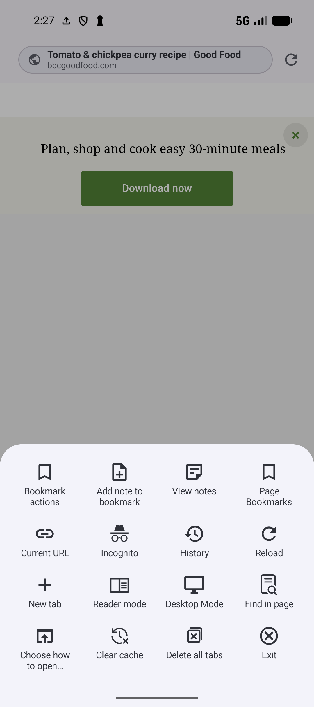

# Browse pages, tabs, and floating bubbles

[Documentation home](../README.md) · [Guide library](../GUIDES.md)

The app's **Browser** opens live websites. **Open article** opens a saved page's extracted text in [Reader](READING.md), and [Bookmark Digest](DIGEST.md) reads a selection from your library. Web browsing and web search do not require an AI provider.

## Start browsing or search the web

1. Open **Browser**, for example from its [home-screen shortcut](SHARING.md#pin-a-browser-shortcut), or open a saved bookmark such as **Tomato and chickpea curry**.
2. Tap the address field. Enter a full address to visit a page, or words such as `chickpea curry` to search the web.
3. Select a suggestion or submit the entry. **Home** returns to **New tab** home, with its search field, frequent saved pages, and bookmark suggestions.

Address suggestions match saved titles, addresses, and domains. They omit archived/deleted/hidden bookmarks and bookmarks in hidden or locked collection trees. These are saved-page suggestions; provider suggestions come from the web. Suggestion requests need a network connection and are currently supported for Google, Bing, DuckDuckGo, and Yandex. Typing here does not run library search or AI Search.

The Browser uses a configured search provider, with Google as fallback. On New tab home, tap the provider icon beside the search field, then choose a provider. The selected provider is used for web queries and supported suggestions.

## Navigate and use the toolbox

Use **Back** and **Forward** to move within the current page's history. Forward is available only when a later page exists. Back leaves Browser when there is no usable previous page. **Reload** refreshes a page; the navigation bar's reload control becomes **Stop loading** while it loads.

The bottom overflow opens the Browser toolbox. Its choices change with the current page and saved bookmark:

*Use the toolbox for the saved bookmark's notes, the current page, and Browser controls.* [View full-size image](../assets/guides/browser/browser-toolbox.png).

| Control | When to use it |
| --- | --- |
| **Bookmark actions** | Act on the saved bookmark you opened. Available actions include opening, organizing, notes, reminders, and other library controls. |
| **Add note to bookmark / View notes** | Keep a note attached to that saved bookmark. Follow the [recipe note example](READING.md#add-a-note-to-the-recipe). |
| **Update dynamic bookmark** | For a [dynamic bookmark](DYNAMIC.md), store the current page location using its URL-matching rules. Following a link does not itself update the saved URL. |
| **Current URL** | Save, share, or copy the page you are viewing now. It can differ from the saved bookmark after following links. |
| **History / Incognito / Standard mode** | Open regular visit history or open Browser home in the selected mode. See [history](#find-and-remove-browser-history) and [incognito](#use-incognito-with-its-limits). |
| **New tab / Tabs** | Start another page or switch pages when tabbed browsing is enabled. See [tabs](#open-and-manage-tabs). |
| **Reader mode / Normal mode** | Extract the current page into a simpler reading layout, then return to the original page. Extraction may fail or omit website content. |
| **Desktop Mode / Mobile Mode** | Change the site's requested presentation and reload it. A website can still choose its own responsive layout. |
| **Find in page** | Search the text currently displayed. Use the previous/next match controls and close the find bar when finished. This is different from library search and saved-content search. |
| **Choose how to open** | Send the current address to an available opening destination. See [opening choices](#choose-an-opening-destination). |
| **Display Options** | Adjust typography while in Reader mode, using the [Reader controls](READING.md#change-reader-display-and-refresh-content). |
| **Smartie** | Ask about the currently displayed page. The Browser entry needs AI Assistant enabled and a Gemini or OpenAI default model; provider setup and allowance apply when you send a request. See [AI](AI.md). |
| **Clear cache / Exit** | Clear website storage after confirmation, or close Browser. Exit is separate from deleting retained regular tabs. |

**Page Bookmarks** appears with its setting and Pro feature access. Its positions are explained in [Reading](READING.md#save-page-bookmark-positions-with-pro).

Use [Bookmark options and library actions](BOOKMARKS.md) for the saved-item controls, and [Privacy, archive, and deletion](PRIVACY.md) before removing or hiding an item. Their usual Pro and permission requirements apply in Browser too.

## Save, share, or copy the current page

Open the curry, follow a website link, then use **Current URL** if you want the new page rather than the original curry bookmark:

1. Open the bottom toolbox and choose **Current URL**.
2. Choose **Save bookmark**, or **Save bookmark in collection** to select a destination.
3. To send the link elsewhere, choose **Share URL with title** and select the receiving Android app.
4. For the clipboard, choose **Copy URL**, **Copy title**, or **Copy URL and title**.

Current URL actions are absent on a blank/start page. Saved bookmark actions continue to refer to the bookmark you originally opened. Long-pressed page links and History also offer **Share URL** and **Copy URL** for their own addresses.

## Open and manage tabs

Enable **Settings → Behavior → Tabbed browsing** with **Default in-app browser → Custom WebView**. This setting is hidden/disabled for Chrome Custom Tab.

1. Choose **New tab** for another start page.
2. Long-press a page link and choose **Open in new tab** to open and select it, or **Open in background tab** to keep reading the current page.
3. Tap the tab bar or open **Tabs**, then tap the page you want. Use **Search tabs** to match a title or address.
4. Use a tab's close control to remove it. With more than one tab, **Delete all tabs** asks for confirmation and leaves one New tab in the current mode.

Regular tabs are retained for later launches. Incognito starts a separate tab set that is cleared when its Browser session ends. Incognito does not guarantee that all session data stays out of device storage.

With tabbed browsing off, **New tab** asks for an address, and foreground/background link actions reuse the current page. Independent tabs require the tabbed setting.

## Find and remove Browser History

In Standard mode, open **History** from the toolbox. Visits are grouped by date. Tap one to open it, or search by title/address. The list keeps up to 200 distinct recent HTTP/HTTPS addresses; revisiting one updates its entry.

A history row's overflow offers **Open in new tab**, **Open in background tab**, **Copy URL**, **Share URL**, **Choose how to open**, and **Delete**. Tab actions need tabbed browsing for independent pages. **Delete** removes one recorded visit; **Clear History** removes the list. This does not delete saved library bookmarks.

## Use incognito with its limits

Choose **Incognito** from the regular toolbox, or **Standard mode** to return to regular Browser home. In the app's Custom WebView, incognito omits Browser History and remembered reading positions, disables cookie acceptance, and changes cache and website-storage settings.

Downloads, manually saved bookmarks, shares, and highlights can remain after an Incognito session. Websites and search providers can still receive your requests. Changing cookie settings can also affect other pages opened inside SmarterBookmarks.

**Clear cache** asks before removing WebView website storage, cookies, cache, and form data. You may need to sign in to sites again. Browser History uses its own **Clear History** control; clearing cache does not invoke that control.

## Long-press links, images, and use Preview

Long-press a page link for **Preview**, **Open**, **Open in new tab**, **Open in background tab**, **Choose how to open**, **Save bookmark**, **Save bookmark in collection**, **Copy URL**, or **Share URL**.

**Preview** opens a temporary sheet with loading, open, and close controls. Close dismisses it. Opening a bookmark preview continues with the configured in-app browser; opening a page-link preview continues in a new tab, or the current page when tabs are off. Preview does not provide the full Browser's highlight or Page Bookmark tools.

Long-press an image for **Download image** and **Share image**; its menu omits Preview and separate-tab actions. Image sharing first downloads the image, so it needs network access and a receiving app that accepts images.

Website upload buttons use Android's file picker. Website download links go to Android Downloads and use its completion notifications. Uploads and downloads depend on the website and Android's access to the selected files. A download is separate from saving a library bookmark or an extracted article.

## Choose an opening destination

Use **Choose how to open** for the current page, a long-pressed link, or a History entry. Available apps determine the destinations. A bookmark-specific opening choice applies only while the current address still matches that bookmark.

**Settings → Bookmarks** controls the normal bookmark opening method and per-domain rules. Use a domain rule when all links from one site should open in a particular app or browser; use the one-time chooser for a single opening. See [bookmark opening settings](SETTINGS.md#choose-how-bookmarks-open).

**Settings → Behavior → Default in-app browser** selects **Custom WebView** or **Chrome Custom Tab**. A Custom Tab uses an installed compatible browser, exposes Android sharing, and adds an update action for dynamic bookmarks. With no supported browser it falls back to Custom WebView.

Chrome Custom Tab incognito depends on support in the installed browser. The app may ask you to copy a browser-settings address, but that setting may be unavailable in your browser version. Check that the page opens in an incognito session, especially after a fallback to Custom WebView, before relying on its privacy behavior.

## Use a floating Browser

1. Open a saved bookmark's menu and choose **Open… → Open in bubble**.
2. If Android asks, allow SmarterBookmarks to display over other apps, then return and open the bubble again.
3. Drag the bubble to move it; tap it to reveal the page. Opening the same bookmark reuses its bubble.
4. Use Back to navigate its page, or collapse it when no previous page is available.
5. Drag it onto the close target, or choose **Exit** in its menu to remove it.

The free limit is five bubbles. More requires Pro with the expanded Browser feature.

The floating address field accepts a page address. Its menu offers **Forward**, **Reload**, **Reader mode / Normal mode**, **Choose how to open**, **Save bookmark**, **Save bookmark in collection**, **Copy to clipboard**, **Share**, and **Exit**. A dynamic bookmark also offers **Update dynamic bookmark**. **Bookmark options** supplies applicable saved-item actions.

Long-pressed links supply opening, save, copy, and share actions; images supply image actions. Floating pages support highlights, but their paragraph controls differ from the full Browser. Use the full Browser or Reader to create paragraph notes and Page Bookmark positions.

Android's floating-Browser notification includes **Close all** to close every bubble and stop the service. Closing a bubble or all bubbles does not delete its saved bookmark.

**Related:** [Reader, speech, and highlights](READING.md) · [Android sharing and shortcuts](SHARING.md) · [Bookmark Digest](DIGEST.md).
