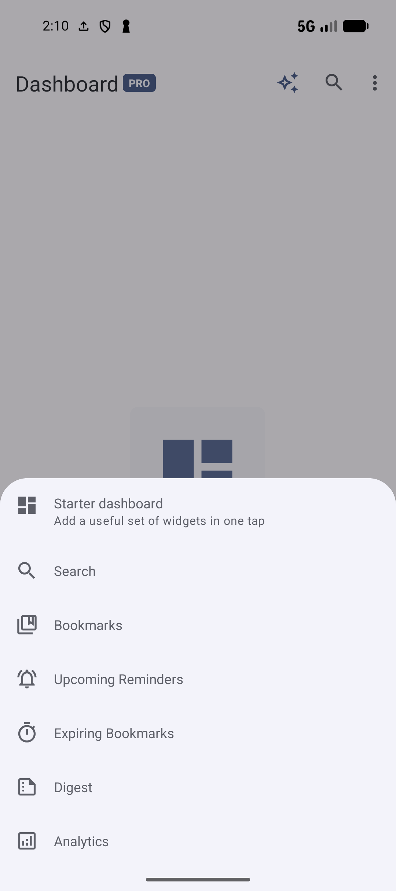
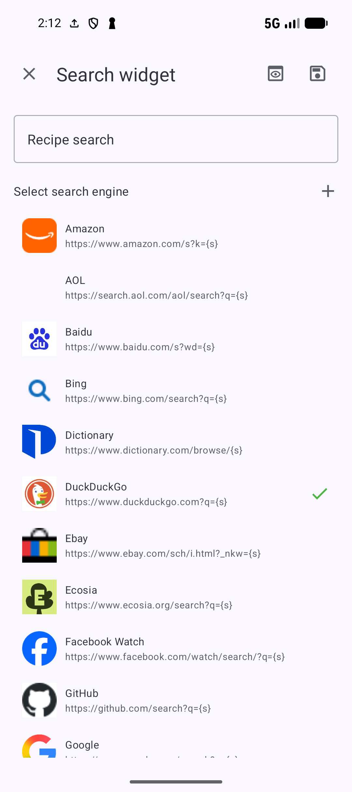
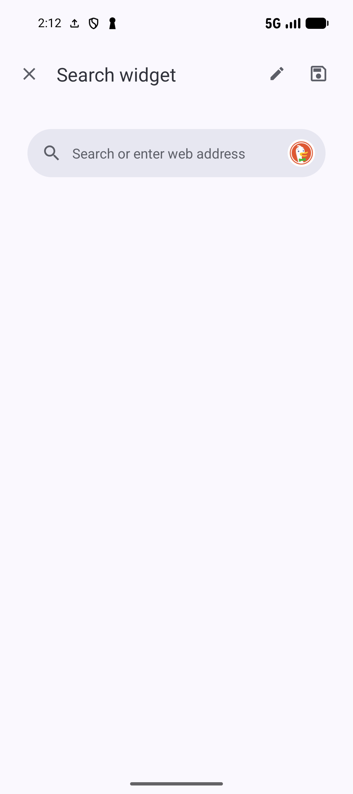

# Build a Dashboard

[Documentation home](../README.md) · [All guides](../GUIDES.md)

Dashboard widgets give quick access to searches, chosen bookmarks, reading progress and library counts inside SmarterBookmarks. Android launcher widgets are separate; see [home-screen sharing](SHARING.md).

## Add your first widget

1. Open **Dashboard** and tap its add button.
2. Choose **Search**, **Bookmarks**, **Upcoming Reminders**, **Expiring Bookmarks**, **Digest** or **Analytics**, according to feature access.
3. Fill the chosen editor, use **Preview** to inspect it, then **Save**. Close with **X** to leave an unsaved draft; an edited draft can ask whether to discard changes.

*Choose a starter layout or add individual widgets to an empty Dashboard.* [View full-size image](../assets/guides/dashboard/dashboard-add.png).

You can add up to 25 widgets. Premium widget access removes that limit and enables reminder/expiry widgets and advanced analytics. Selecting Digest adds its widget immediately; this flow allows one Digest widget.

## Choose a Starter dashboard

**Starter dashboard** appears only when Dashboard is empty. Choose a template to add a group of configured widgets.

| Template | What it adds |
| --- | --- |
| **Essentials** | Google Search, Total bookmarks and Total collections. |
| **Library overview** | Total bookmarks, Total collections, Total notes and Total tags. |
| **Daily review** | Digest and Total bookmarks; with premium widget access, Upcoming Reminders and Expiring Bookmarks too. |
| **Pro planning** | Total bookmarks, Upcoming Reminders and Expiring Bookmarks. Requires premium widget access. |

Starter templates create widgets immediately after selection. If you prefer to choose one editor at a time, close the template chooser and return to Add widget.

## Create a Search widget

1. Choose **Search** in Add widget.
2. Enter a name such as **Recipe search** and select a search engine.
3. Use **Preview**, then **Save** when the name and provider are valid.

*Name the widget and choose its search engine, then use Preview before saving.* [View full-size image](../assets/guides/dashboard/dashboard-search-editor.png).

*Preview shows how the selected provider's search bar will look.* [View full-size image](../assets/guides/dashboard/dashboard-search-preview.png).

The widget searches the selected web provider. Enter a phrase such as `vegetarian chickpea dinner` and submit it to open the provider results, or enter a valid web address to open that address. The overlay also suggests eligible saved bookmarks as you type; tapping a bookmark suggestion opens that saved page. Suggestions are bounded to 100 matches.

To change engines later, open the Search widget's popup and choose a provider. This differs from the library toolbar's [ordinary, FTS and AI Search](SEARCH.md).

### Add a custom search engine

Use the add control in the Search editor's provider area. Enter a provider name and a valid query URL containing `{s}` **exactly once**, for example `https://www.google.com/search?q={s}`. The app substitutes the entered search text for that marker.

A blank name, invalid URL, missing marker or repeated marker blocks adding the engine. Custom providers have a row popup for **Edit** or **Delete**; built-in providers do not. Editing or deleting the provider is separate from deleting the Dashboard widget.

## Create a Bookmarks widget

1. Choose **Bookmarks** and enter its name. A description is optional.
2. Open the bookmark picker. Search existing bookmarks, select the desired rows and return to the editor.
3. Use the picker options to include archived candidates or change their sort if needed. **New bookmark** opens the normal save flow.
4. Drag the selected rows into your preferred order. Choose **List**, **Grid** or **Compact** presentation.
5. Inspect **Preview**, then **Save**. Saving needs a nonblank name and at least one eligible bookmark.

For the recipe library, select **Tomato and chickpea curry** and **Hummus** rather than copying their URLs into a new bookmark. Hidden/locked eligibility still applies to the picker. A widget keeps its configured selection; changing how rows look does not move the bookmarks to another collection.

## Show reminders expiry and Digest

| Widget | Setup and expected use |
| --- | --- |
| **Upcoming Reminders** | Name it, optionally add a description and choose bookmark presentation. It lists eligible configured reminders and needs premium widget access. Create a [bookmark reminder](REMINDERS.md) first when the list is empty. |
| **Expiring Bookmarks** | Uses the comparable editor for bookmarks with configured expiry. It needs premium widget access; a reminder date is not an expiry date. See [bookmark timing](BOOKMARKS.md). |
| **Digest** | Adds a start/continue entry and shows the current Bookmark Digest reading lane and progress. It differs from AI-generated digest content. Follow [Digest](DIGEST.md). |

Android background timing and notification permission affect reminders. Adding a widget does not create reminder or expiry values on its bookmarks.

## Add Analytics

1. Choose **Analytics**, enter a name and select an analytics type.
2. Where the type offers them, choose **Active**, **Archived** or **Both** data and **Count** or **Detailed** display.
3. Configure the type-specific choices, inspect Preview and Save.

| Type | Choices |
| --- | --- |
| **Total bookmarks / Total collections / Total notes / Total tags** | Basic library counters; creation is offered without premium widget access. |
| **Bookmarking trend chart** | Last 7 days, Last 30 days, Last 3 months, Last 6 months, Last 1 year or All time. Premium widget access required. |
| **Bookmarking activity rate** | Organization, tagging, visits, archiving, collection usage or tag usage. Premium widget access required. |

Editing an Analytics widget requires premium widget access, including basic counters.

## Edit move or remove widgets

Open a widget's anchored popup:

- **Edit** reopens its editor, subject to the widget's feature access.
- **Delete** removes the widget after confirmation. It does not delete the referenced library items.
- **Move to top**, **Move up**, **Move down** and **Move to bottom** change Dashboard order. Moves with no valid destination are hidden.

Preview toggles the editor and rendered draft. Save checks the required fields; if it is unavailable, check the name, chosen provider or selected bookmarks before closing the draft.

**Next:** [Navigation and appearance](SETTINGS.md#navigation-and-appearance) · [Digest](DIGEST.md).
