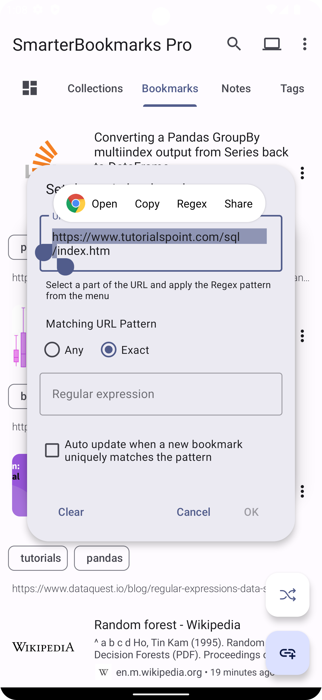
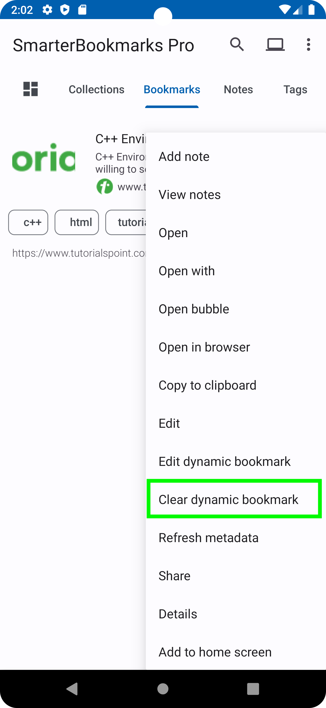

# Dynamic Bookmarks

A dynamic bookmark follows a changing URL while keeping one saved bookmark. Use it to keep your place in a tutorial, comic, podcast series or other website. Set a URL pattern to control which pages can update it.

To update the saved title, description or image instead, use [Refresh bookmark metadata](BOOKMARKS.md#refresh-and-reset-metadata).

## Creating/Setting a Dynamic Bookmark

There are currently two criteria when setting up dynamic bookmarks:

* ANY
* EXACT

ANY matches any URL while EXACT uses Regular expressions to match a URL.

For example, given the following URL <https://www.tutorialspoint.com/cplusplus/index.htm> as a starting point, we can create this bookmark using the EXACT match. This is done by highlighting a portion of the URL as shown below. Then select Regex from the popup menu which creates the following regex `https://www.tutorialspoint.com/cplusplus/(.*)`.

When we're done visiting this page, we can navigate to another URL similar to the first one for example <https://www.tutorialspoint.com/cplusplus/cpp_overview.htm>. Since this is a dynamic bookmark, an update menu icon is shown which lets us update the bookmark to the current URL.

This update will work because it matches the specified regex.

#### Further example

    
    
    

## Removing a Dynamic Bookmark

To unset a dynamic bookmark, simply click on the bookmark options and select "Clear dynamic bookmark."

