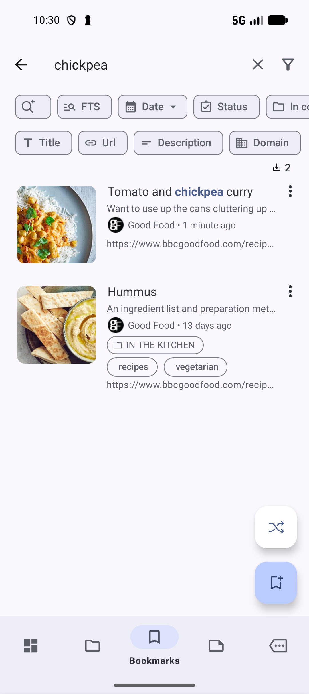
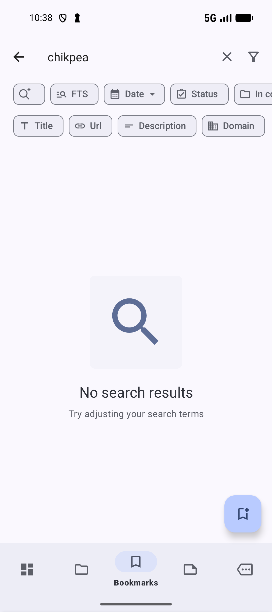

# Find something you saved

Find a saved page using a word you remember from its title. This walkthrough finds **Tomato and chickpea curry**, the recipe from [Save your first bookmark](SAVE.md). Ordinary keyword search works without sign-in, Pro, or AI setup.

## Search for a title

1. Open **Bookmarks**.
2. Tap the magnifying-glass **Search** icon.
3. If **AI Search** is selected, tap its chip to return to keyword search. Enter `chickpea`. For your own library, use a word from a title you saved.
4. Find the matching bookmark in the results. Matching text is highlighted.
5. Tap the bookmark to open its page.

*A remembered word can be enough to find a bookmark.* [View full-size image](../assets/guides/find/search-title.png).

Search can also match descriptions. In this example, **Hummus** appears too because its description mentions chickpeas. Choose the recipe you wanted by its title.

You have succeeded when the result shows the page you wanted and tapping it opens that page. After returning from the page, open **Search** again if it has closed.

If a **Page Bookmarks** popup with **Add bookmark**, **Create Note**, **Share**, and **Copy** appears over the page, press **Back** to dismiss it.

## If nothing appears

A misspelling such as `chikpea` shows **No search results** and **Try adjusting your search terms**.

*Check the spelling or try a shorter word.* [View full-size image](../assets/guides/find/search-no-results.png).

- Check the spelling, then try a different word from the title.
- Check any filters you previously selected; they may narrow the results.
- Return to **Bookmarks** if you were searching inside another list or collection.
- Tap **X** on the right of the search text to clear your query and see the list again.

For more search options, read [Search and filtering](SEARCH.md).

**Next:** [Organize with collections and tags](ORGANIZE.md).

**Previous:** [Save your first bookmark](SAVE.md).

*Screenshots: SmarterBookmarks 1.6.6 in English.*
