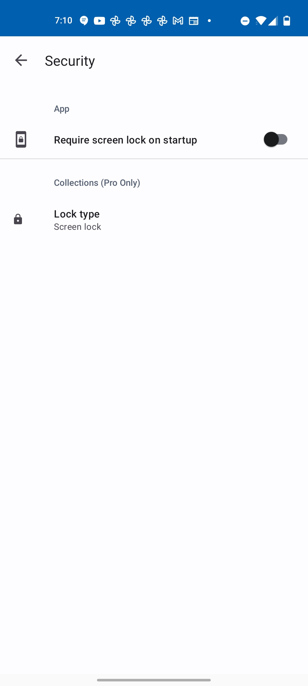
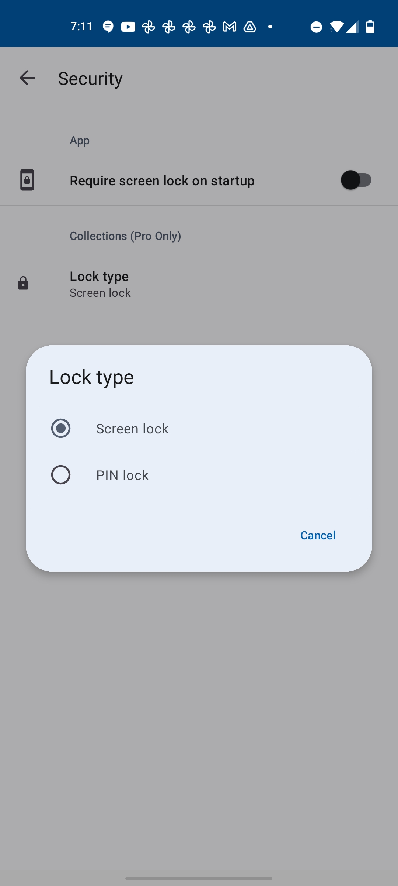
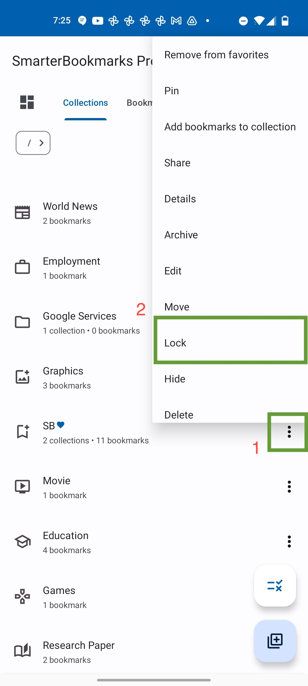
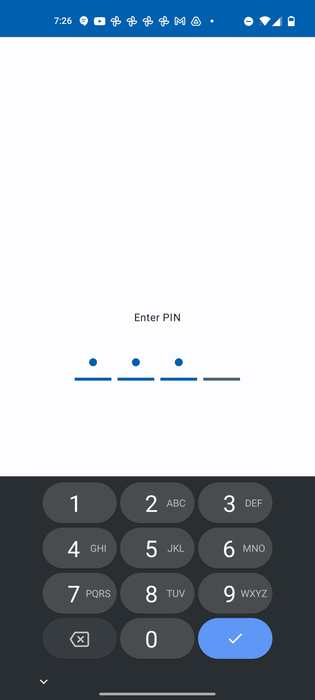
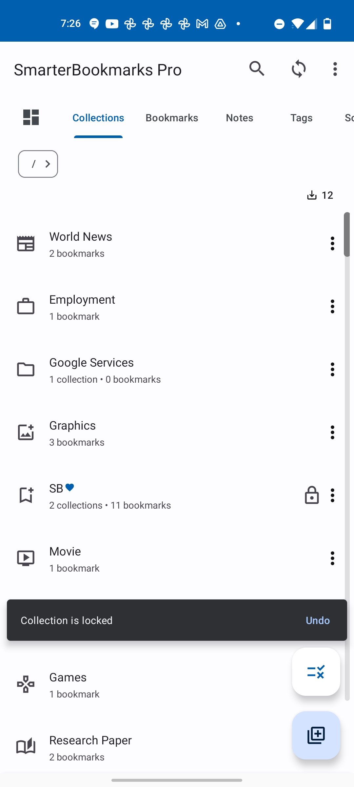
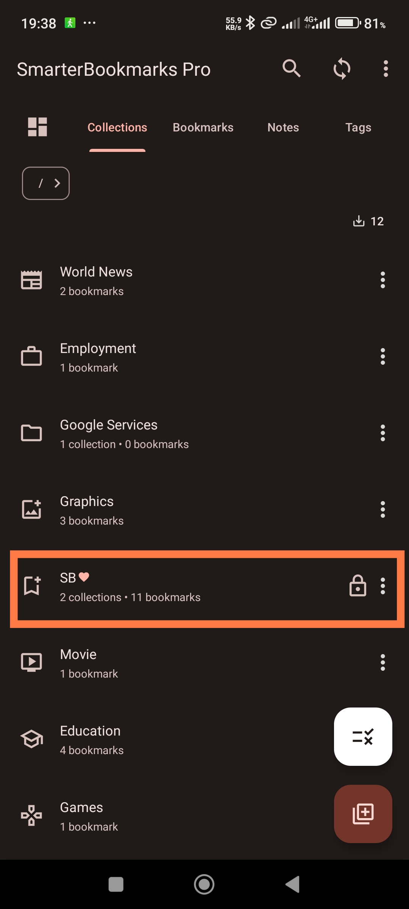
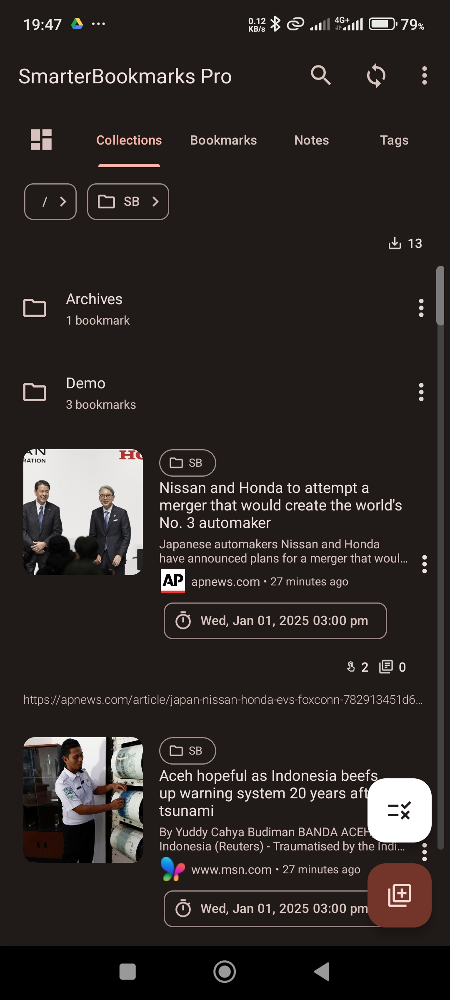
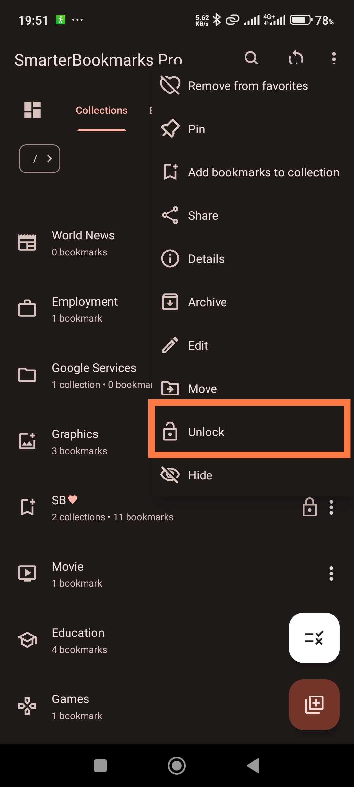
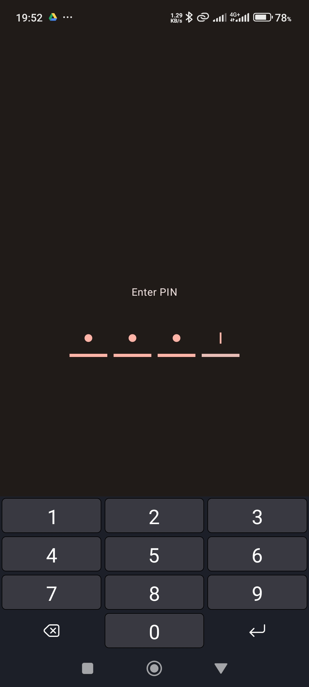
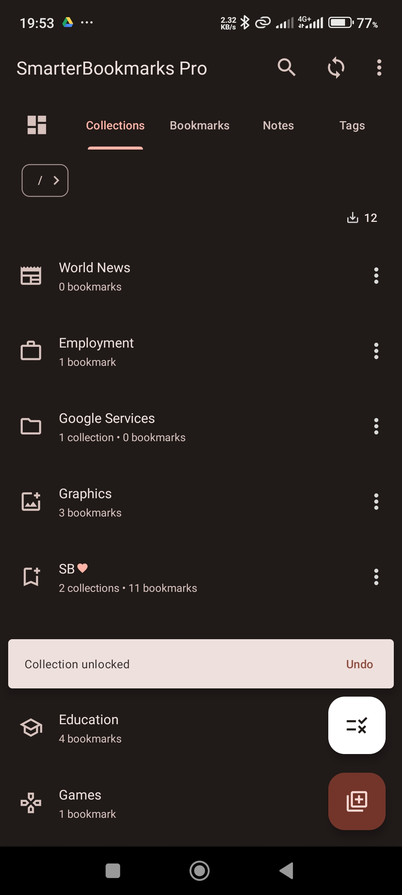

### Locked Collections

[Documentation home](../README.md) · [User guide library](../GUIDES.md)

#### Keep Your Bookmarks Secure

Locked Collections require authentication before you can access protected collections. Choose your device's screen lock or a separate app PIN. Collection locking requires Pro. See [Privacy, archives and deletion](PRIVACY.md#lock-access-to-a-collection) for access restrictions and PIN recovery consequences.

---

#### Key Features:
- **Protected access**: Require authentication for specific collections.
- **Hidden from ordinary views**: Protected content is excluded from ordinary lists, search and other item choices. Tap the collection and authenticate to access it.
- **Screen Lock or PIN**: Use device authentication or a separate app PIN.
- **New or existing collections**: Create a regular collection, then lock it from its menu.
- **Security settings**: Choose the method under **Settings → Security → Collections (Pro Only) → Lock type**.

---

#### How to Use Locked Collections:

1. **Set Up Your Lock Type**
   - Go to **Settings → Security → Collections (Pro Only) → Lock type**.
   - Choose between:
     - **Screen Lock**: Uses your device’s existing lock mechanism (e.g., fingerprint, face unlock, or device PIN).
     - **PIN**: Set a unique app-specific PIN. If you select PIN and haven't set one yet, you'll be prompted to create it when locking your first collection.

   **Screen Lock** is the default. If you choose **PIN** before setting one, follow the PIN setup prompt when you lock a collection.

    
    

2. **Lock an Existing Collection**
   - Navigate to your **Collections** tab.
   - Find the collection you want to lock.
   - Tap the **context menu** (three dots) next to the collection name.
   - Choose **More Actions → Lock**, or **Lock** when actions are listed directly.
   - Complete the authentication or PIN setup prompt.

    
     
      

3. **Create a New Locked Collection**
   - Tap the **+** button in the **Collections** tab to create a new collection.
   - Enter its name and tap **Create**.
   - Open the saved collection's three-dot menu → **More Actions → Lock** and complete authentication or PIN setup.

4. **Access a Locked Collection**
   - Tap on the locked collection in the **Collections** tab.
   - Authenticate using your selected method (Screen Lock or PIN).
   - Authentication lets you access the collection. It remains locked until you use the separate **Unlock** action.

    
    
    

5. **Unlock a Locked Collection**
   - Open the locked collection's three-dot menu → **More Actions → Unlock**, or **Unlock** when actions are listed directly.
   - Authenticate as requested to remove its locked state.
   - The collection then no longer requires collection authentication. This is different from opening it after authentication.

    
    
    

6. **Manage Security Settings**
   - Choose the authentication method under **Settings → Security → Collections (Pro Only) → Lock type**. Use the PIN settings to set or change the app PIN.
   - **Reset PIN** deletes locked collections. Read [the privacy and recovery guidance](PRIVACY.md#lock-access-to-a-collection) before choosing it.

---

#### Perfect For:
- Safeguarding confidential work links.
- Securing sensitive personal information.
- Keeping sensitive collections behind authentication.
