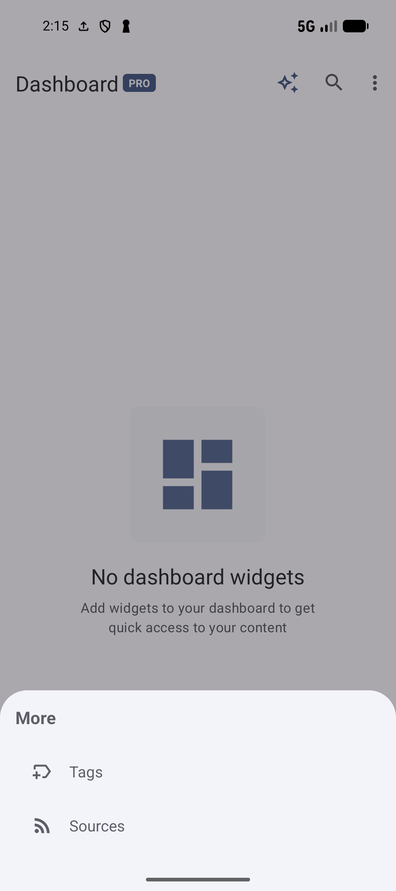

# Navigate your library

[Documentation home](../README.md) · [All guides](../GUIDES.md)

SmarterBookmarks has six main areas: Dashboard, Collections, Bookmarks, Notes, Tags and Sources. The areas you see and the starting area depend on **Settings → Behavior → Active tabs** and **Default start tab**.

## Move between areas

Tap the area's tab or bottom-navigation icon. With bottom navigation and more than five enabled areas, **More** opens the additional destinations. In the six-area layout shown below, Tags and Sources appear under More.

*With all six areas enabled, open More to reach Tags or Sources.* [View full-size image](../assets/guides/navigation/more-navigation.png).

Tap the selected navigation item again to return the supported list to its top. In Tags, chip presentation can behave differently from the ordinary list. In a nested collection, use the path or Back to move up.

Back first closes the current editor, sheet, selection mode or search, or returns through a collection's navigation. **Settings → Behavior → Back twice to exit** can require a second Back within two seconds at the main level. It does not replace the Back behavior inside an open flow.

## Create in the current area

| Current area | Main add action |
| --- | --- |
| Dashboard | **Add widget**. See [Dashboard](DASHBOARD.md). |
| Collections | **New collection**. Name it and choose its parent. |
| Bookmarks | **New bookmark**. Enter a URL and title. See [Save](SAVE.md). |
| Notes | A fresh note editor. See [Notes](NOTES.md). |
| Tags | **New tag**. See [Tag tools](TAGS.md). |
| Sources | **Add source**. See [Sources](SOURCES.md). |

The add control is hidden inside Smart Collections because their members come from rules. Move to a regular collection or Bookmarks to save a new bookmark.

Collections can also show a smaller quick-action button. Open it to **Add bookmark**, **Create Smart Collection** or **Open random bookmark**, depending on the current parent, Pro access and random-bookmark setting. If only one action is available, that action opens directly. A regular collection is needed for manual membership.

## Use the smaller list controls

Enable **Settings → Bookmarks → Enable random bookmark** to expose the smaller random-bookmark action. The related **Random bookmark action** chooses its behavior, and **Smooth scroll to random bookmark** controls scrolling. In a collection it operates on eligible members; on Bookmarks it uses the current applicable list. This differs from Digest's Shuffle.

In Notes, the smaller expand/collapse control changes how much of the note list is shown. It does not open every note editor or change its saved contents.

## Open toolbar destinations

Open the three-dot toolbar menu. Depending on the area, some entries sit under **More options** or **Organize**.

| Destination | Purpose and requirements |
| --- | --- |
| **Settings** | Opens feature and behavior preferences. No account or AI setup is needed to inspect it. |
| **Sync now** | Starts the configured Cloud sync. It appears for a connected account; [Cloud sync setup](SYNC.md#connect-android-devices-with-cloud-sync) is separate from Browser Sync. |
| **Connect to PC** | Opens the Pro local connection screen. Follow [Connect to PC](PC.md). |
| **Trash** | Opens recoverable deleted items when Trash and the required Pro access are enabled. Follow [privacy and deletion](PRIVACY.md). |
| **Markers** | Opens the marker index when the current area's Organize menu is not already the route. Feature availability and the free marker limit still apply. |

Account connections are managed in **Settings → Cloud sync** and **Settings → Browser Sync**. The main toolbar is not a general sign-in/sign-out screen. See [sync and device connections](SYNC.md).

## Customize navigation and lists

Use [Settings](SETTINGS.md#navigation-and-appearance) for active tabs, navigation style, labels, auto-hide, totals, pagination, row size, theme and popup icons. These preferences change presentation; bookmark membership, tags and privacy rules remain part of the corresponding library operations.

**Next:** [Search and saved searches](SEARCH.md) · [Dashboard](DASHBOARD.md).
