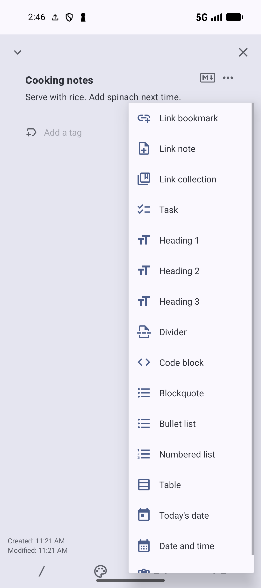

# Write and organize notes

[Documentation home](../README.md) · [User guide library](../GUIDES.md) · [Function index](../FEATURES.md)

Notes can stand alone or be attached to a saved bookmark. Follow the [recipe-note walkthrough](READING.md#add-a-note-to-the-recipe) to write beside a saved page, then use this guide to format, link, tag and organize your notes.

## Create edit and reopen a note

Open **Notes → +** to open the note bottom sheet. Enter a title, such as **Cooking ideas**, and write the body. Close the sheet with its close control to save. Tap the saved note in Notes to reopen it, edit and close again. A blank new note does not create a useful saved entry.

To write beside **Tomato and chickpea curry**, use the bookmark's **Notes → Add note** instead. **Notes → View notes** opens its attached notes. These notes are also notes in the library; attachment supplies the bookmark context.

Use the title and body fields independently: a short title helps finding the note, while the body can hold a recipe adjustment or a longer checklist. The editor's undo/redo arrows reverse or restore text edits. They are editing helpers, rather than a recovery mechanism for deleting a saved note.

## Format text and preview Markdown

Use the editor's formatting actions or enter Markdown in the body, then tap the preview toggle to switch between text editing and formatted reading. Return to editing to correct the underlying text. Markdown rendering follows the note editor preferences; plain text may be shown when Markdown is disabled.

Try this body for a cooking plan:

```markdown
## Next time
- [ ] Buy spinach
- [ ] Try less chilli

**Serve with:** rice
> Check the recipe before changing cooking times.
```

Check that the heading, checklist, bold text and quote read as intended in preview. A preview problem does not mean you should discard the note: return to editing and correct the Markdown. If formatting controls are hidden, use the available slash commands or type the markup directly.

## Insert structure with slash commands

Place the cursor in the body, tap the **/** control and choose the desired command from the scrollable popup. Structural commands insert text at the current position; check the cursor before adding them.



*Use / to add links, tasks, headings and other structure at the cursor.* [View full-size image](../assets/guides/notes/note-slash-commands.png).

You can also type `/` at the start of a line or after whitespace, followed by a command hint in the body. For example, `/heading` narrows the suggestions to headings. This typed route uses the text after the slash to filter the list; the **/** control opens the full command popup. If no command matches, shorten the hint to show choices again.

| Commands | Use |
| --- | --- |
| **Heading 1**, **Heading 2**, **Heading 3** | Insert a heading level, then enter its title. |
| **Task**, **Bullet list**, **Numbered list** | Start a checkbox task or list and fill in its items. |
| **Divider**, **Blockquote**, **Code block** | Separate sections, quote a passage or enclose literal code/text. |
| **Table** | Insert table structure and replace the sample cells with your values. |
| **Today's date**, **Date and time** | Insert the current date or date/time as text. It does not keep updating automatically. |
| **Paste from clipboard** | Insert available clipboard text; check its contents before saving. |

For a note containing `## Next time`, choose **Task** to start a checkbox for `Buy spinach`. Preview it, then undo if the command was inserted in the wrong place. Slash insertion changes note text; choosing a command is not the same as merely opening its menu.

## Link library items inside a note

In the slash menu choose **Link bookmark**, **Link note** or **Link collection**. Search the picker for an eligible item, select it and insert the link. For example, link the curry bookmark from **Cooking ideas**, or link **Recipes to try** as a place to browse more meals. The editor inserts a Markdown internal link; inspect it in preview and open it to check the destination.

Hidden/locked items are excluded from these choices where privacy rules apply. If an item is missing, check its eligibility and search text instead of assuming it was deleted. Internal links need the matching item/library. An inline link is separate from attaching the note to a bookmark.

## Attach or detach a bookmark

For an existing unlinked note, choose its overflow → **Attach bookmark**, search for the saved page and select the intended result. Alternatively, open a bookmark → **Notes → Attach note** and select an existing eligible note. The picker excludes protected hidden/locked choices; save a draft before expecting persisted attachment controls.

On an attached note, choose **Detach bookmark**. When viewing notes from the bookmark, the same action is labeled **Remove from bookmark**. It removes the attachment while retaining the saved note and bookmark. Return to Notes to find the detached note, or attach it to another eligible bookmark afterward. Use **Delete** only when you intend to remove the note itself.

## Tag favorite pin and mark notes

Open a saved note's overflow → **Add tag**, or **Edit tags** when it has tags. Search existing names and check/clear their boxes. Use the explicit **Create tag “name”** action for a missing label. The ordinary picker applies selections as you change them; close it and inspect the note's tags. Use [Tag tools](TAGS.md) for shared renaming, merging or selective refactoring.

The note's **Status** actions offer **Add to favorites/Remove from favorites**, **Pin/Unpin** and **Set marker/Remove marker**. Notes list/editor pin controls depend on the context and saved active state. **Move up/Move down** appears when an adjacent pinned note permits reordering. A favorite can be sorted first; a pin controls its own priority; a marker supplies a return point through **Bookmarks → Organize → Markers**. The free marker limit is 10 shared across bookmarks, collections and notes; Pro removes it.

Long-press a note to select it, tap more rows, check the count and use the selection toolbar for tags, favorites/pins, share, archive or deletion. **Select all** applies to the eligible current query, and **Select range** fills a selected gap where offered. Bulk tag clearing removes associations from the selection, so inspect mixed states first.

## Duplicate copy share and link a note

Open the saved note's overflow and choose:

| Action | What to check |
| --- | --- |
| **Duplicate** | A separate note is created from the title/body, tags and bookmark attachment. Reopen the copy, give it the intended title and inspect those associations before editing independently. |
| **Copy to clipboard** | Copies the note title/body for pasting elsewhere. Check the pasted text. |
| **Copy internal link** | Creates an app link to the saved note. It needs the matching library item when reopened. |
| **Share** | Opens Android's share destinations. Choose a recipient/app deliberately and inspect the shared text. |

The editor overflow also offers copy/share, including current draft text where supported. Save and reopen a note before copying/sharing if you need to be certain the persisted version is the one you intend.

## Archive recover or delete notes

Choose a note's **Archive** to retain it outside the active list. Open **Notes → Archived notes**, search for it and use **Unarchive** to return it. Archived Notes also supports selection, copy/share and Delete where offered. Archive is separate from detaching a bookmark or deleting the note.

Use a note's **Delete**, the editor's Delete or the selection toolbar's Delete to remove the intended saved note/nonblank draft. Review the count/confirmation. Recovery depends on undo/trash settings and Pro Trash access; [Privacy, archives and deletion](PRIVACY.md#restore-from-trash) explains these limits. If you only wanted to remove the recipe context, use Detach/Remove from bookmark instead.

**Related:** [Note display and sorting](BOOKMARKS.md#sort-and-arrange-library-lists) · [Suggested tags](TAGS.md#review-suggested-tags) · [Reading and attached notes](READING.md)

[Documentation home](../README.md) · [User guide library](../GUIDES.md)
