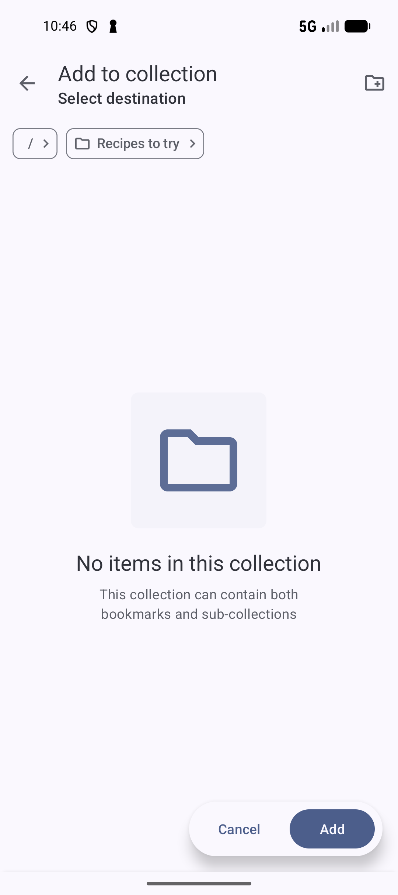
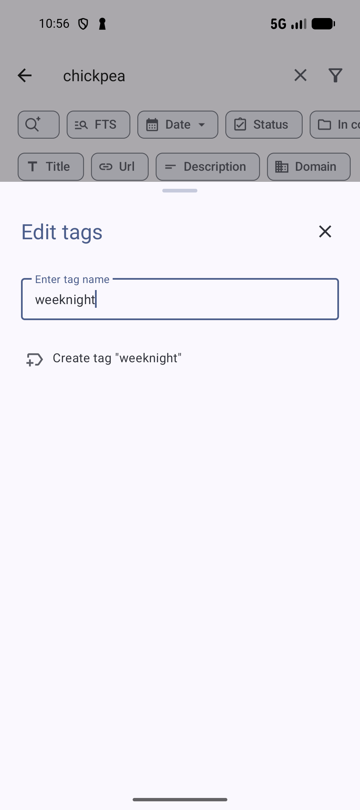
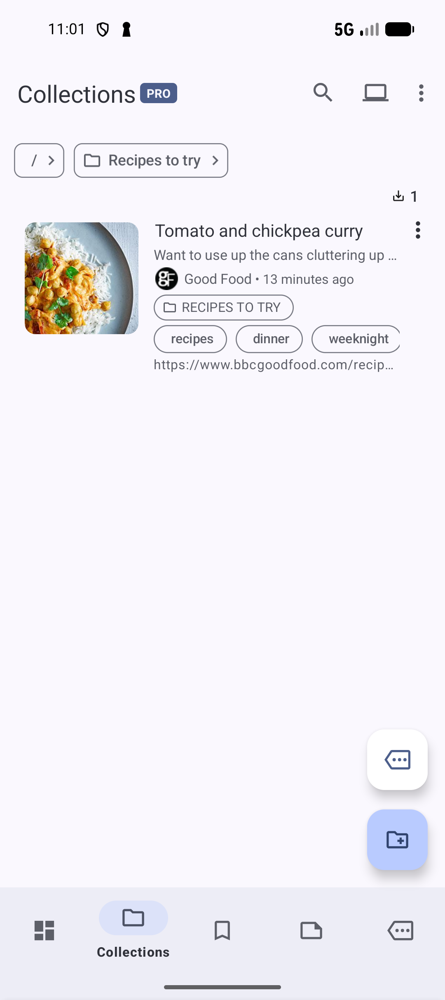

# Organize with collections and tags

Use a **collection** to group bookmarks for a project or activity, such as **Recipes to try**. Use **tags** as labels you can share across collections, such as `recipes`, `dinner`, and `weeknight`. A bookmark can belong to more than one collection and have several tags.

This walkthrough gives **Tomato and chickpea curry** from [Save your first bookmark](SAVE.md) a home so you can find it when planning a meal. These basic steps work without sign-in, Pro, or AI setup.

## Add the bookmark to Recipes to try

1. Open **Bookmarks**, find **Tomato and chickpea curry**, and tap its three-dot menu.
2. Choose **Organize**, then **Add bookmark to collection**. The **Add to collection** screen opens.
3. If the breadcrumb shows another collection, tap **/** to return to the top level. Tap the **folder icon with a +** in the toolbar to open **New collection**.
4. Enter **Recipes to try** in **Name**. Leave **Parent Collection** as **- None** to create it at the top level. You can leave the other options unchanged.
5. Tap **Create**. When the collection list returns, tap **Recipes to try** to enter it.
6. Check that the breadcrumb shows **/ > Recipes to try**, then tap **Add** at the bottom.

 Recipes to try breadcrumb and Add button" width="300"/>

*Enter the destination collection, then tap Add.* [View full-size image](../assets/guides/organize/collection-destination.png).

You should see **Bookmarks added to Recipes to try** and a **Recipes to try** chip on the bookmark. Adding it to this collection preserves any other collection memberships. The bookmark also stays in **Bookmarks**.

If your menu lists actions directly, choose **Add bookmark to collection** without opening **Organize**.

## Apply existing tags and create a new one

1. Open the recipe's three-dot menu again. Choose **Organize**, then **Add tag**, or **Edit tags** if it already has tags. The sheet is titled **Edit tags**.
2. Enter `recipes` in **Enter tag name**. Check the matching tag if it exists; otherwise, tap **Create tag "recipes"** to create and select it. Clear the field and repeat for `dinner`.
3. Clear the field and enter `weeknight`. Check the matching tag, or tap **Create tag "weeknight"** if it is missing. The selected tag is checked. Tap **X** at the top to close the sheet.

*Typing finds matching tags; tap Create tag to create a missing one.* [View full-size image](../assets/guides/organize/create-tag.png).

Tag selections apply immediately. You should now see **recipes**, **dinner**, and **weeknight** on the recipe.

Open **Collections**, then **Recipes to try**, to see the bookmark in its new group.

*The recipe is ready to find by collection or tags when planning dinner.* [View full-size image](../assets/guides/organize/recipes-to-try.png).

**Next:** [Read a saved page and keep your notes](READING.md).

**Related:** [Search and filtering](SEARCH.md) · [Smart Collections](SMART.md), which require Pro.

**Previous:** [Find a saved bookmark](FIND.md).
