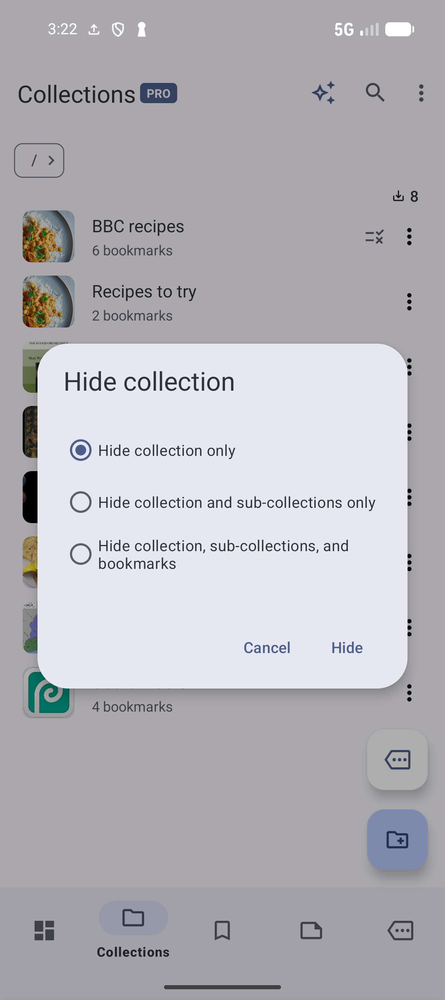

# Visibility archives and deletion

[Documentation home](../README.md) · [User guide library](../GUIDES.md) · [Function index](../FEATURES.md)

Choose the action that matches what you want to retain. Hiding changes visibility, locking requires authentication, archiving keeps items out of active lists, and removing a membership keeps the bookmark elsewhere. Deletion has a wider effect, so review its scope and recovery options first.

## Choose the right scope

| Action | What it changes | How to return |
| --- | --- | --- |
| **Remove from collection** | One bookmark's membership in that collection. The saved bookmark and other memberships remain. | Add it to the collection again. |
| **Detach bookmark / Remove from bookmark** on a note | The note's attachment to the bookmark. Both saved items remain. | Attach the note/bookmark again. |
| **Untag** | A tag association on an item. | Check the tag again in Edit tags. |
| **Hide** | Item visibility in supported lists. It is not encryption or an authentication lock. | Show hidden items, then Unhide with the intended scope. |
| **Lock** a collection | Access protection using the configured device lock or app PIN. | Authenticate to access it; use Unlock when deliberately removing the locked state. |
| **Archive** | Active-list membership while retaining the item in its archive. | Find it in the relevant Archived list and Unarchive. |
| **Delete everywhere** on a bookmark | The saved bookmark across all its collection memberships. | Undo if offered, or Restore from Trash when available. |
| **Delete** a tag/note/collection | The selected entity, with collection bookmark handling determined by deletion choices/settings. | Applicable Undo/Trash recovery, if available. |
| **Delete permanently / Empty trash** | The retained deleted records themselves. | There is no Trash restore afterward; an earlier independent backup is a separate recovery route. |

## Hide and unhide bookmarks

Choose a bookmark's **More Actions → Hide** to remove it from ordinary eligible views. Open the list's **View options → Show hidden** to inspect hidden entries, then choose the item's **Unhide**. Turn Show hidden off again if you prefer the ordinary view.

For several bookmarks, long-press/select them, verify the count and choose **Hide** or **Unhide** from the selection toolbar where offered. Check the current query: selection acts on the eligible selected items, rather than every similarly named page. Hidden is a visibility choice, so use collection locking when authentication is needed.

## Hide and unhide collection trees

On a collection choose **More Actions → Hide**. Review the scope before confirming:

| Scope | What you intended |
| --- | --- |
| **Hide collection only** | Hide this folder without explicitly hiding every child/bookmark. |
| **Hide collection and sub-collections only** | Hide the chosen folder tree. |
| **Hide collection, sub-collections, and bookmarks** | Also mark the tree's bookmarks hidden. |

*Choose how much of the collection tree to hide. Hide collection only is the default; Cancel leaves visibility unchanged.* [View full-size image](../assets/guides/privacy/collection-hide-scope.png).

Use **Collections → View options → Show hidden**, find the collection and choose **Unhide**. Review the corresponding unhide scope and confirm. For example, use collection-only hiding on an old project folder when you intend to preserve the independent visibility settings of its bookmarked pages. Choose the broader scope only when those pages should also be hidden.

A bookmark can have multiple memberships and inherited visibility/access rules. Reopening one folder or unhiding one collection is not proof that every other protected membership has become accessible. Check the item's current memberships and the relevant tree when it does not appear where expected.

## Lock access to a collection

Collection locking requires Pro. Open **Settings → Security → Collections (Pro Only) → Lock type** and choose **Screen lock** or the app **PIN**. Screen lock uses the configured device authentication. Set the app PIN when choosing PIN; follow the setup prompt if needed.

Create/select the intended regular collection, then choose its **More Actions → Lock** and complete the app's authentication/setup flow. Tap the locked collection to authenticate for access. To remove its locked state deliberately, use **Unlock** and authenticate as required. Opening after authentication and changing the stored locked state are different operations.

Locked collections restrict actions such as editing, adding bookmarks, moving/copying, archiving, sharing/exporting and deletion. Unlock the intended collection through its authorized flow before an operation that requires access. Do not assume a bookmark's other collection membership bypasses protected ancestry. Hidden/locked exclusions also affect search, AI context and item-choice screens according to their privacy rules.

If authentication cannot complete, cancel and check the configured device lock/PIN rather than changing protected content. **Reset PIN** deletes locked collections while resetting the lock. Review its consequences and your available backup before choosing it. For illustrated setup steps, see [Locked Collections](LOCKED.md).

## Archive bookmarks collections and notes

Archive an item when you want to keep it but remove it from active work. The action can show confirmation according to app preferences.

| Item | Archive and return |
| --- | --- |
| Bookmark | **More Actions → Archive**. Open **Bookmarks → More options → Archived bookmarks**, find it and choose **More Actions → Unarchive**. New bookmark's **Archive bookmark** saves directly there. |
| Collection | **More Actions → Archive**. Open **Collections → Archived collections**, inspect the retained collection and choose **Unarchive**. |
| Note | Row overflow → **Archive**. Open **Notes → Archived notes** and choose **Unarchive**. |

Search an archive to find the intended item, or long-press/select several and check the count before **Unarchive** or **Delete**. Archived lists also offer context-specific sharing/copying, favorites and metadata actions; available operations depend on item type/state. An archived bookmark is still a saved page, and deleting from its archive has the same recovery considerations as deletion elsewhere.

For recipe planning, archive a completed reference you still want to keep. Unarchive restores it to active use; inspect its collection path afterward. Archiving feed items does not stop a Source from adding future items. Locking/hidden ancestry can restrict archived collection actions too.

## Delete a bookmark everywhere

Open its **More Actions → Delete everywhere**, read the confirmation if offered and confirm only for the intended saved item. This removes the bookmark from every membership. In a collection, **Remove from collection** retains it elsewhere and **Move bookmark** changes that current membership; use those when the saved page is still useful.

For bulk deletion, check the selection count, current query and type before confirming. App preferences control confirmation and Undo. If an **Undo** action appears after an unintended change, use it while available. A dismissed or expired Undo notice is not a guaranteed long-term recovery path.

## Delete a collection and choose bookmark handling

Use **More Actions → Delete** on an eligible unlocked collection. The configured collection-deletion behavior may use a saved choice or ask each time. When choices appear, inspect the bookmark counts and select deliberately:

| Choice | Resulting intent |
| --- | --- |
| **Collection only** | Remove the collection while keeping its bookmarks saved. |
| **Collection + uncategorized bookmarks** | Also delete bookmarks that are not in another collection. Bookmarks with other memberships are retained by this choice. |
| **Collection + ALL bookmarks** | Delete the collection's bookmarks, including ones also used in other collections. |
| **Move bookmarks to destination** | Choose a regular destination before removing the source collection. Check the destination path; the previous destination can be remembered. |

Cancel if the choice/count is unexpected. A locked collection is protected from deletion. For empty folders, use **Collections → Tools → Delete empty collections** and review the candidates. For excessive memberships, use [Review bookmarks in multiple collections](BOOKMARKS.md#clean-up-collections-and-memberships); it removes selected memberships while retaining the saved pages, rather than merging folders.

## Restore from Trash

Trash/Restore requires Pro, its feature access and **Enable trash**. Check **Settings → Behavior → Enable trash** before relying on it for recovery. Trash does not guarantee recovery for a deletion performed when it was unavailable/disabled, or for an item already deleted permanently.

1. Open the main toolbar menu → **Trash**.
2. Find the deleted entry and inspect its type/name and remaining retention time.
3. Choose **Restore** on the entry, or long-press/select entries and use Restore from the selection toolbar.
4. Return to the relevant library list and inspect the restored item, its path and associations.

Restoration uses the deletion context retained for the item. Do not assume a removed parent or independently deleted related item is still present; check the resulting library and restore related entries separately when needed. If restoration fails, keep the Trash entry while checking the reported issue or use an earlier independent backup rather than permanently deleting the recoverable record.

## Set Trash retention and order

The Trash toolbar's **Trash retention (Default)** chooses **7 days**, **30 days**, **90 days** or **Indefinite** for the default. Changing that default is separate from changing an existing entry's retention.

Choose an entry or selected entries → **Set retention period** to choose **1 to 365 days**, then **Save**, or choose **Indefinite**. Retention is counted from deletion time. A shorter period can make an existing entry overdue; the app offers **Delete now**, **Restore item(s)** or **Cancel**. Read that prompt before choosing.

Use **Sort by → Default**, **Days left** or **Last modified**, with **Reversed** when needed, to prioritize recoverable entries. Review items with little time left before their retention expires. Indefinite retention keeps entries until an explicit permanent removal, rather than providing a backup outside the app.

## Permanently remove Trash entries

Use an entry's **Delete permanently**, or select entries and use that action, then review the confirmation. **Empty trash** in the toolbar removes all retained entries after confirmation. These actions eliminate the Trash restoration route. Use [Backup, export and import](BACKUP.md) when you need an independent copy before a wider cleanup.

**Related:** [Bookmark and collection workflows](BOOKMARKS.md) · [Tag association and deletion](TAGS.md#rename-duplicate-remove-or-delete) · [Note attachment and deletion](NOTES.md)

[Documentation home](../README.md) · [User guide library](../GUIDES.md)
