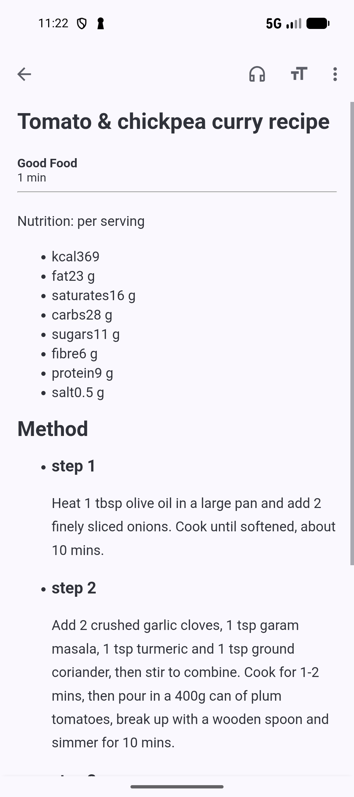
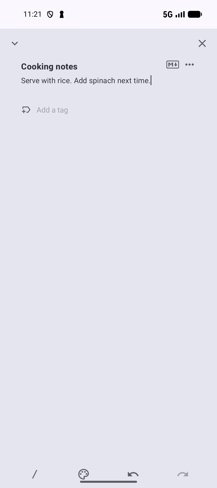
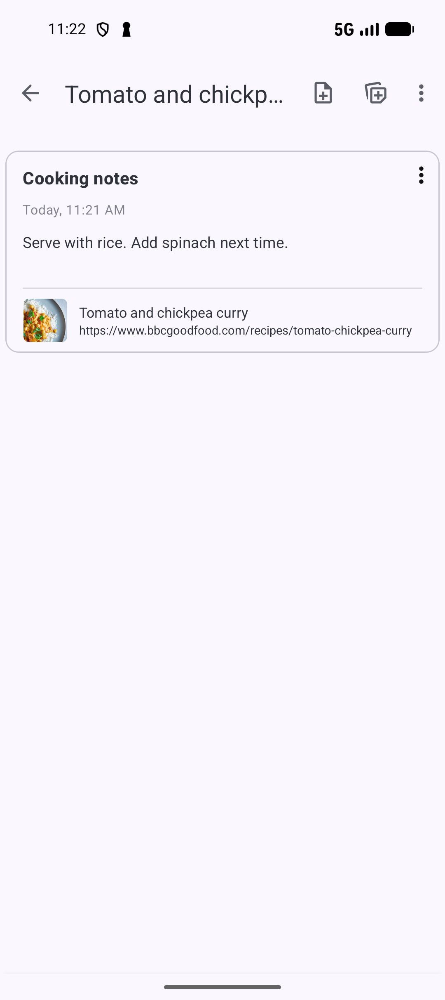
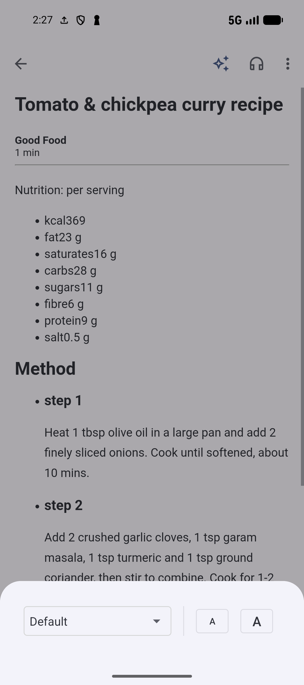
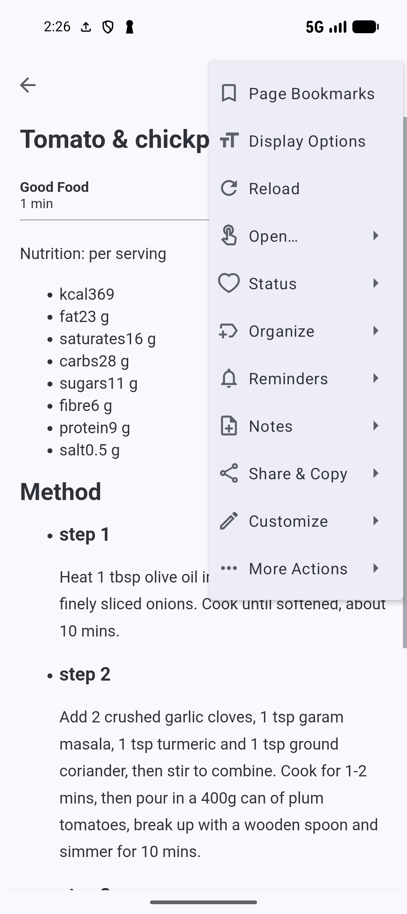

# Read a saved page and keep your notes

[Documentation home](../README.md) · [Guide library](../GUIDES.md)

Open **Tomato and chickpea curry** from [Save your first bookmark](SAVE.md), then keep a cooking note attached to it. Reading and basic notes do not need an AI provider or semantic indexing.

## Open the recipe

1. Open **Bookmarks**, or go to **Collections** → **Recipes to try**.
2. Tap **Tomato and chickpea curry** to open the page.
3. Follow the website's cookie choices if they appear, then scroll to the recipe.
4. Press **Back** to return to your bookmark list.

If a **Page Bookmarks** popup appears while you are trying to use a website control, press **Back** to dismiss the popup, then try the control again.

For a simpler reading view, open the bookmark's three-dot menu and choose **Open…** → **Open article**. This extracts the page's article content. Some websites do not provide content that can be extracted; if the article is missing or incomplete, return to the list and tap the bookmark to use the original page.

*Open article gives the extracted text a simpler reading layout.* [View full-size image](../assets/guides/reading/article-view.png).

## Add a note to the recipe

1. Open the recipe's three-dot menu and choose **Notes** → **Add note**.
2. Enter **Cooking notes** in **Title**.
3. In **Note**, write `Serve with rice. Add spinach next time.`
4. Tap **X** to close the note editor and save it.
5. Open the recipe's menu again and choose **Notes** → **View notes**.

*Write your note, then close the editor with X to save it.* [View full-size image](../assets/guides/reading/note-editor.png).

Your **Cooking notes** entry should appear in the recipe's notes list. Tap it to reopen the editor, change the text, and close it again to save the changes. Notes can also be found from the **Notes** screen.

*View notes brings back the note and the recipe it belongs to.* [View full-size image](../assets/guides/reading/recipe-notes.png).

If the keyboard covers the close control, press **Back** once to hide the keyboard. A completely blank new note is discarded when closed, so enter a title or some text before leaving.

If a note opens in preview mode, use its preview/edit toggle to return to editing. Notes support Markdown when it is enabled in **Settings** → **Notes**; plain text works too.

## Attach a note you already wrote

Choose the recipe's **Notes** → **Attach note** action. Use **Search notes** to find an unattached note, then tap it. You should see **Note attached**.

The picker lists unattached notes. If you see **No unattached notes**, add a fresh note to the bookmark instead, or detach the existing note from its current bookmark before attaching it here.

## Change Reader display and refresh content

In the article's menu, choose **Display Options**. Select a font family, then use the smaller **A** button to decrease the text size or the larger **A** button to increase it. Changes apply immediately and are kept for article Reader and the Browser's Reader mode. Sizes run from 8 to 48; there is no separate Save step.

*Choose a font family, then use the smaller or larger A to adjust text size.* [View full-size image](../assets/guides/reading/display-options.png).

**Reload** or pull to refresh fetches the article again and replaces its saved content when successful. If refreshing fails, Reader reloads the existing content. Missing article files need a network fetch; saved files let Reader reuse the extracted article. Reader content is an extraction of the page, so it may omit site controls or content.

Reader keeps the saved bookmark's normal action menu, including applicable organization and note actions. After following a link away from its saved address, a separate **Current URL** submenu offers actions for that new address: save, save in a collection, share, and copy the address/title. Use that submenu when you mean the new page, not the bookmark you originally opened. [Browser](BROWSER.md#save-share-or-copy-the-current-page) explains the distinction.

*Reader's menu combines display controls with the saved bookmark's organization, notes, and sharing actions.* [View full-size image](../assets/guides/reading/reader-menu.png).

## Resume your reading position

Turn on **Settings → Behavior → Remember reading position**. Returning to the same page can restore its last scroll location. Browser and article Reader keep separate positions, and saved positions expire after 30 days. Incognito Browser does not save or restore them.

This automatic position is different from a manually chosen [Page Bookmark](#save-page-bookmark-positions-with-pro). It does not mean the page is marked read or that Digest's daily selection is complete.

## Read the article aloud

1. Open the recipe with **Open… → Open article**.
2. Tap the headphones icon in Reader's toolbar. Android text to speech reads the extracted paragraphs and reveals the speech controls.
3. Use **Play/Pause** to pause and continue. Use the previous/next paragraph controls to move through the article; while paused they move the reading location, and while playing they continue from the chosen paragraph.
4. Open the speech settings control to show speed. Use minus/plus for 0.25 steps from 0.25 to 2.0.
5. Use **Close** to stop speech and dismiss its controls.

No AI key is needed. A working Android TTS engine and a supported voice are required. In **Settings → Behavior → Advanced → TTS voice**, choose an available offline voice for the app's language, use **Sample voice**, or open **Manage voice data** to install language data through Android. Reader uses the selected installed offline voice when available; a network-only saved voice is ignored. If the device reports the feature unsupported, check its TTS engine and installed language data before retrying.

Digest has its own [Listen and auto-listen controls](DIGEST.md#listen-and-continue-through-a-lane).

## Save text with highlights and annotations

For the recipe, select a useful passage such as part of a cooking step by holding the text and adjusting the selection handles. In the text-selection menu choose **Highlight** to keep that passage and its location. Choose **Create Note** instead when you want a separate note attached to the saved bookmark.

Tap an existing highlight, or open the bookmark's **Notes → Show highlights** sheet and its row menu:

| Action | Effect |
| --- | --- |
| **Annotate / Edit annotation** | Write or change text attached to that highlight. An annotation is different from a bookmark note. Confirm the editor to retain it. |
| **Change color** | Choose a color for that saved passage. |
| **Copy content** | Copy the passage and its annotation to the clipboard. |
| **Create Note** | Create a separate bookmark note from the passage and annotation; keep the highlight as well. |
| **Delete** | Confirm removal from the page and saved highlights list. |

The free annotation limit is two per bookmark/address; Pro with annotation access removes that limit. Existing annotations can be edited. This limit applies to annotations, not plain highlights.

**Show highlights** lets you review the saved passages and annotations without hunting through the page. **Export highlights** copies the saved passage text, annotations, color names, and creation times to the clipboard. Paste it into another app if you want a text copy. It does not create a backup file.

Highlights rely on the page's text and location, so changes to the website/extraction can affect where a saved passage is found. Use the original page when Reader cannot extract the relevant text. Preview sheets do not provide the full Browser's highlight tools.

## Save Page Bookmark positions with Pro

**Page Bookmarks** are ten colored positions inside page content. They are separate from the library bookmark for the recipe, highlighted passages, and automatic reading-position restore.

1. Open **Settings → Bookmarks → Page Bookmarks** and turn on **Enable Page Bookmarks**. Pro with the applicable feature access is required.
2. In the full Browser or Reader, tap ordinary paragraph content, then choose **Add bookmark** in the paragraph popup.
3. Choose an empty colored slot to keep that location.
4. Later, open **Page Bookmarks** from the Browser toolbox or Reader menu and tap an occupied slot to jump to its passage.

Browser-page positions and extracted-article positions are stored separately. Use the same surface when returning to a position. Website content must support the paragraph/location detection.

To manage a position, start from paragraph content → **Add bookmark** again. Choosing an occupied slot asks before replacing it; the active position-creation dialog also offers deletion with confirmation. **Auto-dismiss Dialog** under **Settings → Bookmarks → Page Bookmarks** closes this creation dialog after adding or replacing a position.

The separate viewer's **Replace/Delete** controls may not save position changes. To replace or delete a position, reopen the paragraph's **Add bookmark** dialog and manage the occupied slot there.

The paragraph popup also offers **Create Note**, **Share**, and **Copy content**. Those actions use the detected paragraph, with Create Note available in the full Browser/Reader. The Page Bookmarks setting and Pro access apply to this popup. If it appears over a website control, press Back to dismiss it, then retry the control.

## Links, images, and Smartie in Reader

Long-press a detected link to **Save bookmark**, **Save bookmark in collection**, **Copy to clipboard**, or **Share** it. Image actions additionally offer **Download image** and **Share image**; downloading the image needs network access.

Reader's **Smartie** action uses the article as context. It requires AI Assistant enabled and the Chat feature's selected model to be Gemini or OpenAI, with provider setup for requests. The Browser toolbox checks the default model instead, so the two entry points can differ when feature-model overrides are configured. See [AI](AI.md) for setup and the Ask example.

**Related:** [Browser and tabs](BROWSER.md) · [Bookmark Digest](DIGEST.md) · [Share cards](SHARING.md#share-a-bookmark-as-a-card).

**Next:** [Set a bookmark reminder](REMINDERS.md).

**Previous:** [Organize with collections and tags](ORGANIZE.md).
