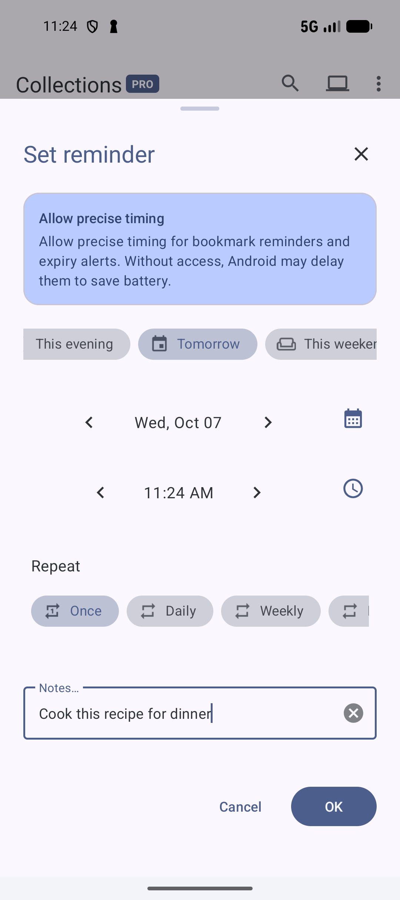
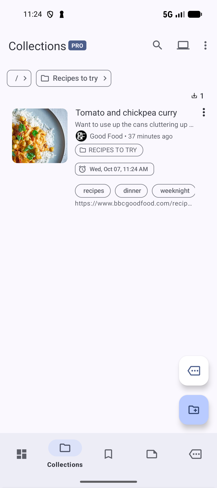

# Set a bookmark reminder

Set a reminder on **Tomato and chickpea curry** so you can return to it when you plan dinner. Bookmark reminders require **Pro** and permission to show notifications. You do not need an AI provider or semantic indexing.

## Remind yourself tomorrow

1. Find the recipe in **Bookmarks** or **Collections** → **Recipes to try**.
2. Open its three-dot menu and choose **Reminders** → **Set reminder**.
3. If Android asks for notification permission, allow it so the app can show the reminder.
4. Swipe the row of quick choices left until **Tomorrow** appears, then tap it. Check the displayed date and time; tap either value to change it.
5. Under **Repeat**, choose **Once** for a single reminder.
6. In **Notes…**, enter `Cook this recipe for dinner` if you want a message with the reminder.
7. Tap **OK** to save the reminder.

*Check the date, time, and repeat choice, then tap OK.* [View full-size image](../assets/guides/reminders/reminder-form.png).

If **OK** is below the screen, drag the sheet's handle upward to expand it. Press **Back** to hide the keyboard if it covers the controls.

The bookmark now shows a reminder chip with its date and time. Reopen its **Reminders** menu and choose **Edit reminder** to check or change the date, time, note, or repeat setting.

*The reminder date and time appear beside the saved recipe.* [View full-size image](../assets/guides/reminders/reminder-saved.png).

If your menu lists actions directly, choose **Set reminder** without opening **Reminders**.

## Repeat or cancel a reminder

For a regular prompt, select **Daily**, **Weekly**, **Monthly**, or **Yearly** under **Repeat**, then tap **OK**. Swipe the repeat choices left to reveal more options. **Custom** lets you choose an interval and decide whether the reminder repeats forever, a set number of times, or until a date.

To stop a reminder, open the bookmark's **Reminders** menu and choose **Delete reminder**. The bookmark itself stays saved. Closing an edit sheet with **Cancel** or **X** leaves the saved reminder unchanged.

## If a reminder does not arrive

Check that **Settings** → **Bookmarks** → **Show reminder notifications** is enabled, and that Android allows notifications for SmarterBookmarks. Also reopen **Edit reminder** to check the next date and time.

If the reminder sheet offers **Allow precise timing**, tap it and enable the app's access in Android settings. Without this access, Android may delay reminders to save battery. Return to the app and check the saved reminder after changing the permission.

**Previous:** [Read a saved page and keep your notes](READING.md).

**Next:** [Collect bookmarks from Sources](SOURCES.md).

**Related:** [Save your first bookmark](SAVE.md) · [Find a saved bookmark](FIND.md).

*Screenshots: SmarterBookmarks 1.6.6 in English.*
