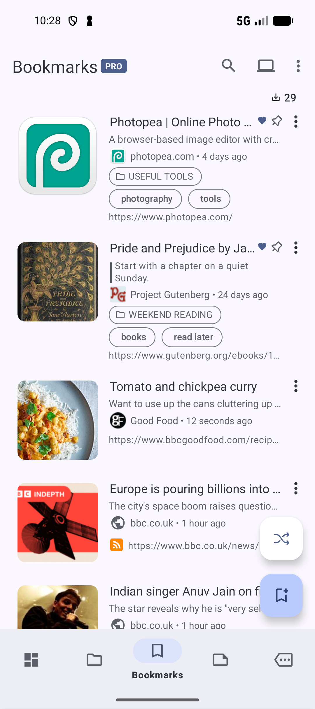

# Save your first bookmark

Save a page so you can find and open it again from **Bookmarks**. You can do this without an account, Pro, or AI setup.

Try saving a recipe to cook later: **Tomato and chickpea curry** from BBC Good Food.

1. Open **Bookmarks** and tap the **bookmark icon with a +** near the bottom of the screen.
2. In **New bookmark**, paste `https://www.bbcgoodfood.com/recipes/tomato-chickpea-curry` into **Url**. You can use the clipboard icon beside the field.
3. Enter **Tomato and chickpea curry** in **Title**. A title is optional, but it makes the bookmark easy to recognize.
4. Tap **Create**.

*Enter the page address and a title, then tap Create.* [View full-size image](../assets/guides/save/bookmark-form.png).

Your new bookmark should appear in **Bookmarks** with the title you entered. Tap it to open the saved page.

*The recipe is now saved for when you want to cook it.* [View full-size image](../assets/guides/save/saved-bookmark.png).

If **Create** is disabled, check that **Url** contains a complete, valid address. For this example, use the exact `https://` address above.

Cover images and page details can appear after saving. To fetch a title before saving, tap the download icon beside **Title**. If you see **Could not fetch title**, enter your own title and tap **Create**. A missing cover or fetched title does not prevent you from saving a valid link.

If **More options** is open and you see **Select a valid parent collection**, choose a collection or **- None** in **Collection**, then tap **Create** again.

Next: [Find a saved bookmark](FIND.md).

*Screenshots: SmarterBookmarks 1.6.6 in English.*
