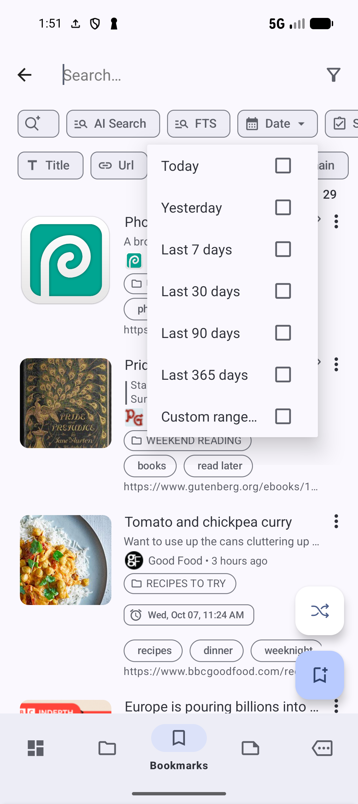
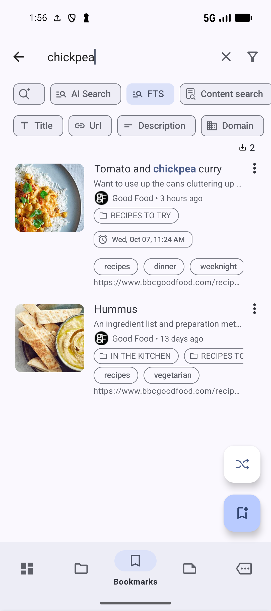
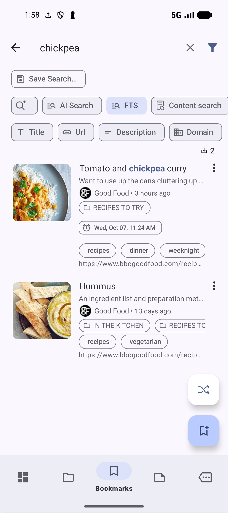

# Search and saved searches

[Documentation home](../README.md) · [All guides](../GUIDES.md)

Use ordinary search for words, filters for item properties, FTS for indexed text, and AI Search for meaning. These modes have different controls and requirements. This reference follows the current 1.6.6 controls; the illustrated [first search](FIND.md) is a useful starting point.

## Search your library

1. Open **Bookmarks**, **Collections**, **Notes**, **Tags** or **Sources**.
2. Tap the toolbar **Search** icon. Enter a word; ordinary results update while you type.
3. Swipe the horizontal chip rows to reach controls outside the visible area.
4. Use each result's usual action; for Sources, open the row's three-dot menu. Tap **X** in the query to clear its text; use the search **Back** arrow to leave search.

In this example library, `chickpea` finds **Tomato and chickpea curry** and **Hummus**. Hummus matches its saved description, so a result's title does not always contain your word. Selecting **Title** narrows the ordinary search to that field.

*A word can match a saved description as well as the title.* [View full-size image](../assets/guides/search/keyword-results.png).

If there are no results, clear the query and selected filters, check the current list or collection scope, and try one correctly spelled word. A misspelling such as `chikpea` does not behave like a meaning-based query. Hidden and locked content can also be ineligible for the current search.

## Basic filters

Tap a property chip to select it and tap it again to turn it off. Search can combine text with properties, so you can find recipes and then narrow them to favorites.

| Control | What it changes |
| --- | --- |
| **AND / OR** | Require all query terms or allow any. Bookmarks, Collections and Notes start with AND; Tags and Sources start with OR. Applicable tag criteria use the selected logic too. |
| **Favorites / Non favorites** | Include or exclude favorite bookmarks, collections or notes. These controls are not shown for Tags or Sources. |
| **Pinned / Unpinned** | Include or exclude pinned items in the supported library lists. |
| **Date** | Filter when an item was created. Choose Today, Yesterday, Last 7 days, Last 30 days, Last 90 days, Last 365 days or **Custom range…**. |

Date choices can be combined. Select **Custom range…**, choose the start date and then an end date that is not before it. Reopen Date and deselect a chosen range to remove it. This is creation date, separate from a bookmark's reminder or expiry.

*Choose a creation-date range; checked choices stay visible when you reopen the menu.* [View full-size image](../assets/guides/search/date-filter.png).

## Bookmarks

| Control | Use it to find |
| --- | --- |
| **Status** | Bookmarks with selected built-in or custom status values. Open the sheet and select values in its activity, reading, progress or custom groups; each selection updates the results. |
| **In collection / Not in collection** | Bookmarks with collection membership or no collection membership. |
| **Tagged / Untagged** | Bookmarks that have at least one tag or none. Tagged alone does not choose a particular tag. |
| **Tags** | Particular existing tags. Search the chooser, select names, then close it to return to search. Selected tags appear as removable chips. This search chooser does not create tags. |
| **Dynamic / Non dynamic** | Bookmarks with or without dynamic URL behavior. See [dynamic bookmarks](DYNAMIC.md). |
| **Broken** | Bookmarks already recorded as broken. Running health checks has separate Pro requirements; filtering a recorded state does not perform a new check. |
| **Title / Url / Description / Domain** | The saved fields to match in ordinary search. In FTS these chips instead insert field prefixes into the query. |

Use `#weeknight` to search tag associations in Bookmarks or Notes. A matching active tag alias can resolve to its canonical tag. If a label is missing, check the spelling in **Tags** rather than assuming ordinary query text creates a tag. See [tag tools](TAGS.md).

## Collections

Search normally spans eligible collections. To stay within a folder, enter that collection before opening Search, then select its named scope chip. The root label is **/**.

- The direct-collection chip searches the current folder.
- The collection-tree chip includes eligible subcollections. The two scope choices are mutually exclusive.
- **Collections** and **Bookmarks** control which result types appear. Selecting Bookmarks also exposes bookmark field chips.
- **Locked / Unlocked** filters collection lock state. A filter does not grant access to protected contents.

For example, enter **Recipes to try**, choose its collection scope, select Bookmarks and search `chickpea`. Check the scope before interpreting a missing result from another folder.

## Notes

Notes support Tagged/Untagged, particular Tags, Favorites/Non favorites and Pinned/Unpinned, along with Date and query logic. Use a word from the note or a `#tag` term. A note attached to a bookmark is still a note record, with its own text and tag associations.

## Tags and Sources

These lists start with OR query logic and omit favorite/pin filters. Switch to AND when every entered term must match. Their ordinary search supports the advanced text shortcuts below; their FTS mode uses the relevant entity's text index.

## Advanced search

Tap the advanced-search chip to show **Exact**, **Exclude** and, in ordinary mode, **Regex**.

| Shortcut | Example | Meaning |
| --- | --- | --- |
| **Exact** | `"chickpea curry"` | Inserts paired quotes for a phrase. Type between them; this does not mean the entire field must equal the phrase. |
| **Exclude** | `chickpea -hummus` | Inserts a minus sign before a term to omit. Combine exclusions with positive terms. |
| **Regex** | `/^chick.*$/` | Inserts the app's delimited regular-expression form and shows helper chips. Use ordinary mode for this shortcut. |

The regex helper chips insert `.*`, `[]`, `()`, `\d+` or `[a-zA-Z0-9]*` at the cursor. Fill empty brackets or groups with your intended expression. Remove the regex text or return to a simple word if an expression is invalid or too restrictive. FTS hides the Regex shortcut.

## Full Text Search and Content

1. Open **Settings → Search** and turn on **Enable Full Text Search**.
2. Return to a library list, open Search and select **FTS**.
3. Enter words from the indexed text. In Bookmarks, tapping Title, Url, Description or Domain inserts a prefix; for example, `title:chickpea`.
4. For saved page text, turn on **Settings → Search → Search page content (Pro-only)** and choose **Content search** in Bookmarks search. This requires Pro Content Search access and available saved page content.

*FTS is a text-search mode; Content search is a separate choice for saved page text.* [View full-size image](../assets/guides/search/fts-results.png).

FTS uses local text indexes, separate from AI indexing. Bookmark queries can include saved metadata and associated tags, aliases, collections and highlights, according to the current criteria. A saved URL alone does not establish that its page text is available for Content search. Other lists use their own text indexes.

To inspect one saved page, open its bookmark menu → **Notes → Search Content**, then enter a word in the content sheet and inspect the matching excerpts. This also requires the applicable Pro access and saved content. See [reading and saved articles](READING.md).

**Settings → Search → toolbar Help** opens **How Full Text Search (FTS) Works**. Use it for the app's query explanation. If Content search is absent, check FTS selection, the page-content setting, Pro access and that you are searching Bookmarks.

## AI Search

Set up **Settings → AI features → Index setup**, enable AI Search and prepare the eligible list's index. In search, select **AI Search**, enter a topic and press **Enter**. Ordinary field/filter shortcuts and saved-search controls are hidden while this mode is active.

Tap AI Search again to return to ordinary search. Indexing, classification and generative chat are separate choices. Follow [AI setup and the recipe search](AI.md#set-up-ai-search) or the [advanced setup reference](AI-SETUP.md).

## Save and reuse a search

Saved searches belong to the current list type. Two per entity are available without Pro; additional saved searches need Pro Saved Searches access. AI-mode queries cannot be saved through this control.

1. Use ordinary search or FTS and choose a nonempty query or at least one filter.
2. Tap the funnel icon beside the query to reveal the saved-search row. It expands this row, rather than opening the advanced text controls.
3. Tap **Save Search…**. Enter a nonblank name that is unique within that list, such as **Chickpea dishes**, then tap **Save**.
4. The new chip becomes active. Tap another saved-search chip to replace the current criteria, or tap the active chip again to disable it and clear its saved criteria.

An enabled saved search is retained by entity and indicated on the applicable navigation icon. Check for an active saved search if reopening a list unexpectedly restores a query.

*The funnel reveals the saved-search row. Save Search stores the current query and filters after you name it.* [View full-size image](../assets/guides/search/saved-search-row.png).

| Maintenance | How |
| --- | --- |
| Rename | Long-press its chip → **Edit**. Change the name; the stored query and filters stay the same. |
| Replace criteria | Set the new current query/filters, then long-press the destination chip → **Replace**. It stores the current criteria and activates that search. |
| Delete | Long-press its chip → **Delete**. This removes the saved search, not its matching bookmarks. |
| Reorder | Drag saved-search chips into the preferred order. **Save Search…** remains the creation entry. |

**Next:** [Navigate and customize your library](NAVIGATION.md) · [AI Search and Smartie](AI.md).
