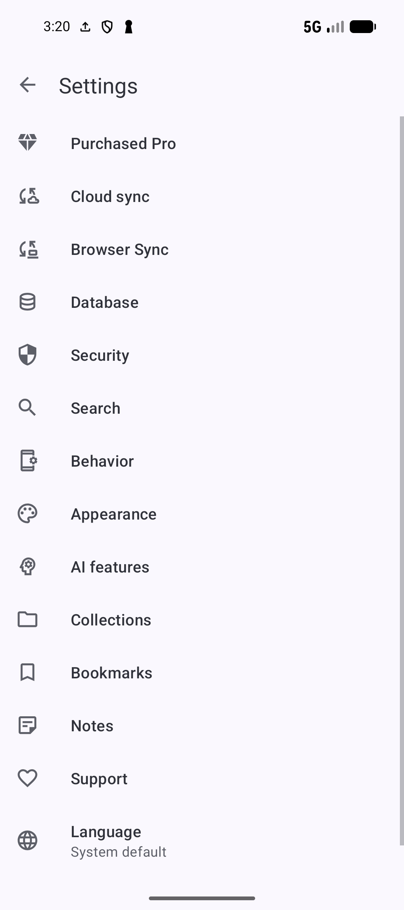

# Choose app settings

[Documentation home](../README.md) · [All guides](../GUIDES.md) · [Find a function](../FEATURES.md)

Open **Settings** from the main toolbar menu, sometimes under **More options**. Choose a category for the behavior you want to change. A disabled or missing control can depend on another setting, Android version, app Pro/feature access, installed apps or notification permission.

Screenshots show SmarterBookmarks 1.6.6. Choose a category below to find its settings and related guide.

*Settings groups controls by feature. The Pro row opens plan details; Support offers optional contributions.* [View full-size image](../assets/guides/settings/settings-home.png).

Open **AI features** for [AI setup and indexing](AI-SETUP.md), [Smartie](SMARTIE.md) and [AI tasks](AI-TASKS.md). Their provider/model choices are separate from the app settings below.

## Security and collection credentials

In **Security → App**, **Require screen lock on startup** asks for Android's configured device credentials when opening the app. Set up a supported Android screen lock first; the control is disabled with an explanation when it is unavailable. The device authentication screen confirms enabling/disabling it.

Under **Security → Collections (Pro Only)**, **Lock type** chooses **Screen lock** or the app's **PIN**. Locking collections needs the relevant Pro access. With PIN selected, **Set a PIN** appears before a PIN exists: enter four digits, then repeat them to confirm. **Change PIN** appears afterward: enter the old PIN, enter four new digits, then confirm the new PIN. Switching from an existing PIN to Screen lock also asks for PIN authentication. See [hidden and locked items](PRIVACY.md) for locking the actual collection and its privacy rules.

**Reset PIN** deletes locked collections and resets the lock. This cannot be undone. Read the warning, tap **Reset** only if you intend its consequences, then enter the displayed confirmation code and confirm again. **Cancel** leaves without that reset. Keep an accessible backup before destructive maintenance; [data recovery](DATA.md) explains the separate restore tools.

## Enable word and page-content search

In **Search**, turn on **Enable Full Text Search** to make the **FTS** chip available in compatible list searches. FTS matches indexed words; it differs from a literal substring and from meaning-based **AI Search**.

Under **Bookmark Search**, **Search page content (Pro-only)** enables the **Content search** chip for bookmarked page text. It depends on FTS, the applicable Pro Content Search access and saved page text. In Bookmarks search, select **FTS**, then **Content search**, and submit words from the saved page. Saving only a URL may leave no page text to search.

The Search settings toolbar opens **How Full Text Search Works**, with the app's explanation and examples. For a starting query, compare `vegetarian dinner` in FTS with the same ordinary keyword search. Open the results and check whether the match came from the title/details or saved text. See [Search and filtering](SEARCH.md) for phrase, prefix and filter behavior, and [AI setup](AI-SETUP.md) for the separate semantic index.

## Navigation and appearance

In **Behavior → Active tabs**, check the main areas you want: **Dashboard**, **Collections**, **Bookmarks**, **Notes**, **Tags** and **Sources**. Keep at least one selected. **Default start tab** chooses an active destination or **Last selected**. If you remove the chosen start destination, select a valid one again. Follow the restart prompt when shown.

In **Appearance → Navigation**, choose **Bottom navigation** or **Top tabs (deprecated)**. Bottom navigation can use **More** when all six areas are active. Its dependent settings are:

- **Show labels in bottom navigation**: **Auto**, **Always show**, **Never show** or **Show when selected**.
- **Auto-hide bottom navigation**: hide it while scrolling supported lists.

These bottom-only controls are hidden with top tabs; changes can request restart. Enable **Behavior → Back twice to exit** if you want a second Back within two seconds to leave the main screen. Back through a nested collection, editor, search or selection state first performs that state's normal navigation.

**Appearance → Theme** offers **System default**, **Light**, **Dark** and **Battery saver**. System default follows the device theme; Battery saver uses Android's power-related night setting.

In **Dark mode surfaces**, **Use AMOLED dark mode** uses true black surfaces. Turn it off to choose **Dark background**: **App theme default**, **Softer charcoal**, **Slate blue-grey**, **Sage green**, **Plum neutral**, **Deep ocean**, **Cool graphite** or **Warm copper**. The background chooser is disabled while AMOLED is on. These surfaces affect dark mode; the app refreshes its screens when you change them.

## List size and menu appearance

In **Appearance → Lists**, **Show total number of items** displays supported list totals. Under **Pagination**, enable paging for supported collection/bookmark lists, then choose **Default pagination size**: **100**, **1,000** or **10,000**. With Pro, **Rows per page** accepts 1 through that selected size. Reducing the default also reduces a larger custom count. Use the list's page controls to reach later items.

Under **Menu**, **Show overflow menu icons** controls toolbar menu icons and requests restart. **Show popup menu icons** controls anchored item menus and appears on Android 10 or newer. **Appearance → Tags → Tag chip outline** shows borders on colored tag chips.

## Browser and Android share choices

In **Behavior → Share intent options**, choose which Android share targets appear:

| Target | Intended flow |
| --- | --- |
| **Save bookmark** | Save the shared bookmark directly |
| **Save bookmark…** | Review/edit the shared bookmark before saving |
| **Save and open bookmark** | Save it and open it |

Selecting a target enables its Android component. Return to the sharing app and reopen its chooser to see available choices. [Save](SAVE.md) shows the normal shared-recipe flow.

In **Behavior → Browser**, **Default in app browser** chooses **Custom WebView** or **Chrome Custom Tab**. **Tabbed browsing** appears only for Custom WebView. These settings choose the in-app implementation; the bookmark opening choice below determines whether to use the app at all.

**Auto-hide top browser bar** and **Auto-hide bottom browser bar** control bars while scrolling. **Swipe to refresh pages** enables pull-to-refresh. **Remember reading position** restores supported browser/reader positions when reopening. If a page keeps refreshing unexpectedly, check the gesture setting. See [Browser and reading](BROWSER.md) for its actual toolbar, tabs and reader controls.

**Add Browser to home screen** requests a pinned launcher shortcut to the app browser home. Confirm the launcher prompt if offered; unsupported launchers show that limitation. It is separate from shortcuts to individual bookmarks.

## Choose how bookmarks open

Open **Bookmarks → Behavior**. **Default click action** decides what a tap does: **No action**, **Open**, **Open incognito mode**, **Choose how to open…**, **Open article**, **Open bubble**, **Details**, **Show highlights**, **Share** or **Copy to clipboard**. Choose Open for ordinary page navigation, or Details when you usually inspect saved metadata first.

**Default opening method** decides where the page opens: **SmarterBookmarks**, **System default browser**, **Ask every time**, or another installed app that can open it. Installed apps determine the list. This is different from the click action and from the app's Custom WebView/Chrome Custom Tab choice.

To override one site:

1. Open **Domain rules**.
2. Enter a valid domain, such as `bbcgoodfood.com`, and choose the app that should open it from the dropdown.
3. Tap the add/save control. The rule appears in the list; invalid input remains in the editor with an error.
4. Use a row's edit control to change its domain or opening app, then **Save**. Use its remove control to delete the override.
5. Open a bookmark from that domain and check the chosen destination. Removing the rule returns that site to the default opening method.

If you uninstall an app used by a rule, choose another opening app or remove the rule. Bubble, incognito and reader actions still need their normal feature/device support. [Browser and reading](BROWSER.md) and [Android sharing and shortcuts](SHARING.md) explain those flows.

## Confirmation, undo, Trash and usage data

In **Behavior → Show or hide action confirmation**, select confirmation for deleting **collections, bookmarks, notes or tags**, archiving **collections, bookmarks or notes**, deleting **bookmark reminders**, and removing **bookmark expiry**. The selection affects supported listed actions; it is not a universal confirmation switch for every feature.

**Enable undo last action** offers reversal for supported recent operations. **Enable trash** retains supported deleted data for Trash recovery and appears with the applicable Pro/Trash access. Check [deletion and privacy](PRIVACY.md) for Remove versus Delete everywhere, retention and restore. An undo control is not a substitute for a backup of important data.

**Enable Deep Refresh Gesture** lets you pull down and hold for one second to refresh supported lists. Use it when a list needs a deeper refresh; it is different from browser page pull-to-refresh.

**Export custom images during backup or cloud sync** includes custom images as text in those data operations. Large images can increase data size and affect performance. Change it deliberately before the next backup/sync; it does not itself start one. See [data maintenance](DATA.md) and [Cloud sync](SYNC.md).

**Share anonymous app usage statistics** controls the app's analytics/crash-information collection used for improvement. Turn it off if you do not want that collection enabled. It is separate from optional cloud AI data sharing, sync and sending feedback. Read the **Privacy Policy** in About for the published explanation.

## Collection defaults and tree behavior

In **Collections**, **Default collection (auto)** and **Default collection (manual)** separately offer **None** or **Last Used**. None does not reuse a remembered destination; Last Used uses the remembered collection for that saving flow. Check the actual destination in the bookmark form when placement matters.

**Collection deletion behavior** sets the linked-bookmark consequence:

| Choice | Consequence |
| --- | --- |
| **Collection only** | Remove the collection and keep its bookmarks |
| **Collection + uncategorized bookmarks** | Also delete bookmarks that would be left without a collection |
| **Collection + ALL bookmarks** | Delete all bookmarks belonging to that collection, including shared ones |
| **Move bookmarks to destination** | Choose a destination for the bookmarks |
| **Always ask** | Choose the behavior for each collection deletion |

Review the affected bookmarks before deleting a collection, especially if some belong to other collections. [Deletion and privacy](PRIVACY.md) describes the deletion preview and recovery limitations.

Under **Bookmark Digest**, **Include sub-collections** includes eligible nested bookmarks when launching [Bookmark Digest](DIGEST.md) from a collection. Under **Tree View**, **Single expansion per level** collapses other expanded folders at that level; **Highlight expanded folder row** adds the subtle focused/expanded-row background. **Shortcuts → Allow duplicate collection shortcuts** permits more than one home-screen shortcut for the same collection. See [the collection reference](BOOKMARKS.md#build-and-maintain-collection-paths) for organization and tree use.

## Save details and clean URLs

In **Bookmarks → New Bookmark Details**, **Update existing bookmark** updates a matching saved bookmark when saving it again. This differs from duplicate handling during import. Under **Refresh Metadata Options**, **Download metadata** retrieves details; **Download principal image** depends on it and retrieves the page's main preview image. Both need network access.

In **Settings → Bookmarks → Behavior**, **Save resolved URLs** stores a redirect's final destination during supported save/enrichment flows. **Remove tracking parameters** enables query cleanup. **Parameters to remove** offers:

| Choice | Saved URL handling |
| --- | --- |
| **Known tracking parameters** | Remove the built-in tracking list |
| **Custom list** | Show **Tracking parameters** for comma-separated names you want removed |
| **All query parameters (risky)** | Remove the entire query, including parameters a site may need |

For a custom rule, enter names such as `utm_source,utm_campaign` rather than a full URL. Check the saved page still opens the intended content. These preferences apply to supported saving/processing flows; changing them is not a command to rewrite every saved URL.

In **New Bookmark Dialog**, **Remember last used tags** reuses the previous selection; turning it off clears the remembered tags. **Enable bookmark templates** exposes reusable presets for tags, collections and statuses during creation. Turning on the switch does not require Pro; template creation limits still apply. Use the template controls in the [bookmark reference](BOOKMARKS.md).

## Refresh metadata and maintain offline images

Tap **Bookmarks → Refresh metadata**, choose **Bookmarks with missing metadata** or **All bookmarks**, then **OK** to start retrieving details in the background. **Cancel** leaves without starting that request. Retrieval needs network access and can request Android notification permission. Follow progress in the notification, then check the updated bookmark details.

Under **Offline Bookmark Images**, enable **Save images for offline use**. Then choose:

- **Maximum storage**: **50, 100, 200, 300, 500, 1000, 1500 or 2000 MB**, or **Unlimited**. The summary can show current storage usage.
- **Storage location**: default app storage or an accessible folder selected through Android. Grant the folder access and check the displayed location. Selecting a folder does not guarantee access after it is moved or revoked.
- **Only download on Wi-Fi**: wait for Wi-Fi for eligible image downloads.

Tap **Download missing images** to fill absent saved copies. **Clear saved images** asks for confirmation and frees saved preview-image storage; it does not delete the bookmark URLs. Allow the Android notification request if offered so the operation can start. **Stop** appears while downloads or clearing are waiting or running and cancels them; you can also cancel from the notification. A stopped or failed operation can leave some images downloaded or cleared, so check storage usage and bookmark images before retrying. Offline preview images are separate from downloaded reader articles.

## Bookmark rows, random selection and Digest

Under **Bookmarks List**, **Datetime format** offers relative or absolute styles, **Absolute (Show Today)**, and date/time patterns previewed with the current date. Choose the preview that is easiest to read. **Show bookmark tags on a single line** controls wrapping; **Sort tags and other metadata by name** uses alphabetical order.

**Show bookmark counters** controls display of opening/note and other supported counts. **Enable bookmark counters** records how often a bookmark opens. Turning off display does not itself turn off recording; choose both independently.

Under **Random Bookmarks**, enable random selection, choose **Random bookmark action** from the same action list as Default click action, and optionally **Smooth scroll to random bookmark**. **No action** selects/scrolls without opening a page; other choices open/share/show the eligible selected bookmark. The random control appears in applicable bookmark/collection flows when enabled.

Under **Bookmark Digest**, **Show digest labels** identifies AI Digest, AI Summary, Description or Link above the text. **Show Digest source labels** shows site name/favicon when available. **Add Digest to home screen** requests a pinned launcher shortcut. Generated AI content is optional; [Bookmark Digest](DIGEST.md) covers the reading flow and [AI setup](AI-SETUP.md#choose-summary-style-and-format) covers generation.

## Shortcuts, bubbles and downloaded articles

Under **Bookmarks → Shortcuts**, **Shortcut open mode** chooses **System default** or **App decides**. The mode change applies to new shortcuts. With App decides, **Widget/shortcut open behavior** appears and offers **System default**, **Open**, **Choose how to open…**, **Share** or **Copy to clipboard**. **Use image for bookmark shortcut if available** uses the bookmark image as its icon. Launcher support still determines whether a pinned shortcut can be created. See [Android integration](SHARING.md).

Under **Bookmark Bubbles**, **Expand when opened** controls the initial floating-bubble size and **Dynamic toolbar color** uses page-related color. Bubble access/permissions remain separate; see [Browser](BROWSER.md).

Under **Article Mode**, **Enable Article Mode** exposes extracted reader content where available. **Automatically download articles** caches it when opened and depends on Article Mode. **Delete all downloaded articles** immediately clears cached articles; it is separate from bookmark deletion and offline-image clearing. Save any content you need through a suitable backup/export before clearing caches. [Reading and notes](READING.md) shows opening an article.

## Reminder, expiry and Page Bookmark preferences

Under **Reminders (Pro Only)**, **Show reminder notifications** enables supported reminders and **Auto-dismiss reminder notifications** removes one when you tap it. In **Expiring Bookmarks**, the equivalent **Show expiry notifications (Pro Only)** and **Auto-dismiss expiry notifications** control expiry alerts. They need the applicable Pro notification access and Android notification permission; an expiry/reminder must also be configured on a bookmark.

On Android 12 or newer, **Reminders may arrive late** appears when precise timing access is absent. Tap it to open Android's timing permission for reminders/expiry alerts. Follow [Reminder troubleshooting](REMINDERS.md#if-a-reminder-does-not-arrive) if alerts still do not arrive. These controls do not govern AI task schedules.

With Page Bookmarks Pro/feature access, **Page Bookmarks → Enable Page Bookmarks** enables the page-content popup. **Show Visual Highlight** controls its visual shadow/highlight, and **Auto-dismiss Dialog** closes it after creating a Page Bookmark. Both depend on the main switch. See [Page Bookmark positions](READING.md#save-page-bookmark-positions-with-pro) for saving and returning to a page position.

## Bookmark health checks

**Bookmark Health Monitoring** appears with the applicable Pro health feature access. Enable **Enable Health Monitoring**, then choose **Check Frequency**: **Daily**, **Weekly**, **Monthly** or **Never**. **WiFi Only** constrains the network; **Show Notifications** reports detected broken/inaccessible links. These controls depend on monitoring being enabled. Android may delay background checks.

**Check Now** schedules a manual URL check and displays progress while active. **Reset Health Status** immediately resets the recorded check times and health data to unknown without confirmation. Neither deletes the bookmarks. A failed/inaccessible status can be caused by sign-in, network or server restrictions; open and check the page before deleting it. See [bookmark health and cleanup](BOOKMARKS.md#check-and-manage-bookmark-health) for checking results and choosing what to keep.

## Note focus, text and list preferences

In **Notes**, **Create and focus on content** puts the cursor in a new note's body. For existing notes, choose **Open read-only** for reading, or **Open and focus on content** for editing. The options disable each other; **Open and focus on content at the end** depends on editing focus and moves the cursor to the end. If a choice is disabled, check the other opening mode first.

**Font size** offers **11, 12, 14 (default), 16, 18, 20, 25, 30, 35 or 40**. **Enable markdown** controls formatted note rendering. The app refreshes its screens after these changes. Under **Note List**, **Max lines to display in note preview** selects 1 through 10 lines (default 5), **Show note tags on a single line** controls wrapping, and **Sort tags and other metadata by name** sorts them alphabetically. See [Notes](NOTES.md) for editing and linking notes.

## Choose a reading voice

Open **Behavior → Advanced → TTS voice**. **Voice** offers **System default** or downloaded offline voices matching the app's current language. The list depends on the Android text-to-speech engine; it is not a Smartie/generative model setting.

Select a voice, use **Sample** in the picker or **Sample voice** on the settings screen to hear it, then **OK** to save the choice. If none are available or TTS is not ready, use **Manage voice data** to open Android's voice-data screen and install a matching voice through the system. Return to TTS voice and try again. Device engines can vary, and the system voice installer may be unavailable.

## Use external automation links and intents

Open **Behavior → Advanced → Automation & Tasker**. Tap **Application ID (package name)**, **Extra: target collection path**, **Internal bookmark link prefix** or **Bookmark Digest link** to copy its value. Use the values shown on your device so the automation targets your app.

**Full automation reference** copies the supported activity names, actions, extras and URI formats together. Use that block in Tasker, MacroDroid or another app that sends Android intents/opens links. For example:

1. Configure a **text/plain** share intent to the save/edit-save target named in the copied reference.
2. Set its standard shared-text extra to a page URL.
3. Optionally set the copied target-collection-path extra to `Recipes to try/Weeknight`. Missing path segments can be created, so check spelling before triggering it.
4. Run it once and check the saved bookmark and destination.

For opening an existing bookmark, use the copied internal prefix with the URL encoded as a query value, or the supported bookmark-ID format. For Digest, use the copied Digest URI or single-bookmark format. Use valid accessible item IDs and URL encoding; opening routes still follow normal privacy/access rules. See [Android integration](SHARING.md) for share targets and shortcuts. External intents are separate from bookmark rules and [AI tasks](AI-TASKS.md).

## Language, Pro and optional Support

At the Settings root, **Language** offers **Device language** and the listed app languages. Choose a language you can read; the app refreshes its screens. TTS choices depend on the selected language.

The first Settings row shows **Upgrade to Pro**, **Purchased Pro** or **Subscribed to Pro** according to the current app state. Open it to inspect available monthly, yearly or lifetime plans and the current plan. Prices/availability come from Google Play; read its displayed terms before confirming a purchase.

**View plans** compares available plans. **Manage subscription** opens Google Play subscription management for the applicable account/plan. If pricing or current status cannot load, check Play availability, connection and the purchasing account, then reopen the screen; do not assume another purchase is required. Lifetime Pro is a purchase rather than a recurring subscription. Pro feature access and provider AI allowance remain separate.

**Settings → Support** offers **Say Thanks**, **Buy a Coffee**, **Buy a Beer**, **Buy Lunch** and **Buy Dinner**. These are optional, repeatable contributions, not Pro upgrades and not provider credit. They do not require Pro. Buttons wait for Play product prices to load; choosing one opens Play's purchase flow. **About Support → How Support Works** explains them. Review the actual price in Play before purchase.

## About, help and reporting a problem

Open **Settings → About** to find the app name and installed **Version**. Include that version when reporting a problem.

| About control | What opens |
| --- | --- |
| **What's New** | The installed release highlights sheet |
| **Changelog** | The public full release history; network needed |
| **Help Center** | Online documentation, including [all guides](../GUIDES.md) and the [function index](../FEATURES.md) |
| **View Tutorial** | Onboarding again |
| **App Features** / **Pro Features** | Explanatory feature entries; these are not master enable/disable switches |
| **Rate this app** | The store listing |
| **Send Feedback** | An email chooser/draft with app version and Android/device context |
| **Telegram** | The community channel |
| **Open Source Licenses** | Included third-party license information |
| **Support translation** | The public translation project |
| **Privacy Policy** | The published privacy page |

For feedback, describe the steps, expected result and actual result, and review the supplied device information before sending the email yourself. Avoid including private bookmark content or credentials in a report. If no app can open an email, store or web link, install or choose a suitable app for that destination.

**Also from Smarter Technologist** opens **Smarter You**, **Smarter Events** or **Smarter Library** if installed, or their store pages. These links are separate apps, not bookmark settings.

For library recovery use [Data maintenance](DATA.md); for account synchronization use [Sync](SYNC.md); for model/provider controls use [AI setup](AI-SETUP.md).
