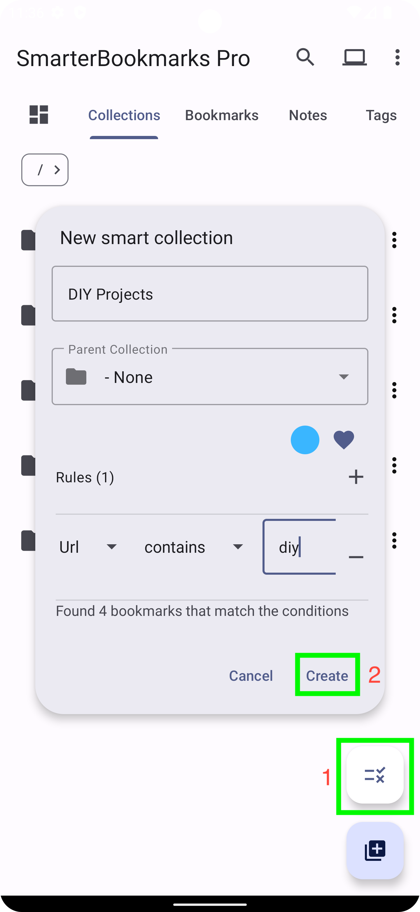
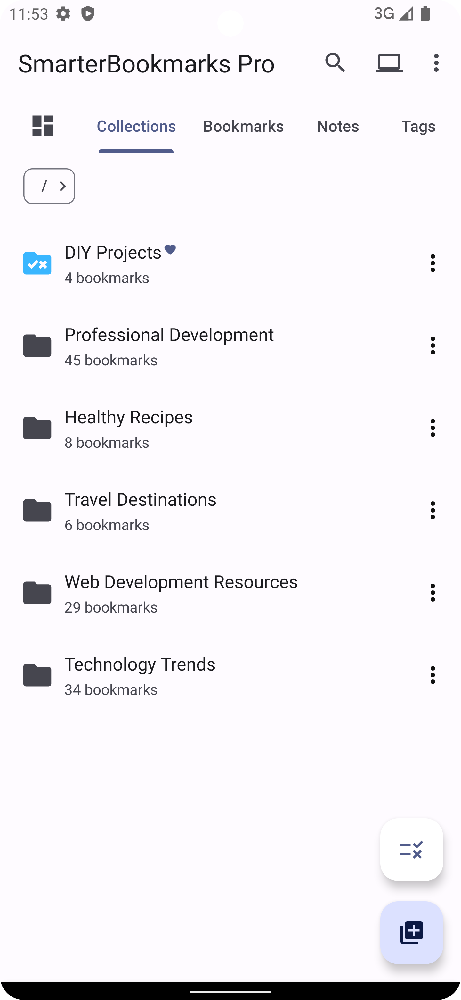
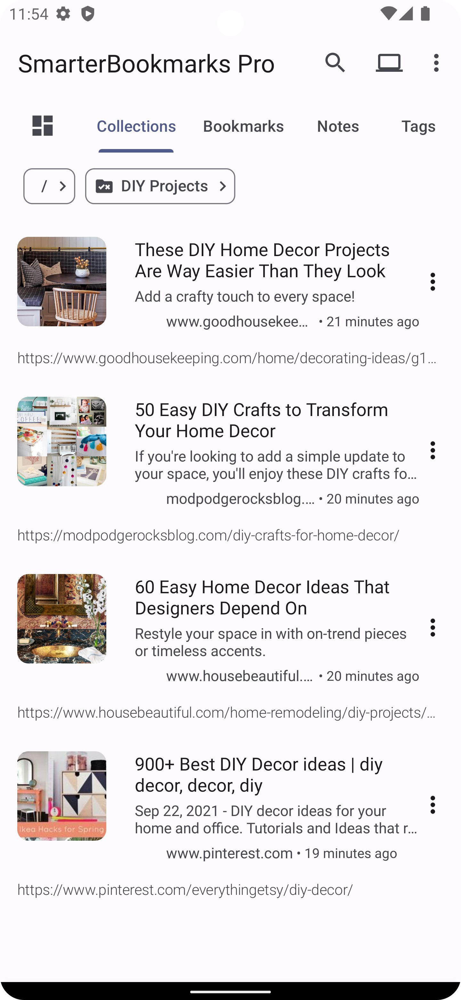

# Smart Collections

You can create Smart Collections to organize bookmarks by criteria you specify, such as URL, title, domain, or the date a bookmark was created or modified.

## Create a Smart Collection

You can create a custom Smart Collection to organize bookmarks by the criteria that you specify. Smart Collections require Pro. They cannot contain subfolders; bookmarks cannot be added manually to them. They can only contain bookmarks derived from the criteria you specify.

To create a Smart Collection:

1. Open **Collections** and return to the top level with **/** in the breadcrumb.
2. Tap the smaller action button above **+**. If an action sheet opens, choose **Create smart collection**; otherwise, the rules button opens the form directly.
3. Enter the name of the Smart Collection.
4. Tap **Add Rule**, then choose a field, operator, and value. Check the matching-bookmark count.
5. Set a color for the collection if desired.
6. Tap **Create**.

Upon creation, the new Smart Collection will appear in the list of Collections.

Follow [Create the BBC recipes Smart Collection](ADVANCED.md#use-a-smart-collection-for-a-changing-list) for a step-by-step example.

    
    
    

## Rule types and operators

Smart Collections support powerful rules so you can precisely control which bookmarks appear.

- **OR logic:** Match bookmarks that satisfy *any* of the rules in a group.
- **NOT conditions:** Exclude bookmarks that match a rule or a whole group.
- **Rule grouping:** Combine rules into groups and apply AND/OR/NOT at the group level for complex logic.
- **Regex support:** Use regular expressions for URL, title, description, or domain matching.
- **Negation operators:** "Not contains," "Not starts with," and "Not ends with" for text fields.
- **Collection or subcollection:** Match bookmarks that are in a specific collection or any of its subcollections.
- **Collection name matching:** Match the current collection or subcollection name against the rule. After renaming a collection, update any name-based rule that should continue matching it. A recreated collection can match when its name meets the rule.
- **Cross-linked bookmarks:** Include bookmarks that have incoming or outgoing link relationships (Pro).
- **Health status (BROKEN):** Show links marked broken or those not marked broken (Pro; requires Bookmark Health Monitoring). Not marked broken includes unchecked links and does not confirm that a link is healthy.
