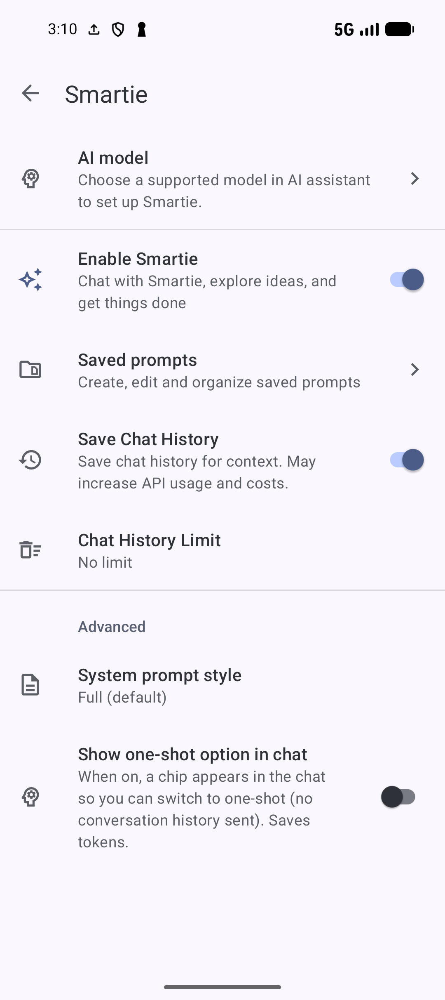

# Work with Smartie conversations

[Documentation home](../README.md) · [All guides](../GUIDES.md) · [AI setup](AI-SETUP.md)

Use **Ask** to discuss and research saved content. Use **Agent** when you want supported library changes. A saved conversation keeps the discussion available later; an attachment tells Smartie which items or files to consider.

Screenshots show Smartie in SmarterBookmarks 1.6.6. The [recipe walkthrough](AI.md#ask-smartie-about-saved-pages) includes an example question and an answer with links to saved recipes.

## Enable, open and resize Smartie

1. Save a provider key in **Settings → AI features → AI setup → Providers** and choose a supported **AI assistant → AI model**. See [key validation and model choices](AI-SETUP.md#add-test-or-remove-a-provider-key).
2. Open **AI assistant → Smartie**, turn on **Enable Smartie**, and read the confirmation.
3. Return to Bookmarks and tap the toolbar **stars** entry.
4. Choose the **Ask** or **Agent** chip before sending the request.

*Enable Smartie for chat and Save Chat History to keep conversations. History limits and prompt style are separate choices.* [View full-size image](../assets/guides/ai/smartie-settings.png).

If Smartie's **AI model** row displays “Choose a supported model in AI assistant to set up Smartie,” tap it to open **AI assistant**, then open **AI model** to see the configured **Smartie and AI tasks** choice.

The sheet header has an arrow to move between its collapsed/intermediate states, a preview/title area that expands the sheet, and **X** to close it. Drag the sheet when you need more room. A separate arrow beside a long input expands/collapses the text editor; it does not start a new conversation. Closing Smartie and stopping a running response are different controls.

Tap the model name in the header to select a supported model or **Use default model**. This updates the shared **Smartie and AI tasks** feature model, so it also affects later task runs. Check the matching provider key and allowance after switching.

## Ask a focused question and check sources

Try this recipe request with your saved library: `Which saved pages could help me plan a vegetarian dinner? Link to the bookmarks you use.` The answer depends on your saved content, model and setup.

*Open the source bookmarks to check the recipe details.* [View full-size image](../assets/guides/ai/smartie-answer.png).

Tap an answer's bookmark, collection, tag or note source card to open that accessible item. Available source actions follow the normal item controls. A citation shows what Smartie referenced; check the original page for details that matter.

Smartie can search visible bookmarks by meaning and keywords, find collections/tags/notes/Sources by their information, and read saved article text. A complete semantic index improves topic retrieval, while keyword fallback can still help when semantic retrieval is unavailable. With a cloud index method, a semantic lookup can send the query to that separate provider.

For live web research or reading URLs outside your saved library, choose a supported Gemini model. Examples you can adapt are `Read this URL and compare it with my saved chickpea curry recipe`, or `Find current information about this ingredient and link to the pages you consulted.` These requests need a network connection and use provider allowance. Ask for linked sources and distinguish new web pages from saved bookmarks in the result. OpenAI chat can retrieve accessible library items and their saved articles.

Ask does not apply bookmark, note, tag or collection changes. Explicit requests to create or manage an AI task are a separate supported route; see [tasks from chat](AI-TASKS.md#create-and-manage-tasks-from-smartie).

## Attach library context, images or files

1. Tap the attachment control in the input, or type `@` to open context choices.
2. Choose **Bookmarks**, **Collections**, **Tags** or **Notes**, then select the accessible item you want to reference. The input also recognizes `@bookmark:`, `@collection:`, `@tag:` and `@note:`.
3. Check the context chips before sending. Tap a chip's close control to remove it from the draft.
4. Write the task using the attached names, for example `Compare the attached recipe with this shopping note. List what I still need.`

Context is attached to the request you send; the chips clear after sending. It is not a permanent filter for every later message. Hidden/locked content remains subject to privacy/access rules, and a chosen item can become unavailable before the request is processed.

The same attachment sheet offers **Camera**, **Photos** and **File**. Camera lets you take a picture; Photos uses Android's image picker; File opens the document picker. Choose the item, check its chip/preview, and remove it before sending if it is wrong. The selected model/provider must support that attachment type. Keep file attachments under about 4 MB. If a file cannot be read or interpreted, use a supported smaller file or paste the relevant text.

Attaching content provides it to the provider when you send the request. It does not automatically create a bookmark or note from it.

## Keep, open, rename or delete conversations

Open **Settings → AI features → AI assistant → Smartie** and enable **Save Chat History** if you want retained chats. The header **+** starts a separate conversation. Use a new one when changing topic or when earlier discussion would confuse the request.

To return later, open Smartie's **Conversations** control in the header and tap the conversation. Linked task conversations are marked. Long-press a row to choose **Rename** or **Delete**. Rename edits its title; **Save** confirms it. Delete asks for confirmation and removes that retained conversation. If you delete the current one, Smartie moves to another remaining conversation or starts a new one.

Deleting or limiting history can make a task's previously chosen conversation unavailable. Task reports remain a separate destination; choose a valid chat again if you need linked results.

## Set chat history limits

With Smartie and **Save Chat History** enabled, open **Chat History Limit**:

| Choice | What to enter next |
| --- | --- |
| **No limit** | No age/count limit; Limit Value and Limit Scope are hidden |
| **Keep last N days** | A positive **Limit Value** in days |
| **Keep last N entries** | A positive **Limit Value** in message entries |

**Apply limit → Per conversation** applies the selected limit to each conversation. **Across all conversations** applies it across retained conversations. These are retention rules: older history can be removed, so do not rely on it as the only copy of useful content. Copy or save an important answer as a note before it ages out.

## Save and manage reusable prompts

Tap a sent user message and choose **Save prompt**. Enter a name and nonempty prompt body, then **Save**. A name such as `Dinner comparison` is easier to find than a long question.

Use the attachment sheet → **Saved prompts** to put a prompt into the input. It is not sent automatically. If the input already contains a different draft, confirm replacing it. Edit the wording for the current context, attach the items needed, then send.

Open **AI assistant → Smartie → Saved prompts** to manage them. Tap a prompt or its edit control to change its name/body and **Save**. The editor's **Delete** control asks for confirmation. With multiple prompts, a row's overflow offers **Move up** and **Move down**; the first/last boundary direction is unavailable. **New prompt** creates another named request. Saved prompts are separate from retained conversation messages.

## Stop, regenerate or keep an answer

Use **Stop** while a response is generating if you want to end that request. On a completed answer, the action row offers:

| Action | Result |
| --- | --- |
| **Copy** | Copies the answer text to the clipboard |
| **Share** | Opens Android's share chooser with answer text |
| **Add to note** | Creates a note from the response; open Notes to review it |
| **Regenerate** | Resubmits the associated user request and replaces that answer with a new response |

Regenerate appears when the response has an eligible preceding request. It makes another provider request and can produce different results. It is not an undo button for actions that already happened. For a request with attachments, include any essential context again if needed rather than assuming a past draft attachment is still active.

If a response fails, check the selected feature model, matching provider key, connection and allowance. A saved key is not a promise of available quota. Use ordinary/AI Search to reach saved pages while resolving the provider problem; [index recovery](AI-SETUP.md#recover-indexing-and-remove-model-downloads) covers the separate retrieval setup.

## Answer clarification questions

Smartie can pause for one to three essential questions in a sheet. Select a radio choice or write an answer for each question, then tap **Continue**. A written answer overrides its choice. Complete all required answers. **Cancel** or dismissing the sheet ends that waiting request; it does not mean permission to proceed with a guessed answer.

## One-shot and system prompt style

In **AI assistant → Smartie**, enable **Show one-shot option in chat** to reveal the **One-shot** chip. Turn it on for a request that should omit conversation history. Explicitly attach or repeat everything needed for that request. One-shot controls what history is sent; it does not itself turn off local history retention.

Under Smartie's **Advanced → System prompt style**, **Full (default)** uses the app's detailed instructions/examples and **Minimal** uses shorter instructions. One-shot always uses Minimal. A smaller prompt can reduce sent context, but it does not replace provider setup, access checks or a clear request.

## Use Agent with the appropriate review

Agent needs Pro Agent access and a working cloud feature model. Tap the mode chip → **Agent**, then choose the interaction chip:

| Interaction | Change handling |
| --- | --- |
| **Interactive** | Review before applying proposed changes |
| **Auto** | Applies permitted actions automatically |
| **Smart** | Lets the model decide when review is needed |

For a first change, use Interactive and name a small set of items: `Add the tag weeknight to the attached dinner recipes. Show the changes before applying them.` Check the target names and operation in the review and accept only the intended proposal. After applying it, open the affected items to check the change.

## Request supported library actions

Use item names, the attached context and the desired result. Normal feature permissions, privacy/authentication and app limits still apply to actions requested in chat. The full OpenAI research and Agent tool set requires Android 8 or newer. On older devices, OpenAI has basic bookmark, collection and tag search, time, AI task and clarification controls.

| Area | Supported request types and examples |
| --- | --- |
| Bookmarks | Create/edit/delete saved pages, refresh metadata, generate tags, add notes; for example `Refresh the title and description of the attached bookmark` |
| Notes | Create/edit/delete notes, attach a note to a bookmark or duplicate a note; for example `Make a shopping note from these two recipes` |
| Collections | Create/edit/delete collections; add/move bookmarks; lock/unlock through the normal access rules; for example `Move these recipes into Weeknight dinners after review` |
| Smart Collections | Create or edit supported smart rules; for example `Create a Smart Collection for bookmarks tagged weeknight` |
| Tags | Create/rename/delete tags and add/remove/replace item tags; for example `Replace dinner-plans with weeknight on the selected recipes` |
| Sources | Add/edit/delete a Source, change enabled/pinned/favorite/archive state, move a pinned Source up/down, or trigger sync for an eligible configured Source |
| Multiple items | Create/edit a specified set or apply the same action across a matched set; name the scope and ask for counts/results |

When adding or editing a Source, state its type, location and desired schedule; [Sources](SOURCES.md) explains setup. For a bulk action, ask Smartie to identify the intended items before applying changes, then compare the successful/failed counts with the library. Work that needs a separate decision for each item may use a background batch when configured; the same action on many items can run in the live chat.

Smartie can also open a saved item, open a bookmark in the reader, browser, incognito mode, app chooser or floating bubble, view its notes, share/copy content or create a shortcut when that action is available. For example, `Open Tomato and chickpea curry in the article reader.` These follow the corresponding [browser and reading](READING.md) or Android permissions.

The supported operations above do not include direct dynamic-bookmark configuration. Use the normal bookmark editor for that configuration.

## Save generated text as a file

Ask explicitly: `Save this recipe comparison as dinner-comparison.md in Downloads.` Supported text formats include **.md, .txt, .csv, .json, .html and .xml**. State the content and format you want; a generated text file is not a rendered PDF or Word document.

When the response includes a file card, tap it to open Downloads and inspect the saved file. Device file access and provider/tool support are required. This route is separate from **Copy**, **Share** and **Add to note**.

## Track background batch jobs

Enable [Background batch processing](AI-SETUP.md#gemini-context-cache-and-batches) only with a supported Gemini setup. For a large operation that needs separate reasoning per item, discuss the scope in Smartie and confirm the batch before submission. A queued provider job is not an already completed library change.

Open the **Batch jobs** control in Smartie when it is available:

1. Read the job's **Pending**, **Running**, **Complete**, **Cancelled** or **Failed** status.
2. For an active job, **Check status** contacts the provider and refreshes its state; **Cancel** requests cancellation.
3. For a completed job, tap the result counts to inspect item results/logs, including failed or skipped items.
4. Swipe a finished entry to delete its local record, or use **Clear finished** and confirm to remove finished records together.

Deleting a job entry or clearing the list does not undo applied library changes. Active jobs cannot be removed by the finished-entry swipe; cancel them first if you need to stop the provider work. Use the result and the actual affected items to assess completion.

For repeated prompts, use [AI tasks](AI-TASKS.md), which have their own schedule and run history.
