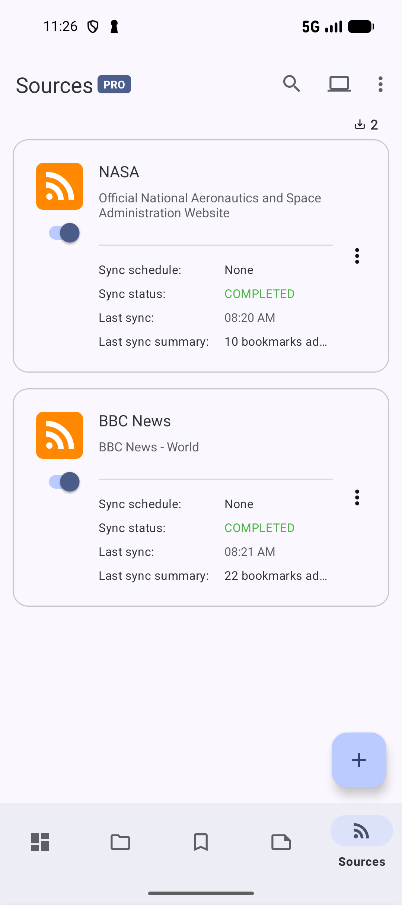
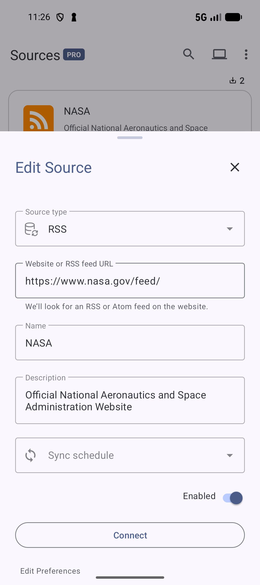

# Collect bookmarks from Sources

[Documentation home](../README.md) · [Guide library](../GUIDES.md)

Use **Sources** to bring new links into your library from an RSS or Atom feed, or import bookmark files from a Google Drive folder. A source collects content; [Cloud sync and Browser Sync](SYNC.md) keep data aligned across devices.

*Check each source's schedule and last sync result from its row.* [View full-size image](../assets/guides/sources/source-list.png).

## Add an RSS feed

1. Open **Sources** and tap **+**. The **Add Source** sheet opens.
2. Choose **RSS** in **Source type**.
3. Paste the publisher's website address or feed address into **Website or RSS feed URL**, then tap **Connect**.
4. Check **Source Preview**. A website can advertise several feeds; if **Found feeds** appears, choose the feed you want and check its preview.
5. Check **Name** and optionally edit **Description**. The name must be unique in your source list.
6. Choose a **Sync schedule**. Use **None** to control imports manually. Keep **Enabled** on to make the source available for syncing.
7. Check **Save and sync** if you want to import the current entries immediately, then tap **Save**. Leave **Reimport data** off for ordinary use.

**Connect** checks the address and previews entries. It does not save the source. If you change the address afterward, connect again before saving.

*An existing RSS source uses the same address and connection fields in Edit Source. Tap X or Cancel to leave without saving.* [View full-size image](../assets/guides/sources/edit-source.png).

If the website has no advertised feed, try its direct RSS or Atom address. For **No RSS feed** or a connection failure, check the address and your network, then reconnect. Some websites do not offer feeds.

### Choose among discovered feeds

When **Found feeds** appears, tap a feed chip by its name/type. The form replaces the address with that feed and connects again. Check that **Source Preview** now contains the entries you intended before Save. A site's news, category, and comments feeds can contain different links; changing the selected feed changes what this source imports.

## Check imports and control how much arrives

The source row shows its sync schedule, last sync status, time, and how many bookmarks were added. A completed run can add zero bookmarks when there are no new entries. Find imported links in **Bookmarks** and organize them like any other saved link.

To check for new entries now, open the enabled source's three-dot menu and choose **Sync**. To change its address or schedule, choose **Edit**. Changes take effect when you tap **Save**.

For a feed that produces more links than you want:

- Set **Sync schedule** to **None** for manual checks, or turn **Enabled** off to pause scheduled imports.
- Choose **Archive** in the source's menu to remove it from the active source list and stop its jobs. Open the Sources screen menu → **Archived sources**, then choose **Unarchive** when you want it back. An enabled source resumes its configured schedule after unarchiving.
- Archive individual imported bookmarks when you want them out of the active bookmark list. This is separate from archiving the source.

Feed import and AI organization are separate steps. Semantic indexing helps search find related meanings; it does not itself assign collections or tags. You can always [organize imported links manually](ORGANIZE.md).

## Import files from a Google Drive folder

1. In **Add Source**, choose **Google Drive** in **Source type**.
2. Tap the folder picker beside **Google Drive Folder**, sign in when asked, and select the folder to read.
3. Tap **Connect** and check **Source Preview**. The source can import supported HTML, JSON, plain text, and CSV bookmark files from that folder.
4. Enter a unique **Name**, choose the schedule and **Enabled** state, then tap **Save**. Choose **Save and sync** for an immediate import.

This source reads import files. It does not turn the selected folder into Cloud sync storage or synchronize changes back to those files. For a complete local backup, use [ZIP export](BACKUP.md).

## Reconsider entries with Reimport data

Open a source's overflow → **Edit**, reconnect if you changed its feed/folder, and use the controls under **Edit Preferences**:

- **Save and sync** requests an immediate run after saving an enabled source.
- **Reimport data** lets the next run reconsider feed entries/files recorded as already imported. It is reset after the run rather than acting as a permanent always-import switch.

Leave Reimport data off for routine checks. It does not merge similarly named tags/collections or guarantee that every old entry becomes a second bookmark; the usual URL and import duplicate rules still apply. Export a current [ZIP backup](BACKUP.md#save-a-complete-backup) before reimporting into a library you use, then compare a small recognizable set of bookmarks and collections afterward.

The available schedules are **None**, **15 minutes**, **1, 3, 6, 12, or 24 hours**, and **7 days**. None is manual; Enabled off pauses incoming runs. Android can delay scheduled work because of sleep, network, or battery restrictions. Confirm the selected **Sync schedule** before saving.

## Favorites, pins, markers, and list order

Use a source row's overflow for **Favorite / Remove favorite**, **Pin / Unpin**, **Set marker / Remove marker**, and the applicable edit/sync/archive/delete actions. Markers retain a place to return to and share the app's normal free limit. Pinned sources have **Move up / Move down** only when a neighboring pinned position exists.

Tapping a source row does not currently open a source-detail library screen; use its overflow to act on it.

| Sources toolbar option | Effect |
| --- | --- |
| **Sort by → Default / Name / Last synced / Last modified / Random** | Choose what orders the list. |
| **Reversed / Favorites first** | Reverse the selected ordering or put favorite sources first. |
| **Custom / Custom sort options → Show drag handles** | Use a manual row order and reveal its drag controls. Custom order is hidden in Archived sources. |
| **Reset custom sort** | Rebuild manual order from a selected ordering; free access offers Default, while Pro offers the other reset choices too. |
| **List view options → Show popup menu** | Show/hide each row's overflow button. |
| **Refresh** | Reload the source list; use the source's **Sync** action to request incoming content. |

## Select several sources, delete, and recover

1. Long-press a source to enter selection, then tap others. Check the selection count before acting.
2. Use **Select all** for the current list/query, or its range-selection control where applicable.
3. Choose **Archive / Unarchive**, **Pin / Unpin**, or **Delete** from the selection toolbar. Moving a pinned source requires a single selected source and an available neighbor.
4. Press Back to leave selection without an action.

Archive keeps the source and imported bookmarks, stops its manual and scheduled imports, and removes its pin. **Archived sources → Unarchive** restores it to the active list; an enabled source can resume its schedule.

For permanent removal, use a row's **Delete** or selection **Delete**. The confirmation setting determines whether the app asks first. If Undo is enabled, use the deletion message's **Undo** before it disappears. With Trash enabled, the source is retained there according to Trash rules; open the app's **Trash** to restore it while available. Without that retention, deleting the source is final. Imported bookmarks are separate library items and are not removed just by removing their source.

**Related:** [Data maintenance](DATA.md) · [Cloud sync and Browser Sync](SYNC.md).

**Next:** [Back up, export, and import](BACKUP.md).

**Previous:** [Set a bookmark reminder](REMINDERS.md).
