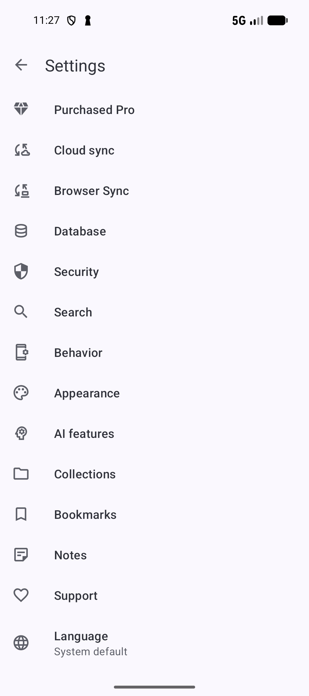

# Cloud sync and Browser Sync

[Documentation home](../README.md) · [Guide library](../GUIDES.md)

Choose the connection for the devices you want to use:

| Feature | What it connects |
| --- | --- |
| **Cloud sync** | SmarterBookmarks libraries on Android devices using a selected cloud account. |
| **Browser Sync** | Bookmark and collection changes between Android and the SmarterBookmarks Chrome extension, through Google Drive. |
| **Sources → Google Drive** | Imports bookmark files from a folder. See [Sources](SOURCES.md). |
| **ZIP backup** | A saved copy you can restore later. See [Backup](BACKUP.md). |

Cloud sync and Browser Sync have separate settings. Set up the connection you need; turning on one does not configure the other. Browser Sync is available without Pro.

*Open Cloud sync for Android libraries, Browser Sync for Chrome, or Database for backup files.* [View full-size image](../assets/guides/sync/sync-settings.png).

## Connect Android devices with Cloud sync

Export a [current ZIP backup](BACKUP.md) on each device before connecting libraries that already contain different data.

1. Open **Settings → Cloud sync**.
2. Turn on **Cloud sync** and choose **Account type**: **Google Drive** or **Dropbox**.
3. Use the account row to sign in to the selected provider and grant the requested access.
4. Tap **Sync now** and check **Sync status**. Open **Sync logs** for the result and details of a run.
5. On the other Android device, choose the same provider and account, then sync there too.

Wait for one device's run to finish before checking the other device for its changes. Verify a recognizable bookmark, such as the recipe from the beginner guide, on both devices.

For background updates, choose **Auto sync frequency** and **Sync when on**. **Sync on launch** can also request a sync when you open the app. Android schedules background work, so an interval is not an exact appointment; network conditions, device sleep, and battery restrictions can delay it.

**Export App Settings to Cloud** and **Import App Settings from Cloud** are optional. Enable them when you want preferences transferred as well as library data.

If changes have not arrived, check that both devices use the same account and provider, that Cloud sync is on, and that the network matches **Sync when on**. Open the app and try **Sync now**, then read **Sync logs**. The background help and battery options on this screen explain delays on your device.

**Reset cloud storage** permanently deletes the app's data in the selected cloud storage. Use it only when you intend to reset that stored data; it is not a routine retry button.

### Disconnect an account or change its provider

In **Settings → Cloud sync**, tap the connected **Account** row, then choose **Disconnect** in the account confirmation. If you want another connection, choose the intended **Account type**, sign in, and verify the account before requesting Sync now. Disconnecting the account is different from **Reset cloud storage**: the latter deletes the app's stored provider data.

Provider permission and the connected account determine whether a run can proceed. If access is revoked, reconnect the account before syncing.

### Read Cloud sync logs and background status

Open **Sync logs** after a run. Read its time, duration, outcome, and change/conflict counts. Tap a populated changes count for the item details, or a populated conflicts count for the conflicting data. The logs report conflicts but do not let you choose a winning copy. Check the affected bookmark, collection, note, or tag and keep a backup before making corrective edits.

Use a run's overflow **Delete** to remove that log, or toolbar **Clear logs** and confirm to remove saved history. Log removal does not undo transferred changes or reset cloud storage. Keep useful details until you have understood a failed run.

| Cloud sync option | Effect |
| --- | --- |
| **Sync when on** | **WiFi only** waits for a network Android considers unmetered. This can include mobile connections marked unmetered and excludes Wi-Fi marked metered. |
| **Suppress sync notifications (toasts)** | Hide start, completion, and error toasts. Read Sync status/logs when these messages are suppressed. |
| **Auto sync status** | Inspect the background schedule/status rather than inferring it from the chosen interval alone. |
| **Automatic sync and Android** | Open the in-app explanation of background timing and network restrictions. |
| **Turn off battery optimizations for auto sync** | Open Android app settings, where available, to adjust device battery/autostart restrictions. Labels and controls vary by device. |

While a run is active, **Cancel** requests its stop. If background updates pause, open the app or use **Sync now** after checking the account and network; this also refreshes the schedule. A planned interval is not a guaranteed delivery time.

## Sync with the Chrome extension

1. Install [Smarter Bookmarks - Browser Sync from the Chrome Web Store](https://chromewebstore.google.com/detail/smarter-bookmarks-browser/lgipeegdmmacbnojdhooeficfnfmkpof) and sign in to it with the Google account you want to use for syncing.
2. On Android, open **Settings → Browser Sync**.
3. Tap **Google Account** to connect Google Drive, then turn on **Sync with browser**.
4. Tap **Sync now**. Its summary shows the result, including changes pulled, uploaded, and still pending.
5. Make a small change, such as saving a bookmark, and check it on the other side after syncing. Bookmark and collection edits and removals can travel in both directions.

Choose **Sync frequency** for background checks. **Wi-Fi only** and **Charging only** restrict background runs. **Sync history** lists recent runs and their results. While a run is active, **Cancel sync** stops that run.

If **Sync now** is unavailable, check **Sync with browser**, the connected **Google Account**, and your network. If a run fails, check **Sync history** and try again once connectivity and account access are available. Use the same Google account in Android and the extension.

**Reset Browser Sync** deletes Browser Sync files from Google Drive, clears this device's sync state, and turns Browser Sync off. Bookmarks remain on this Android device. Read its confirmation before choosing Reset, and set it up again afterward if you want a fresh connection.

### Inspect Browser Sync history

Open **Sync history** and tap a run to see its status, started/finished times, duration, pulled/uploaded/pending counts, and any error. A canceled run may have incomplete changes. Check a recognizable bookmark on both sides after a successful run.

Toolbar **Clear logs** asks before deleting saved Browser Sync run history. It does not reverse edits or perform **Reset Browser Sync**.

**Related:** [Data maintenance](DATA.md) · [Connect to PC over a local network](PC.md#how-it-works).

**Next:** [Find and use your library with AI](AI.md).

**Previous:** [Back up, export, and import](BACKUP.md).
