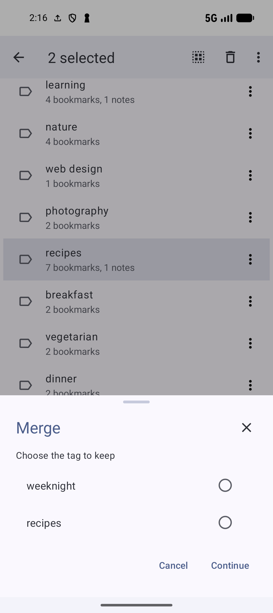
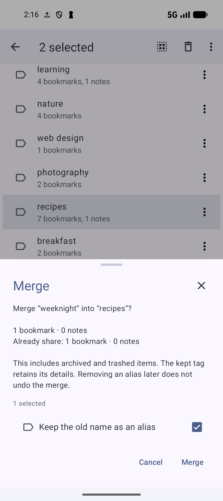

# Tags and tag tools

[Documentation home](../README.md) · [User guide library](../GUIDES.md) · [Function index](../FEATURES.md)

Tags label bookmarks and notes across collection paths. Start with the [recipe tag picker](ORGANIZE.md#apply-existing-tags-and-create-a-new-one), then use this guide to create standalone tags, maintain shared labels and review suggestions.

## Browse search and create tags

Open **Tags**, or **More → Tags** when it is not a visible navigation tab. Tap a tag such as `recipes` to see its bookmarks and notes. Use the tagged-items toolbar's **Search** to narrow those items; clear the query to return to the full eligible list. Hidden/locked content is excluded where the query requires it, so the visible count is not a promise of every protected association.

Use the Tags **+** button to create a standalone tag. Enter a recognizable name such as `weeknight` and confirm creation. Correct a blank name or a name already in use when validation blocks it. To attach the new label, open a bookmark/note's **Add tag** or **Edit tags**, search for it and check it. Creating a standalone tag does not tag items automatically.

In the picker, typing searches existing tags; use **Create tag “name”** explicitly when the intended label does not exist. Tag selections in the ordinary bookmark/note editing picker apply as you change them. Check the item afterward before a larger cleanup.

## Rename duplicate remove or delete

| Action | Steps and scope |
| --- | --- |
| **Rename** | Open a tag row's overflow → Rename, or its tagged-items toolbar → Rename tag. Enter the new name and tap Rename. The shared tag name changes for linked bookmarks and notes; Cancel retains it. Choose a different name if it is blank or collides with an existing name. |
| **Duplicate tag** | Open the tag row's overflow → Duplicate tag, give the copy a valid distinct name and complete the naming flow. The new tag is added to the original tag's linked bookmarks and notes while the original label remains. Inspect the resulting associations before using it as a new category. |
| **Untag** | Use an item/tag-chip menu's Untag, or clear the tag in that item's Edit tags sheet, to remove that association. The tag can remain on other items. |
| **Delete everywhere** or tag-row **Delete** | Review and confirm deletion of the tag itself. This removes the shared label/associations rather than one bookmark or note. |

To rename `dinner` to `evening meals`, inspect the tagged-items list first so the new name still describes all its uses. To remove `dinner` only from **Hummus**, change that item's association instead of deleting the shared tag. Tag deletion recovery follows the app's applicable deletion/trash policy; see [Privacy, archives and deletion](PRIVACY.md).

## Merge tags into one kept tag

Merge combines tags that should mean the same thing, keeping one shared label and its linked items.

1. Open **Tags**, long-press one tag and select at least one more.
2. Choose **Merge** from the selection toolbar.
3. In **Choose the tag to keep**, choose the name you want to retain, then tap **Continue**. For example, choose `recipes` when consolidating a duplicate recipe label.
4. Read the preview for each tag being merged, including linked bookmark/note usage and shared items. Review **Keep the old name as an alias**, which starts checked.
5. Tap **Merge** only when the tag to keep and scope are correct; cancel to keep the tags separate.

The screens below show how to review a merge. `weeknight` and `recipes` have different meanings, so keep these tags separate. Use Merge only for labels that should mean the same thing.

*Choose the tag to keep before reviewing the change. Opening this chooser does not merge the selected tags.* [View full-size image](../assets/guides/tags/tag-merge-choose.png).

*Review the linked-item counts and Keep the old name as an alias before confirming. Cancel keeps the tags separate.* [View full-size image](../assets/guides/tags/tag-merge-preview.png).

The kept tag retains its details. Links from the other tags, their aliases and group memberships transfer to it, including archived and trashed item associations. The other merged tags are removed. Keeping their names as aliases lets those spellings refer to the kept tag later. Removing such an alias does not undo the merge. If a preview reports changed or protected items, refresh and review again; do not assume a previous preview still applies.

Review padded or near-identical names before using Merge, and check the linked bookmarks, notes, aliases and groups afterward. Use **Rename** when a tag only needs a clearer spelling.

## Manage aliases

An alias is another spelling for an existing tag. For example, `JS` can refer to `JavaScript` without maintaining two independent labels.

Open a tag's **Manage aliases**, or **Tags → Tag tools → Manage aliases**. Tap **+ / New alias**, enter **Alternate spelling**, select the tag it should refer to, then **Create**. Search the tag chooser when needed. The target must be an active tag; create it first if none exists. An alias must not conflict with another tag or alias.

Open an existing alias or its overflow → **Edit** to change the spelling/target, then **Save**. **Remove** asks for confirmation and removes only the alternate spelling; tagged items stay attached to the tag it refers to. If a spelling is already an active different tag, the tool can offer a merge preview instead of silently redirecting it. Review that wider scope before confirming.

Use **Tags → View options → Show alias indicator** to mark tags that have aliases in **List** or **Compact**. This option is unavailable in **Chips** layout. Switch to List or Compact when you need this indicator.

## Manage groups and browse grouped items

A tag group keeps related labels together without changing their names or item links. A group named **Meal planning** might contain `recipes`, `dinner` and `weeknight`.

Open **Tags → Tag tools → Manage groups → + / New group**. Enter a group name, search/check its tags and tap **Create**. To add several existing labels quickly, long-press/select them in Tags → **Add to group**, choose an existing group or **New group**, then complete the choice/name and creation.

Open a managed group or its overflow for **Edit**, adjust its name/tag selection and **Save**. **Remove** deletes the group after confirmation while leaving its tags and tagged items intact. **Open** shows the group's associated items. Search there to narrow the eligible bookmarks/notes and use supported selection actions on that result list. A group is a tag browsing aid, rather than a collection that directly contains notes.

## Review duplicate and unused tags

Open **Tags → Tag tools → Duplicate and unused tags**. Switch between:

| Tab | Review |
| --- | --- |
| **Duplicates** | Pairs with matching spelling. Open one, choose the tag to keep and review the Merge preview. |
| **Similar names** | Similar spelling candidates. Inspect each tag's actual meaning/use before merging. |
| **Unused** | Tags with no linked bookmarks or notes. Open a row, read the removal confirmation and tap Remove only if the label is no longer needed. |

These are candidates for reviewed changes. The tool rechecks current data before merging/removing; refresh a stale preview or a tag that is no longer available. If an unwanted spelling remains, rename or merge that tag manually.

## Refactor tags on chosen items

Use a tag's **Refactor tags** when its label needs a narrower meaning, or when some items need additional labels. This changes selected associations while preserving the original tag in the library.

1. Open the tag overflow → **Refactor tags**. Inspect its visible bookmark/note usage.
2. Choose **Add other tags to these items**, **Replace [tag] on items**, or **Remove [tag] from items**. Adding retains the original label; replacing swaps it for the chosen labels; removing detaches it from the chosen items.
3. For Add/Replace, search/check the target tags and tap **Continue**. Explicitly create a missing tag only when you want that new name.
4. In **Select items**, choose bookmark/note types, an optional **Title contains** filter, and **Archived items only** where appropriate. Use the collection filter to limit bookmarks. **All collections** can include notes; one chosen collection limits this operation to its bookmarks.
5. Search/select the intended rows. Selections remain when search changes; inspect the selected count. You can change up to 100 bookmarks/notes per batch.
6. Tap **Continue**, read the Add/Replace/Remove preview and item counts, then **Apply**. Read the result counts and inspect representative items afterward.

For example, refactor `recipes` by adding `weeknight` only to the curry and similar quick meals. Avoid selecting a dessert that should retain only `recipes`. Hidden/locked items are excluded from the eligible picker. A stale/protected preview requires a fresh review; if a change fails, the tool reports that previous data was kept. Apply another batch deliberately if more than 100 items need work.

### Remove or replace a tag from a selection

Long-press/select bookmarks or notes, choose **Remove tag** or **Replace tag**, then select the original label and replacement where required. The sheet can offer **Bookmarks only**, **Notes only** or both, depending on the action context. Check that scope and the selected items before confirmation. This changes their associations; use tag-row Delete only when you intend to delete the shared tag itself.

## Create a collection from a tag

Open a tag's **Create new collection** action. Enter **Collection name**, select a regular parent or **No parent collection**, then **Continue**. Review the preview count and tap **Create** to make the regular collection.

For example, turn `weeknight` into a **Weeknight meals** collection under **Recipes to try**. The eligible visible tagged bookmarks become members; notes are excluded, existing tags stay attached, and other collection memberships stay available. Correct an invalid name/parent or refresh changed items if validation blocks creation. This makes a collection from tagged bookmarks; it does not convert a tag group or merge existing collections.

## Review suggested tags

**Suggested tags** recommends existing labels from the semantic index. Prepare [AI Search indexing](AI.md#set-up-ai-search), enable **AI insights**, and include **Tags** in the index. The bookmark must have a current eligible index entry; for a note, include **Notes** and finish indexing that note with the current model. Cloud indexing requires the applicable list/model consent. Opening this sheet uses stored index data and does not itself start indexing or generation.

1. Open a saved bookmark → **Organize → Suggested tags**, or a note → **Suggested tags**. A linked note's destination sheet also offers the action.
2. Inspect the candidate existing tags, check the ones you want to add and tap **Continue**.
3. Read the addition preview, then **Apply**. Existing tags remain attached.

To process several items, long-press/select them in **Bookmarks** or **Notes**, then **Suggested tags**. Review each item in turn. **Continue** with no tags selected skips that item; cancel ends the workflow. Apply on one item does not approve every later item.

For the curry, select `dinner` only if it fits. No suggestions can mean there are no useful candidates or that indexing is incomplete. Use **AI setup** when offered, finish indexing, and reopen the item. If it changed or the model/index changed during review, refresh and choose again. Suggested tags has no separate Pro requirement; indexing and provider setup have their own requirements.

## Generate tags from an untagged page

**Generate tags** is a separate immediate action. Enable **AI classification → Enable classification**, and set **Max number of auto tags** to the number of additions you want. On an untagged bookmark, choose **Organize → Generate tags**. It retrieves usable page content, finds keyword/page-metadata labels, limits them using that maximum and attaches them directly. Inspect the new labels afterward.

There is no selection or Apply preview here. The action uses keyword discovery, without requiring a semantic index or generative provider. Fetching page content can still require a network connection. If the control is absent, check that the bookmark has no tags and classification is enabled. If generation fails, check page access or label the bookmark manually. Generated names may include unwanted spaces; review them and use **Rename** or **Merge** when needed.

## Review possible aliases and related tags

With **AI insights** enabled and current indexed **Tags**, open **Tags → AI insights → Possible aliases** or **Related tag groups**. Both use existing semantic tag data and can be incomplete when index coverage is low. Cloud index consent applies to the selected lists/model.

**Possible aliases** compares meaning, spelling and initials. Open a pair, check both names and visible bookmark/note usage, and choose **Merge into [name]** for the tag you want to keep. Read the Merge preview and **Keep the old name as an alias**, then confirm **Merge** only if these are the same label. The merge has the full scope described above, including archived/trashed associations.

**Related tag groups** suggests tags that may belong together while remaining separate. Open a pair, inspect the evidence, choose **New group**, name it and review its checked tags before **Create**. You can change the selection in the group picker. For example, group `dinner` and `weeknight` without merging their distinct meanings.

For one tag, choose its **Find related tags**. The sheet shows how many tags are indexed and lets you choose a suggested partner, then follows the same group review/creation flow. If the selected tag is not indexed, follow **AI setup**, finish indexing and retry. If no candidates appear, you can still create a group yourself.

### Keep separate not related or review later

Choose **Keep separate** on an alias pair that should retain two meanings. Choose **Not related** when a group suggestion is unhelpful. **Review later** hides either pair for one day without merging or grouping. These decisions apply to the current pair state; renaming tags or changing linked items/model state can make a pair eligible again. A changed preview asks you to refresh and review before accepting it.

**Related:** [Bookmark selection](BOOKMARKS.md#select-and-change-several-items) · [Notes](NOTES.md) · [Privacy and deletion](PRIVACY.md) · [AI setup](AI.md)

[Documentation home](../README.md) · [User guide library](../GUIDES.md)
